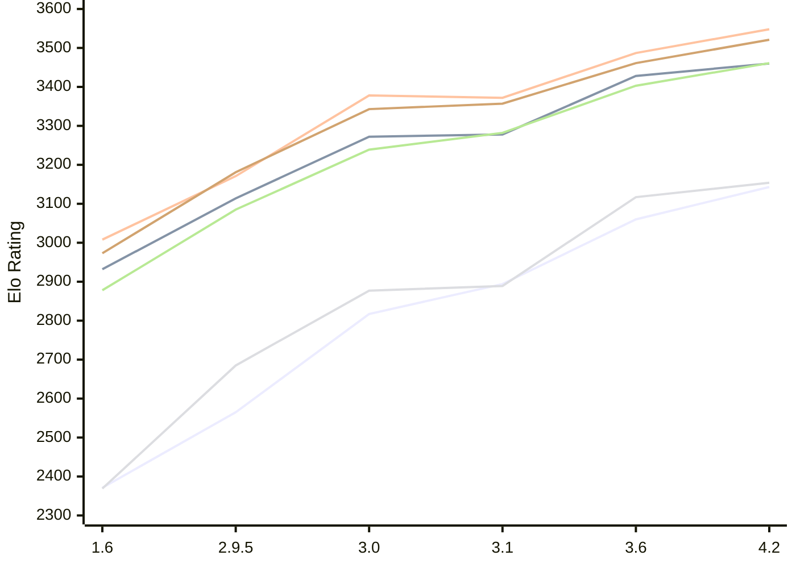

# Engine: Chessenger

Author: Dariusz Domagała

Home: https://github.com/chessengeriadoteu/chessenger

## Elo Ratings E1 (Ultra 7 265T (1.50 GHz) - E-Core)

| Version | Published | STC 8.0+0.08s  | LTC 60.0+0.60s | VLTC 2m24s+1.12s | Comment |
| --- | --- | --- | --- | --- | --- |
| 4.2 | 2026-11-12 | 3143(+83) | 3460(+32) | 3548(+61) |  |
| 3.6 | 2026-11-01 | 3060(+166) | 3428(+150) | 3487(+115) |  |
| 3.1 | 2026-10-21 | 2894(+77) | 3278(+6) | 3372(-6) |  |
| 3.0 | 2026-10-17 | 2817(+252) | 3272(+158) | 3378(+207) |  |
| 2.9.5 | 2026-10-15 | 2565(+194) | 3114(+182) | 3171(+163) |  |
| 1.6 | 2026-10-07 | 2371 | 2932 | 3008 |  |
 | | | cElo (∆ prev) | cElo (∆ prev) | cElo (∆ prev) | 

## Elo Ratings P1 (Ultra 7 265T (1.50 GHz) - P-Core)

| Version | Published | STC 8.0+0.08s  | LTC 60.0+0.60s | VLTC 2m24s+1.12s | Comment |
| --- | --- | --- | --- | --- | --- |
| 4.2 | 2026-11-12 | 3154(+37) | 3461(+58) | 3521(+60) |  |
| 3.6 | 2026-11-01 | 3117(+228) | 3403(+121) | 3461(+104) |  |
| 3.1 | 2026-10-21 | 2889(+12) | 3282(+43) | 3357(+14) |  |
| 3.0 | 2026-10-17 | 2877(+192) | 3239(+154) | 3343(+162) |  |
| 2.9.5 | 2026-10-15 | 2685(+316) | 3085(+207) | 3181(+208) |  |
| 1.6 | 2026-10-07 | 2369 | 2878 | 2973 |  |
 | | | cElo (∆ prev) | cElo (∆ prev) | cElo (∆ prev) | 

## Elo Ratings T1 (i5-7500T 2.70GHz)

| Version | Published | STC 8.0+0.08s  | LTC 60.0+0.60s | VLTC 2m24s+1.12s | Comment |
| --- | --- | --- | --- | --- | --- |
| 1.6 | 2026-10-07 | 2369 | 2878 | 2973 |  |
 | | | cElo (∆ prev) | cElo (∆ prev) | cElo (∆ prev) | 

<a href="https://github.com/computer-chess-index/cci/issues/new?template=submit-version.yml&title=[VERSION]+Chessenger+<version>&body=###%20Engine%20name%0AChessenger%0A%0A###%20Version%0A4.2" target="_blank">Submit new version</a>

 Test Conditions:

GUI/CLI: <a href=https://github.com/cutechess/cutechess target="_blank">Cute-Chess</a> 
Elo Calculation: <a href=https://www.remi-coulom.fr/Bayesian-Elo/ target="_blank">Bayesian-Elo</a> 
CPU for P1: Intel(R) Core(TM) Ultra 7 265T (1.50 GHz) - P-Core 
CPU for E1: Intel(R) Core(TM) Ultra 7 265T (1.50 GHz) - E-Core 
CPU for T1: Intel(R) Core(TM) i5-7500T 2.70GHz 
Opening book: 8_moves_v3 
\* STC: 8.0+0.08s, LTC: 60.0+0.60s, VLTC: 2m24s+1.12s

 Lists:
Ratings: <a href=https://github.com/computer-chess-index/cci/blob/main/lists/CCIRatings.csv target="_blank">Complete list</a>

Generated: 2026-11-23 05:37:15

## Ratings Verlauf E1 / P1

## Detailed Evaluation Results

| Version | Time Control | Variant | Elo  | Range +/- | Matches | Score | Average Opponent Elo | Draws |
| --- | --- |--- | --- | --- | --- | --- | --- | --- |
| 4.2 | VLTC (2m24s+1.12s) | E1 | 3548 | 35 | 190 | 51% | 3541 | 80% |
|  |  | P1 | 3521 | 57 | 72 | 52% | 3507 | 82% |
|  | LTC (60.0+0.60s) | P1 | 3461 | 41 | 140 | 54% | 3438 | 80% |
|  |  | E1 | 3460 | 41 | 140 | 49% | 3468 | 79% |
|  | STC (8.0+0.08s) | P1 | 3154 | 48 | 116 | 49% | 3162 | 59% |
|  |  | E1 | 3143 | 36 | 220 | 52% | 3128 | 53% |
| --- | --- |--- | --- | --- | --- | --- | --- | --- |
| 3.6 | VLTC (2m24s+1.12s) | P1 | 3461 | 36 | 184 | 52% | 3445 | 77% |
|  |  | E1 | 3487 | 30 | 276 | 53% | 3468 | 75% |
|  | LTC (60.0+0.60s) | P1 | 3403 | 37 | 180 | 51% | 3394 | 75% |
|  |  | E1 | 3428 | 27 | 334 | 52% | 3413 | 73% |
|  | STC (8.0+0.08s) | P1 | 3117 | 38 | 196 | 51% | 3106 | 54% |
|  |  | E1 | 3060 | 33 | 270 | 52% | 3040 | 51% |
| --- | --- |--- | --- | --- | --- | --- | --- | --- |
| 3.1 | VLTC (2m24s+1.12s) | E1 | 3372 | 29 | 306 | 52% | 3355 | 61% |
|  |  | P1 | 3357 | 29 | 300 | 54% | 3329 | 68% |
|  | LTC (60.0+0.60s) | E1 | 3278 | 34 | 224 | 50% | 3282 | 60% |
|  |  | P1 | 3282 | 34 | 232 | 50% | 3285 | 62% |
|  | STC (8.0+0.08s) | E1 | 2894 | 33 | 284 | 49% | 2898 | 36% |
|  |  | P1 | 2889 | 50 | 116 | 47% | 2916 | 47% |
| --- | --- |--- | --- | --- | --- | --- | --- | --- |
| 3.0 | VLTC (2m24s+1.12s) | P1 | 3343 | 46 | 122 | 50% | 3344 | 68% |
|  |  | E1 | 3378 | 31 | 270 | 50% | 3376 | 64% |
|  | LTC (60.0+0.60s) | P1 | 3239 | 49 | 106 | 56% | 3193 | 69% |
|  |  | E1 | 3272 | 31 | 274 | 49% | 3282 | 64% |
|  | STC (8.0+0.08s) | P1 | 2877 | 52 | 116 | 57% | 2819 | 38% |
|  |  | E1 | 2817 | 41 | 174 | 53% | 2789 | 45% |
| --- | --- |--- | --- | --- | --- | --- | --- | --- |
| 2.9.5 | VLTC (2m24s+1.12s) | P1 | 3181 | 37 | 196 | 52% | 3167 | 61% |
|  |  | E1 | 3171 | 34 | 244 | 50% | 3174 | 48% |
|  | LTC (60.0+0.60s) | P1 | 3085 | 50 | 118 | 54% | 3052 | 45% |
|  |  | E1 | 3114 | 41 | 168 | 51% | 3104 | 50% |
|  | STC (8.0+0.08s) | P1 | 2685 | 41 | 196 | 53% | 2655 | 34% |
|  |  | E1 | 2565 | 37 | 254 | 55% | 2519 | 27% |
| --- | --- |--- | --- | --- | --- | --- | --- | --- |
| 1.6 | VLTC (2m24s+1.12s) | P1 | 2973 | 50 | 130 | 55% | 2908 | 40% |
|  |  | E1 | 3008 | 43 | 168 | 55% | 2939 | 43% |
|  | LTC (60.0+0.60s) | P1 | 2878 | 57 | 116 | 63% | 2611 | 33% |
|  |  | E1 | 2932 | 40 | 218 | 57% | 2785 | 35% |
|  | STC (8.0+0.08s) | P1 | 2369 | 62 | 90 | 43% | 2433 | 24% |
|  |  | E1 | 2371 | 46 | 184 | 57% | 2249 | 23% |