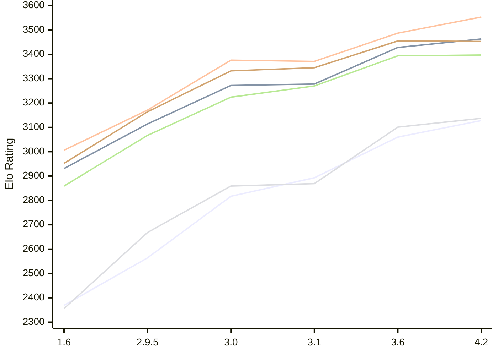

# Engine: Chessenger

Author: Dariusz Domagała

Home: https://github.com/chessengeriadoteu/chessenger

## Elo Ratings E1 (Ultra 7 265T (1.50 GHz) - E-Core)

| Version | Published | STC 8.0+0.08s  | LTC 60.0+0.60s | VLTC 2m24s+1.12s | Comment |
| --- | --- | --- | --- | --- | --- |
| 4.2 | 2026-11-12 | 3128(+68) | 3463(+35) | 3553(+66) |  |
| 3.6 | 2026-11-01 | 3060(+167) | 3428(+150) | 3487(+116) |  |
| 3.1 | 2026-10-21 | 2893(+76) | 3278(+6) | 3371(-5) |  |
| 3.0 | 2026-10-17 | 2817(+253) | 3272(+158) | 3376(+205) |  |
| 2.9.5 | 2026-10-15 | 2564(+195) | 3114(+183) | 3171(+165) |  |
| 1.6 | 2026-10-07 | 2369 | 2931 | 3006 |  |
 | | | cElo (∆ prev) | cElo (∆ prev) | cElo (∆ prev) | 

## Elo Ratings P1 (Ultra 7 265T (1.50 GHz) - P-Core)

| Version | Published | STC 8.0+0.08s  | LTC 60.0+0.60s | VLTC 2m24s+1.12s | Comment |
| --- | --- | --- | --- | --- | --- |
| 4.2 | 2026-11-12 | 3137(+36) | 3397(+3) | 3453(-2) |  |
| 3.6 | 2026-11-01 | 3101(+232) | 3394(+124) | 3455(+110) |  |
| 3.1 | 2026-10-21 | 2869(+10) | 3270(+46) | 3345(+13) |  |
| 3.0 | 2026-10-17 | 2859(+191) | 3224(+157) | 3332(+168) |  |
| 2.9.5 | 2026-10-15 | 2668(+312) | 3067(+208) | 3164(+212) |  |
| 1.6 | 2026-10-07 | 2356 | 2859 | 2952 |  |
 | | | cElo (∆ prev) | cElo (∆ prev) | cElo (∆ prev) | 

## Elo Ratings T1 (i5-7500T 2.70GHz)

| Version | Published | STC 8.0+0.08s  | LTC 60.0+0.60s | VLTC 2m24s+1.12s | Comment |
| --- | --- | --- | --- | --- | --- |
| 1.6 | 2026-10-07 | 2356 | 2859 | 2952 |  |
 | | | cElo (∆ prev) | cElo (∆ prev) | cElo (∆ prev) | 

<a href="https://github.com/computer-chess-index/cci/issues/new?template=submit-version.yml&title=[VERSION]+Chessenger+<version>&body=###%20Engine%20name%0AChessenger%0A%0A###%20Version%0A4.2" target="_blank">Submit new version</a>

 Test Conditions:

GUI/CLI: <a href=https://github.com/cutechess/cutechess target="_blank">Cute-Chess</a> 
Elo Calculation: <a href=https://www.remi-coulom.fr/Bayesian-Elo/ target="_blank">Bayesian-Elo</a> 
CPU for P1: Intel(R) Core(TM) Ultra 7 265T (1.50 GHz) - P-Core 
CPU for E1: Intel(R) Core(TM) Ultra 7 265T (1.50 GHz) - E-Core 
CPU for T1: Intel(R) Core(TM) i5-7500T 2.70GHz 
Opening book: 8_moves_v3 
\* STC: 8.0+0.08s, LTC: 60.0+0.60s, VLTC: 2m24s+1.12s

 Lists:
Ratings: <a href=https://github.com/computer-chess-index/cci/blob/main/lists/CCIRatings.csv target="_blank">Complete list</a>

Generated: 2026-11-18 05:37:29

## Ratings Verlauf E1 / P1

## Detailed Evaluation Results

| Version | Time Control | Variant | Elo  | Range +/- | Matches | Score | Average Opponent Elo | Draws |
| --- | --- |--- | --- | --- | --- | --- | --- | --- |
| 4.2 | VLTC (2m24s+1.12s) | E1 | 3553 | 37 | 176 | 52% | 3540 | 80% |
|  |  | P1 | 3453 | 155 | 8 | 50% | 3453 | 100% |
|  | LTC (60.0+0.60s) | E1 | 3463 | 43 | 128 | 49% | 3468 | 78% |
|  |  | P1 | 3397 | 129 | 12 | 50% | 3397 | 100% |
|  | STC (8.0+0.08s) | P1 | 3137 | 69 | 56 | 48% | 3147 | 57% |
|  |  | E1 | 3128 | 45 | 140 | 51% | 3120 | 51% |
| --- | --- |--- | --- | --- | --- | --- | --- | --- |
| 3.6 | VLTC (2m24s+1.12s) | P1 | 3455 | 36 | 184 | 52% | 3438 | 77% |
|  |  | E1 | 3487 | 30 | 276 | 53% | 3468 | 75% |
|  | LTC (60.0+0.60s) | P1 | 3394 | 38 | 172 | 51% | 3384 | 75% |
|  |  | E1 | 3428 | 27 | 334 | 52% | 3413 | 73% |
|  | STC (8.0+0.08s) | P1 | 3101 | 38 | 192 | 51% | 3089 | 54% |
|  |  | E1 | 3060 | 33 | 270 | 52% | 3040 | 51% |
| --- | --- |--- | --- | --- | --- | --- | --- | --- |
| 3.1 | VLTC (2m24s+1.12s) | P1 | 3345 | 29 | 300 | 54% | 3318 | 68% |
|  |  | E1 | 3371 | 29 | 306 | 52% | 3355 | 61% |
|  | LTC (60.0+0.60s) | E1 | 3278 | 34 | 224 | 50% | 3282 | 60% |
|  |  | P1 | 3270 | 34 | 232 | 50% | 3271 | 62% |
|  | STC (8.0+0.08s) | E1 | 2893 | 33 | 284 | 49% | 2897 | 36% |
|  |  | P1 | 2869 | 50 | 116 | 47% | 2896 | 47% |
| --- | --- |--- | --- | --- | --- | --- | --- | --- |
| 3.0 | VLTC (2m24s+1.12s) | P1 | 3332 | 46 | 122 | 50% | 3333 | 68% |
|  |  | E1 | 3376 | 31 | 270 | 50% | 3375 | 64% |
|  | LTC (60.0+0.60s) | P1 | 3224 | 49 | 106 | 56% | 3178 | 69% |
|  |  | E1 | 3272 | 31 | 274 | 49% | 3282 | 64% |
|  | STC (8.0+0.08s) | P1 | 2859 | 52 | 116 | 57% | 2801 | 38% |
|  |  | E1 | 2817 | 41 | 174 | 53% | 2789 | 45% |
| --- | --- |--- | --- | --- | --- | --- | --- | --- |
| 2.9.5 | VLTC (2m24s+1.12s) | P1 | 3164 | 37 | 196 | 52% | 3151 | 61% |
|  |  | E1 | 3171 | 34 | 244 | 50% | 3174 | 48% |
|  | LTC (60.0+0.60s) | P1 | 3067 | 50 | 118 | 54% | 3035 | 45% |
|  |  | E1 | 3114 | 41 | 168 | 51% | 3104 | 50% |
|  | STC (8.0+0.08s) | P1 | 2668 | 41 | 196 | 53% | 2638 | 34% |
|  |  | E1 | 2564 | 37 | 254 | 55% | 2518 | 27% |
| --- | --- |--- | --- | --- | --- | --- | --- | --- |
| 1.6 | VLTC (2m24s+1.12s) | P1 | 2952 | 50 | 130 | 55% | 2889 | 40% |
|  |  | E1 | 3006 | 43 | 168 | 55% | 2939 | 43% |
|  | LTC (60.0+0.60s) | P1 | 2859 | 57 | 116 | 63% | 2596 | 33% |
|  |  | E1 | 2931 | 40 | 218 | 57% | 2785 | 35% |
|  | STC (8.0+0.08s) | P1 | 2356 | 62 | 90 | 43% | 2419 | 24% |
|  |  | E1 | 2369 | 45 | 184 | 57% | 2249 | 23% |