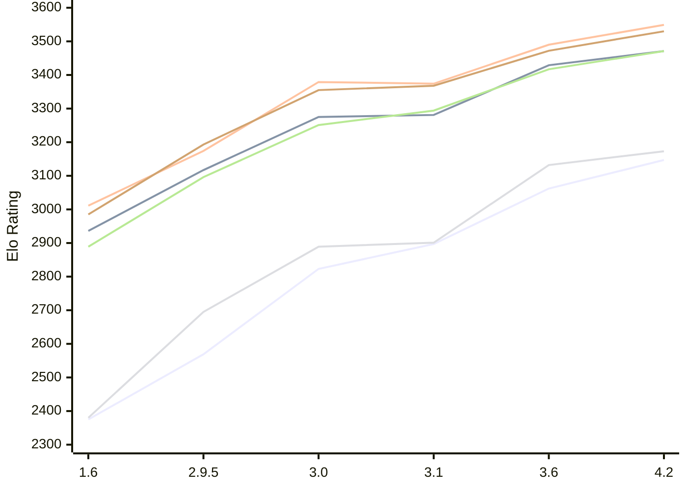

# Engine: Chessenger

Author: Dariusz Domagała

Home: https://github.com/chessengeriadoteu/chessenger

## Elo Ratings E1 (Ultra 7 265T (1.50 GHz) - E-Core)

| Version | Published | STC 8.0+0.08s  | LTC 60.0+0.60s | VLTC 2m24s+1.12s | Comment |
| --- | --- | --- | --- | --- | --- |
| 4.2 | 2026-11-12 | 3147(+85) | 3471(+42) | 3549(+59) |  |
| 3.6 | 2026-11-01 | 3062(+165) | 3429(+148) | 3490(+116) |  |
| 3.1 | 2026-10-21 | 2897(+74) | 3281(+6) | 3374(-5) |  |
| 3.0 | 2026-10-17 | 2823(+254) | 3275(+158) | 3379(+205) |  |
| 2.9.5 | 2026-10-15 | 2569(+194) | 3117(+181) | 3174(+163) |  |
| 1.6 | 2026-10-07 | 2375 | 2936 | 3011 |  |
 | | | cElo (∆ prev) | cElo (∆ prev) | cElo (∆ prev) | 

## Elo Ratings P1 (Ultra 7 265T (1.50 GHz) - P-Core)

| Version | Published | STC 8.0+0.08s  | LTC 60.0+0.60s | VLTC 2m24s+1.12s | Comment |
| --- | --- | --- | --- | --- | --- |
| 4.2 | 2026-11-12 | 3173(+41) | 3471(+54) | 3530(+58) |  |
| 3.6 | 2026-11-01 | 3132(+231) | 3417(+123) | 3472(+104) |  |
| 3.1 | 2026-10-21 | 2901(+12) | 3294(+43) | 3368(+13) |  |
| 3.0 | 2026-10-17 | 2889(+194) | 3251(+155) | 3355(+162) |  |
| 2.9.5 | 2026-10-15 | 2695(+315) | 3096(+207) | 3193(+208) |  |
| 1.6 | 2026-10-07 | 2380 | 2889 | 2985 |  |
 | | | cElo (∆ prev) | cElo (∆ prev) | cElo (∆ prev) | 

## Elo Ratings T1 (i5-7500T 2.70GHz)

| Version | Published | STC 8.0+0.08s  | LTC 60.0+0.60s | VLTC 2m24s+1.12s | Comment |
| --- | --- | --- | --- | --- | --- |
| 1.6 | 2026-10-07 | 2380 | 2889 | 2985 |  |
 | | | cElo (∆ prev) | cElo (∆ prev) | cElo (∆ prev) | 

<a href="https://github.com/computer-chess-index/cci/issues/new?template=submit-version.yml&title=[VERSION]+Chessenger+<version>&body=###%20Engine%20name%0AChessenger%0A%0A###%20Version%0A4.2" target="_blank">Submit new version</a>

 Test Conditions:

GUI/CLI: <a href=https://github.com/cutechess/cutechess target="_blank">Cute-Chess</a> 
Elo Calculation: <a href=https://www.remi-coulom.fr/Bayesian-Elo/ target="_blank">Bayesian-Elo</a> 
CPU for P1: Intel(R) Core(TM) Ultra 7 265T (1.50 GHz) - P-Core 
CPU for E1: Intel(R) Core(TM) Ultra 7 265T (1.50 GHz) - E-Core 
CPU for T1: Intel(R) Core(TM) i5-7500T 2.70GHz 
Opening book: 8_moves_v3 
\* STC: 8.0+0.08s, LTC: 60.0+0.60s, VLTC: 2m24s+1.12s

 Lists:
Ratings: <a href=https://github.com/computer-chess-index/cci/blob/main/lists/CCIRatings.csv target="_blank">Complete list</a>

Generated: 2026-11-25 05:37:23

## Ratings Verlauf E1 / P1

## Detailed Evaluation Results

| Version | Time Control | Variant | Elo  | Range +/- | Matches | Score | Average Opponent Elo | Draws |
| --- | --- |--- | --- | --- | --- | --- | --- | --- |
| 4.2 | VLTC (2m24s+1.12s) | P1 | 3530 | 57 | 72 | 52% | 3518 | 82% |
|  |  | E1 | 3549 | 35 | 194 | 51% | 3541 | 80% |
|  | LTC (60.0+0.60s) | P1 | 3471 | 41 | 140 | 54% | 3448 | 80% |
|  |  | E1 | 3471 | 37 | 172 | 50% | 3468 | 78% |
|  | STC (8.0+0.08s) | P1 | 3173 | 45 | 128 | 50% | 3174 | 60% |
|  |  | E1 | 3147 | 36 | 220 | 52% | 3132 | 53% |
| --- | --- |--- | --- | --- | --- | --- | --- | --- |
| 3.6 | VLTC (2m24s+1.12s) | P1 | 3472 | 36 | 184 | 52% | 3455 | 77% |
|  |  | E1 | 3490 | 29 | 284 | 53% | 3470 | 75% |
|  | LTC (60.0+0.60s) | P1 | 3417 | 36 | 184 | 52% | 3405 | 75% |
|  |  | E1 | 3429 | 27 | 338 | 52% | 3414 | 73% |
|  | STC (8.0+0.08s) | P1 | 3132 | 37 | 200 | 51% | 3120 | 55% |
|  |  | E1 | 3062 | 31 | 294 | 52% | 3046 | 51% |
| --- | --- |--- | --- | --- | --- | --- | --- | --- |
| 3.1 | VLTC (2m24s+1.12s) | P1 | 3368 | 29 | 300 | 54% | 3341 | 68% |
|  |  | E1 | 3374 | 29 | 306 | 52% | 3357 | 61% |
|  | LTC (60.0+0.60s) | P1 | 3294 | 34 | 232 | 50% | 3297 | 62% |
|  |  | E1 | 3281 | 34 | 224 | 50% | 3286 | 60% |
|  | STC (8.0+0.08s) | P1 | 2901 | 50 | 116 | 47% | 2930 | 47% |
|  |  | E1 | 2897 | 33 | 284 | 49% | 2901 | 36% |
| --- | --- |--- | --- | --- | --- | --- | --- | --- |
| 3.0 | VLTC (2m24s+1.12s) | P1 | 3355 | 46 | 122 | 50% | 3356 | 68% |
|  |  | E1 | 3379 | 31 | 270 | 50% | 3378 | 64% |
|  | LTC (60.0+0.60s) | P1 | 3251 | 49 | 106 | 56% | 3205 | 69% |
|  |  | E1 | 3275 | 31 | 274 | 49% | 3285 | 64% |
|  | STC (8.0+0.08s) | P1 | 2889 | 52 | 116 | 57% | 2831 | 38% |
|  |  | E1 | 2823 | 41 | 174 | 53% | 2793 | 45% |
| --- | --- |--- | --- | --- | --- | --- | --- | --- |
| 2.9.5 | VLTC (2m24s+1.12s) | P1 | 3193 | 37 | 196 | 52% | 3179 | 61% |
|  |  | E1 | 3174 | 34 | 244 | 50% | 3177 | 48% |
|  | LTC (60.0+0.60s) | P1 | 3096 | 50 | 118 | 54% | 3063 | 45% |
|  |  | E1 | 3117 | 41 | 168 | 51% | 3106 | 50% |
|  | STC (8.0+0.08s) | P1 | 2695 | 41 | 196 | 53% | 2665 | 34% |
|  |  | E1 | 2569 | 37 | 254 | 55% | 2523 | 27% |
| --- | --- |--- | --- | --- | --- | --- | --- | --- |
| 1.6 | VLTC (2m24s+1.12s) | P1 | 2985 | 50 | 130 | 55% | 2920 | 40% |
|  |  | E1 | 3011 | 43 | 168 | 55% | 2943 | 43% |
|  | LTC (60.0+0.60s) | P1 | 2889 | 57 | 116 | 63% | 2620 | 33% |
|  |  | E1 | 2936 | 40 | 218 | 57% | 2789 | 35% |
|  | STC (8.0+0.08s) | P1 | 2380 | 62 | 90 | 43% | 2444 | 24% |
|  |  | E1 | 2375 | 46 | 184 | 57% | 2253 | 23% |