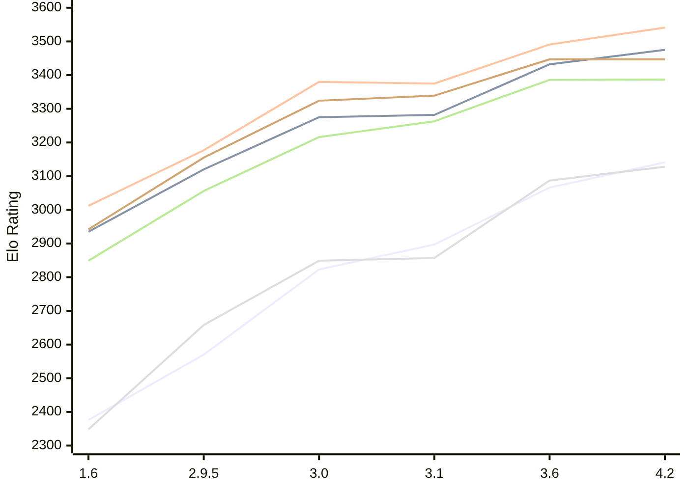

# Engine: Chessenger

Author: Dariusz Domagała

Home: https://github.com/chessengeriadoteu/chessenger

## Elo Ratings E1 (Ultra 7 265T (1.50 GHz) - E-Core)

| Version | Published | STC 8.0+0.08s  | LTC 60.0+0.60s | VLTC 2m24s+1.12s | Comment |
| --- | --- | --- | --- | --- | --- |
| 4.2 | 2026-11-12 | 3141(+75) | 3475(+43) | 3541(+50) |  |
| 3.6 | 2026-11-01 | 3066(+169) | 3432(+150) | 3491(+116) |  |
| 3.1 | 2026-10-21 | 2897(+74) | 3282(+7) | 3375(-5) |  |
| 3.0 | 2026-10-17 | 2823(+253) | 3275(+155) | 3380(+203) |  |
| 2.9.5 | 2026-10-15 | 2570(+194) | 3120(+185) | 3177(+165) |  |
| 1.6 | 2026-10-07 | 2376 | 2935 | 3012 |  |
 | | | cElo (∆ prev) | cElo (∆ prev) | cElo (∆ prev) | 

## Elo Ratings P1 (Ultra 7 265T (1.50 GHz) - P-Core)

| Version | Published | STC 8.0+0.08s  | LTC 60.0+0.60s | VLTC 2m24s+1.12s | Comment |
| --- | --- | --- | --- | --- | --- |
| 4.2 | 2026-11-12 | 3128(+41) | 3387(+1) | 3447(0) |  |
| 3.6 | 2026-11-01 | 3087(+230) | 3386(+123) | 3447(+108) |  |
| 3.1 | 2026-10-21 | 2857(+8) | 3263(+47) | 3339(+15) |  |
| 3.0 | 2026-10-17 | 2849(+191) | 3216(+160) | 3324(+169) |  |
| 2.9.5 | 2026-10-15 | 2658(+310) | 3056(+207) | 3155(+213) |  |
| 1.6 | 2026-10-07 | 2348 | 2849 | 2942 |  |
 | | | cElo (∆ prev) | cElo (∆ prev) | cElo (∆ prev) | 

## Elo Ratings T1 (i5-7500T 2.70GHz)

| Version | Published | STC 8.0+0.08s  | LTC 60.0+0.60s | VLTC 2m24s+1.12s | Comment |
| --- | --- | --- | --- | --- | --- |
| 1.6 | 2026-10-07 | 2348 | 2849 | 2942 |  |
 | | | cElo (∆ prev) | cElo (∆ prev) | cElo (∆ prev) | 

<a href="https://github.com/computer-chess-index/cci/issues/new?template=submit-version.yml&title=[VERSION]+Chessenger+<version>&body=###%20Engine%20name%0AChessenger%0A%0A###%20Version%0A4.2" target="_blank">Submit new version</a>

 Test Conditions:

GUI/CLI: <a href=https://github.com/cutechess/cutechess target="_blank">Cute-Chess</a> 
Elo Calculation: <a href=https://www.remi-coulom.fr/Bayesian-Elo/ target="_blank">Bayesian-Elo</a> 
CPU for P1: Intel(R) Core(TM) Ultra 7 265T (1.50 GHz) - P-Core 
CPU for E1: Intel(R) Core(TM) Ultra 7 265T (1.50 GHz) - E-Core 
CPU for T1: Intel(R) Core(TM) i5-7500T 2.70GHz 
Opening book: 8_moves_v3 
\* STC: 8.0+0.08s, LTC: 60.0+0.60s, VLTC: 2m24s+1.12s

 Lists:
Ratings: <a href=https://github.com/computer-chess-index/cci/blob/main/lists/CCIRatings.csv target="_blank">Complete list</a>

Generated: 2026-11-16 05:37:16

## Ratings Verlauf E1 / P1

## Detailed Evaluation Results

| Version | Time Control | Variant | Elo  | Range +/- | Matches | Score | Average Opponent Elo | Draws |
| --- | --- |--- | --- | --- | --- | --- | --- | --- |
| 4.2 | VLTC (2m24s+1.12s) | E1 | 3541 | 79 | 36 | 53% | 3521 | 83% |
|  |  | P1 | 3447 | 208 | 4 | 50% | 3447 | 100% |
|  | LTC (60.0+0.60s) | E1 | 3475 | 79 | 40 | 49% | 3483 | 68% |
|  |  | P1 | 3387 | 207 | 4 | 50% | 3387 | 100% |
|  | STC (8.0+0.08s) | P1 | 3128 | 116 | 20 | 45% | 3155 | 50% |
|  |  | E1 | 3141 | 89 | 36 | 53% | 3121 | 44% |
| --- | --- |--- | --- | --- | --- | --- | --- | --- |
| 3.6 | VLTC (2m24s+1.12s) | P1 | 3447 | 36 | 184 | 52% | 3429 | 77% |
|  |  | E1 | 3491 | 30 | 276 | 53% | 3472 | 75% |
|  | LTC (60.0+0.60s) | P1 | 3386 | 38 | 172 | 51% | 3376 | 75% |
|  |  | E1 | 3432 | 28 | 326 | 52% | 3417 | 74% |
|  | STC (8.0+0.08s) | P1 | 3087 | 38 | 188 | 51% | 3078 | 54% |
|  |  | E1 | 3066 | 33 | 266 | 52% | 3046 | 51% |
| --- | --- |--- | --- | --- | --- | --- | --- | --- |
| 3.1 | VLTC (2m24s+1.12s) | P1 | 3339 | 29 | 300 | 54% | 3312 | 68% |
|  |  | E1 | 3375 | 29 | 306 | 52% | 3357 | 61% |
|  | LTC (60.0+0.60s) | E1 | 3282 | 34 | 224 | 50% | 3286 | 60% |
|  |  | P1 | 3263 | 34 | 232 | 50% | 3266 | 62% |
|  | STC (8.0+0.08s) | E1 | 2897 | 33 | 284 | 49% | 2901 | 36% |
|  |  | P1 | 2857 | 50 | 116 | 47% | 2884 | 47% |
| --- | --- |--- | --- | --- | --- | --- | --- | --- |
| 3.0 | VLTC (2m24s+1.12s) | P1 | 3324 | 46 | 122 | 50% | 3325 | 68% |
|  |  | E1 | 3380 | 31 | 270 | 50% | 3379 | 64% |
|  | LTC (60.0+0.60s) | P1 | 3216 | 49 | 106 | 56% | 3170 | 69% |
|  |  | E1 | 3275 | 31 | 274 | 49% | 3286 | 64% |
|  | STC (8.0+0.08s) | P1 | 2849 | 52 | 116 | 57% | 2790 | 38% |
|  |  | E1 | 2823 | 41 | 174 | 53% | 2793 | 45% |
| --- | --- |--- | --- | --- | --- | --- | --- | --- |
| 2.9.5 | VLTC (2m24s+1.12s) | P1 | 3155 | 37 | 196 | 52% | 3141 | 61% |
|  |  | E1 | 3177 | 34 | 244 | 50% | 3179 | 48% |
|  | LTC (60.0+0.60s) | P1 | 3056 | 50 | 118 | 54% | 3024 | 45% |
|  |  | E1 | 3120 | 41 | 168 | 51% | 3109 | 50% |
|  | STC (8.0+0.08s) | P1 | 2658 | 41 | 196 | 53% | 2628 | 34% |
|  |  | E1 | 2570 | 36 | 254 | 55% | 2525 | 27% |
| --- | --- |--- | --- | --- | --- | --- | --- | --- |
| 1.6 | VLTC (2m24s+1.12s) | P1 | 2942 | 50 | 130 | 55% | 2877 | 40% |
|  |  | E1 | 3012 | 43 | 168 | 55% | 2943 | 43% |
|  | LTC (60.0+0.60s) | P1 | 2849 | 57 | 116 | 63% | 2587 | 33% |
|  |  | E1 | 2935 | 40 | 218 | 57% | 2789 | 35% |
|  | STC (8.0+0.08s) | P1 | 2348 | 62 | 90 | 43% | 2411 | 24% |
|  |  | E1 | 2376 | 45 | 184 | 57% | 2256 | 23% |