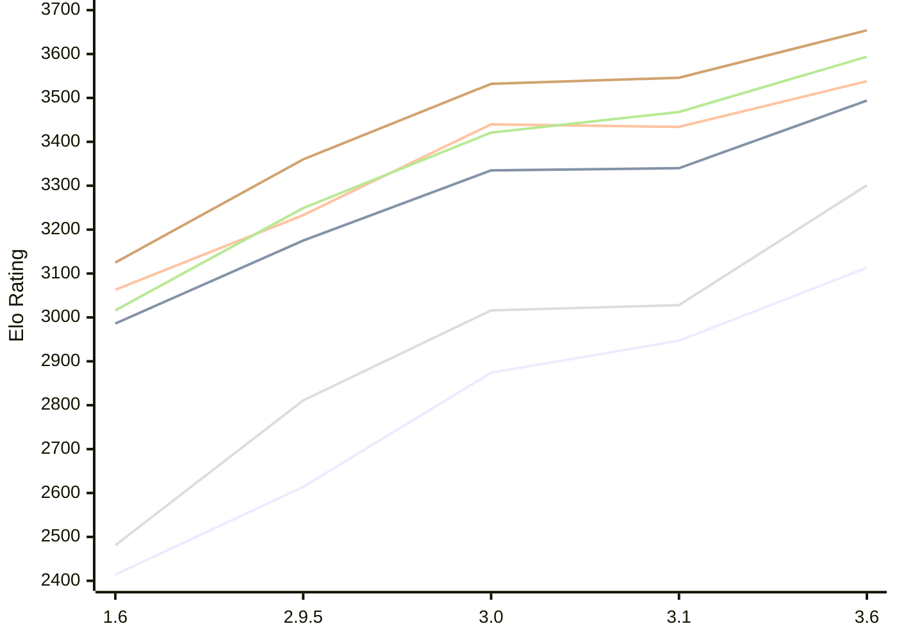

# Engine: Chessenger

Author: Dariusz Domagała

Home: https://github.com/chessengeriadoteu/chessenger

## Elo Ratings E1 (Ultra 7 265T (1.50 GHz) - E-Core)

| Version | Published | STC 8.0+0.08s  | LTC 60.0+0.60s | VLTC 2m24s+1.12s | Comment |
| --- | --- | --- | --- | --- | --- |
| 3.6 | 2026-11-01 | 3113(+166) | 3494(+154) | 3538(+104) |  |
| 3.1 | 2026-10-21 | 2947(+73) | 3340(+5) | 3434(-6) |  |
| 3.0 | 2026-10-17 | 2874(+260) | 3335(+160) | 3440(+207) |  |
| 2.9.5 | 2026-10-15 | 2614(+200) | 3175(+189) | 3233(+170) |  |
| 1.6 | 2026-10-07 | 2414 | 2986 | 3063 |  |
 | | | cElo (∆ prev) | cElo (∆ prev) | cElo (∆ prev) | 

## Elo Ratings P1 (Ultra 7 265T (1.50 GHz) - P-Core)

| Version | Published | STC 8.0+0.08s  | LTC 60.0+0.60s | VLTC 2m24s+1.12s | Comment |
| --- | --- | --- | --- | --- | --- |
| 3.6 | 2026-11-01 | 3301(+273) | 3594(+126) | 3654(+108) |  |
| 3.1 | 2026-10-21 | 3028(+12) | 3468(+47) | 3546(+14) |  |
| 3.0 | 2026-10-17 | 3016(+205) | 3421(+172) | 3532(+172) |  |
| 2.9.5 | 2026-10-15 | 2811(+330) | 3249(+233) | 3360(+235) |  |
| 1.6 | 2026-10-07 | 2481 | 3016 | 3125 |  |
 | | | cElo (∆ prev) | cElo (∆ prev) | cElo (∆ prev) | 

## Elo Ratings T1 (i5-7500T 2.70GHz)

| Version | Published | STC 8.0+0.08s  | LTC 60.0+0.60s | VLTC 2m24s+1.12s | Comment |
| --- | --- | --- | --- | --- | --- |
| 1.6 | 2026-10-07 | 2481 | 3016 | 3125 |  |
 | | | cElo (∆ prev) | cElo (∆ prev) | cElo (∆ prev) | 

<a href="https://github.com/computer-chess-index/cci/issues/new?template=submit-version.yml&title=[VERSION]+Chessenger+<version>&body=###%20Engine%20name%0AChessenger%0A%0A###%20Version%0A3.6" target="_blank">Submit new version</a>

 Test Conditions:

GUI/CLI: <a href=https://github.com/cutechess/cutechess target="_blank">Cute-Chess</a> 
Elo Calculation: <a href=https://www.remi-coulom.fr/Bayesian-Elo/ target="_blank">Bayesian-Elo</a> 
CPU for P1: Intel(R) Core(TM) Ultra 7 265T (1.50 GHz) - P-Core 
CPU for E1: Intel(R) Core(TM) Ultra 7 265T (1.50 GHz) - E-Core 
CPU for T1: Intel(R) Core(TM) i5-7500T 2.70GHz 
Opening book: 8_moves_v3 
\* STC: 8.0+0.08s, LTC: 60.0+0.60s, VLTC: 2m24s+1.12s

 Lists:
Ratings: <a href=https://github.com/computer-chess-index/cci/blob/main/lists/CCIRatings.csv target="_blank">Complete list</a>

Generated: 2026-11-09 05:37:12

## Ratings Verlauf E1 / P1

## Detailed Evaluation Results

| Version | Time Control | Variant | Elo  | Range +/- | Matches | Score | Average Opponent Elo | Draws |
| --- | --- |--- | --- | --- | --- | --- | --- | --- |
| 3.6 | VLTC (2m24s+1.12s) | E1 | 3538 | 34 | 212 | 53% | 3521 | 74% |
|  |  | P1 | 3654 | 37 | 172 | 53% | 3634 | 77% |
|  | LTC (60.0+0.60s) | E1 | 3494 | 29 | 298 | 53% | 3471 | 74% |
|  |  | P1 | 3594 | 41 | 144 | 52% | 3579 | 76% |
|  | STC (8.0+0.08s) | E1 | 3113 | 35 | 230 | 52% | 3093 | 50% |
|  |  | P1 | 3301 | 46 | 126 | 52% | 3281 | 60% |
| --- | --- |--- | --- | --- | --- | --- | --- | --- |
| 3.1 | VLTC (2m24s+1.12s) | P1 | 3546 | 29 | 300 | 54% | 3518 | 68% |
|  |  | E1 | 3434 | 29 | 306 | 52% | 3417 | 61% |
|  | LTC (60.0+0.60s) | P1 | 3468 | 34 | 228 | 50% | 3471 | 62% |
|  |  | E1 | 3340 | 34 | 224 | 50% | 3344 | 60% |
|  | STC (8.0+0.08s) | P1 | 3028 | 51 | 112 | 49% | 3039 | 47% |
|  |  | E1 | 2947 | 34 | 276 | 49% | 2952 | 36% |
| --- | --- |--- | --- | --- | --- | --- | --- | --- |
| 3.0 | VLTC (2m24s+1.12s) | P1 | 3532 | 46 | 122 | 50% | 3533 | 68% |
|  |  | E1 | 3440 | 31 | 270 | 50% | 3438 | 64% |
|  | LTC (60.0+0.60s) | P1 | 3421 | 49 | 106 | 56% | 3375 | 69% |
|  |  | E1 | 3335 | 31 | 274 | 49% | 3344 | 64% |
|  | STC (8.0+0.08s) | P1 | 3016 | 52 | 116 | 57% | 2958 | 38% |
|  |  | E1 | 2874 | 41 | 174 | 53% | 2844 | 45% |
| --- | --- |--- | --- | --- | --- | --- | --- | --- |
| 2.9.5 | VLTC (2m24s+1.12s) | E1 | 3233 | 34 | 244 | 50% | 3235 | 48% |
|  |  | P1 | 3360 | 37 | 196 | 52% | 3348 | 61% |
|  | LTC (60.0+0.60s) | E1 | 3175 | 41 | 168 | 51% | 3164 | 50% |
|  |  | P1 | 3249 | 50 | 118 | 54% | 3217 | 45% |
|  | STC (8.0+0.08s) | P1 | 2811 | 41 | 196 | 53% | 2781 | 34% |
|  |  | E1 | 2614 | 36 | 254 | 55% | 2568 | 27% |
| --- | --- |--- | --- | --- | --- | --- | --- | --- |
| 1.6 | VLTC (2m24s+1.12s) | E1 | 3063 | 43 | 168 | 55% | 2994 | 43% |
|  |  | P1 | 3125 | 50 | 130 | 55% | 3058 | 40% |
|  | LTC (60.0+0.60s) | E1 | 2986 | 40 | 218 | 57% | 2839 | 35% |
|  |  | P1 | 3016 | 57 | 116 | 63% | 2732 | 33% |
|  | STC (8.0+0.08s) | E1 | 2414 | 46 | 184 | 57% | 2292 | 23% |
|  |  | P1 | 2481 | 62 | 90 | 43% | 2546 | 24% |