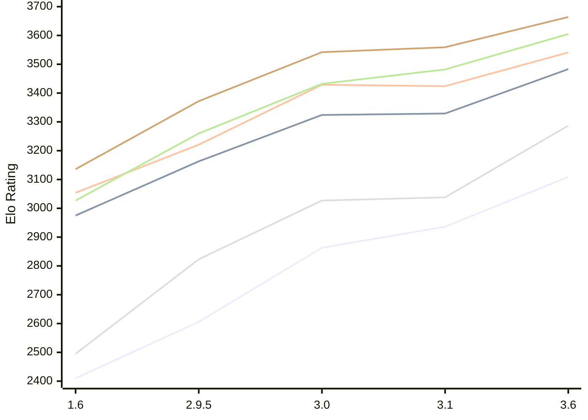

# Engine: Chessenger

Author: Dariusz Domagała

Home: https://github.com/chessengeriadoteu/chessenger

## Elo Ratings E1 (Ultra 7 265T (1.50 GHz) - E-Core)

| Version | Published | STC 8.0+0.08s  | LTC 60.0+0.60s | VLTC 2m24s+1.12s | Comment |
| --- | --- | --- | --- | --- | --- |
| 3.6 | 2026-11-01 | 3109(+173) | 3483(+154) | 3541(+117) |  |
| 3.1 | 2026-10-21 | 2936(+73) | 3329(+5) | 3424(-5) |  |
| 3.0 | 2026-10-17 | 2863(+257) | 3324(+161) | 3429(+208) |  |
| 2.9.5 | 2026-10-15 | 2606(+196) | 3163(+188) | 3221(+167) |  |
| 1.6 | 2026-10-07 | 2410 | 2975 | 3054 |  |
 | | | cElo (∆ prev) | cElo (∆ prev) | cElo (∆ prev) | 

## Elo Ratings P1 (Ultra 7 265T (1.50 GHz) - P-Core)

| Version | Published | STC 8.0+0.08s  | LTC 60.0+0.60s | VLTC 2m24s+1.12s | Comment |
| --- | --- | --- | --- | --- | --- |
| 3.6 | 2026-11-01 | 3287(+249) | 3605(+123) | 3664(+105) |  |
| 3.1 | 2026-10-21 | 3038(+11) | 3482(+50) | 3559(+17) |  |
| 3.0 | 2026-10-17 | 3027(+204) | 3432(+172) | 3542(+170) |  |
| 2.9.5 | 2026-10-15 | 2823(+328) | 3260(+233) | 3372(+236) |  |
| 1.6 | 2026-10-07 | 2495 | 3027 | 3136 |  |
 | | | cElo (∆ prev) | cElo (∆ prev) | cElo (∆ prev) | 

## Elo Ratings T1 (i5-7500T 2.70GHz)

| Version | Published | STC 8.0+0.08s  | LTC 60.0+0.60s | VLTC 2m24s+1.12s | Comment |
| --- | --- | --- | --- | --- | --- |
| 1.6 | 2026-10-07 | 2495 | 3027 | 3136 |  |
 | | | cElo (∆ prev) | cElo (∆ prev) | cElo (∆ prev) | 

<a href="https://github.com/computer-chess-index/cci/issues/new?template=submit-version.yml&title=[VERSION]+Chessenger+<version>&body=###%20Engine%20name%0AChessenger%0A%0A###%20Version%0A3.6" target="_blank">Submit new version</a>

 Test Conditions:

GUI/CLI: <a href=https://github.com/cutechess/cutechess target="_blank">Cute-Chess</a> 
Elo Calculation: <a href=https://www.remi-coulom.fr/Bayesian-Elo/ target="_blank">Bayesian-Elo</a> 
CPU for P1: Intel(R) Core(TM) Ultra 7 265T (1.50 GHz) - P-Core 
CPU for E1: Intel(R) Core(TM) Ultra 7 265T (1.50 GHz) - E-Core 
CPU for T1: Intel(R) Core(TM) i5-7500T 2.70GHz 
Opening book: 8_moves_v3 
\* STC: 8.0+0.08s, LTC: 60.0+0.60s, VLTC: 2m24s+1.12s

 Lists:
Ratings: <a href=https://github.com/computer-chess-index/cci/blob/main/lists/CCIRatings.csv target="_blank">Complete list</a>

Generated: 2026-11-12 05:37:07

## Ratings Verlauf E1 / P1

## Detailed Evaluation Results

| Version | Time Control | Variant | Elo  | Range +/- | Matches | Score | Average Opponent Elo | Draws |
| --- | --- |--- | --- | --- | --- | --- | --- | --- |
| 3.6 | VLTC (2m24s+1.12s) | E1 | 3541 | 30 | 264 | 53% | 3519 | 75% |
|  |  | P1 | 3664 | 37 | 180 | 53% | 3644 | 77% |
|  | LTC (60.0+0.60s) | E1 | 3483 | 28 | 310 | 53% | 3461 | 74% |
|  |  | P1 | 3605 | 38 | 168 | 51% | 3594 | 74% |
|  | STC (8.0+0.08s) | P1 | 3287 | 39 | 180 | 49% | 3290 | 55% |
|  |  | E1 | 3109 | 34 | 246 | 53% | 3083 | 51% |
| --- | --- |--- | --- | --- | --- | --- | --- | --- |
| 3.1 | VLTC (2m24s+1.12s) | P1 | 3559 | 29 | 300 | 54% | 3530 | 68% |
|  |  | E1 | 3424 | 29 | 306 | 52% | 3406 | 61% |
|  | LTC (60.0+0.60s) | P1 | 3482 | 34 | 228 | 50% | 3484 | 62% |
|  |  | E1 | 3329 | 34 | 224 | 50% | 3333 | 60% |
|  | STC (8.0+0.08s) | P1 | 3038 | 51 | 112 | 49% | 3047 | 47% |
|  |  | E1 | 2936 | 34 | 276 | 49% | 2942 | 36% |
| --- | --- |--- | --- | --- | --- | --- | --- | --- |
| 3.0 | VLTC (2m24s+1.12s) | P1 | 3542 | 46 | 122 | 50% | 3544 | 68% |
|  |  | E1 | 3429 | 31 | 270 | 50% | 3428 | 64% |
|  | LTC (60.0+0.60s) | P1 | 3432 | 49 | 106 | 56% | 3386 | 69% |
|  |  | E1 | 3324 | 31 | 274 | 49% | 3333 | 64% |
|  | STC (8.0+0.08s) | P1 | 3027 | 52 | 116 | 57% | 2969 | 38% |
|  |  | E1 | 2863 | 41 | 174 | 53% | 2834 | 45% |
| --- | --- |--- | --- | --- | --- | --- | --- | --- |
| 2.9.5 | VLTC (2m24s+1.12s) | E1 | 3221 | 34 | 244 | 50% | 3224 | 48% |
|  |  | P1 | 3372 | 37 | 196 | 52% | 3359 | 61% |
|  | LTC (60.0+0.60s) | P1 | 3260 | 50 | 118 | 54% | 3228 | 45% |
|  |  | E1 | 3163 | 41 | 168 | 51% | 3152 | 50% |
|  | STC (8.0+0.08s) | P1 | 2823 | 41 | 196 | 53% | 2793 | 34% |
|  |  | E1 | 2606 | 36 | 254 | 55% | 2560 | 27% |
| --- | --- |--- | --- | --- | --- | --- | --- | --- |
| 1.6 | VLTC (2m24s+1.12s) | E1 | 3054 | 43 | 168 | 55% | 2984 | 43% |
|  |  | P1 | 3136 | 50 | 130 | 55% | 3067 | 40% |
|  | LTC (60.0+0.60s) | E1 | 2975 | 40 | 218 | 57% | 2828 | 35% |
|  |  | P1 | 3027 | 57 | 116 | 63% | 2743 | 33% |
|  | STC (8.0+0.08s) | P1 | 2495 | 62 | 90 | 43% | 2560 | 24% |
|  |  | E1 | 2410 | 45 | 184 | 57% | 2288 | 23% |