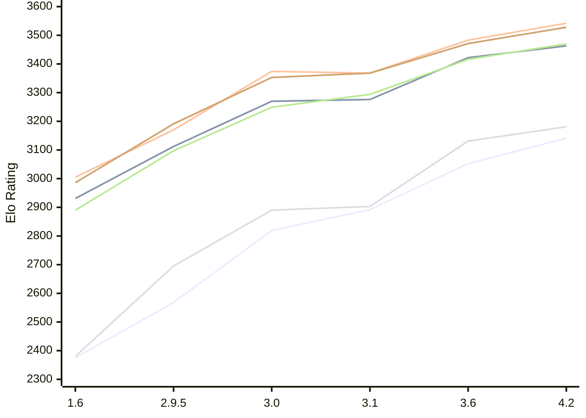

# Engine: Chessenger

Author: Dariusz Domagała

Home: https://github.com/chessengeriadoteu/chessenger

## Elo Ratings E1 (Ultra 7 265T (1.50 GHz) - E-Core)

| Version | Published | STC 8.0+0.08s  | LTC 60.0+0.60s | VLTC 2m24s+1.12s | Comment |
| --- | --- | --- | --- | --- | --- |
| 4.2 | 2026-11-12 | 3141(+89) | 3463(+41) | 3542(+59) |  |
| 3.6 | 2026-11-01 | 3052(+160) | 3422(+146) | 3483(+115) |  |
| 3.1 | 2026-10-21 | 2892(+73) | 3276(+6) | 3368(-6) |  |
| 3.0 | 2026-10-17 | 2819(+251) | 3270(+158) | 3374(+204) |  |
| 2.9.5 | 2026-10-15 | 2568(+193) | 3112(+181) | 3170(+165) |  |
| 1.6 | 2026-10-07 | 2375 | 2931 | 3005 |  |
 | | | cElo (∆ prev) | cElo (∆ prev) | cElo (∆ prev) | 

## Elo Ratings P1 (Ultra 7 265T (1.50 GHz) - P-Core)

| Version | Published | STC 8.0+0.08s  | LTC 60.0+0.60s | VLTC 2m24s+1.12s | Comment |
| --- | --- | --- | --- | --- | --- |
| 4.2 | 2026-11-12 | 3181(+50) | 3470(+54) | 3528(+57) |  |
| 3.6 | 2026-11-01 | 3131(+228) | 3416(+122) | 3471(+103) |  |
| 3.1 | 2026-10-21 | 2903(+13) | 3294(+45) | 3368(+15) |  |
| 3.0 | 2026-10-17 | 2890(+195) | 3249(+152) | 3353(+162) |  |
| 2.9.5 | 2026-10-15 | 2695(+315) | 3097(+207) | 3191(+205) |  |
| 1.6 | 2026-10-07 | 2380 | 2890 | 2986 |  |
 | | | cElo (∆ prev) | cElo (∆ prev) | cElo (∆ prev) | 

## Elo Ratings T1 (i5-7500T 2.70GHz)

| Version | Published | STC 8.0+0.08s  | LTC 60.0+0.60s | VLTC 2m24s+1.12s | Comment |
| --- | --- | --- | --- | --- | --- |
| 1.6 | 2026-10-07 | 2380 | 2890 | 2986 |  |
 | | | cElo (∆ prev) | cElo (∆ prev) | cElo (∆ prev) | 

<a href="https://github.com/computer-chess-index/cci/issues/new?template=submit-version.yml&title=[VERSION]+Chessenger+<version>&body=###%20Engine%20name%0AChessenger%0A%0A###%20Version%0A4.2" target="_blank">Submit new version</a>

 Test Conditions:

GUI/CLI: <a href=https://github.com/cutechess/cutechess target="_blank">Cute-Chess</a> 
Elo Calculation: <a href=https://www.remi-coulom.fr/Bayesian-Elo/ target="_blank">Bayesian-Elo</a> 
CPU for P1: Intel(R) Core(TM) Ultra 7 265T (1.50 GHz) - P-Core 
CPU for E1: Intel(R) Core(TM) Ultra 7 265T (1.50 GHz) - E-Core 
CPU for T1: Intel(R) Core(TM) i5-7500T 2.70GHz 
Opening book: 8_moves_v3 
\* STC: 8.0+0.08s, LTC: 60.0+0.60s, VLTC: 2m24s+1.12s

 Lists:
Ratings: <a href=https://github.com/computer-chess-index/cci/blob/main/lists/CCIRatings.csv target="_blank">Complete list</a>

Generated: 2026-11-27 05:37:22

## Ratings Verlauf E1 / P1

## Detailed Evaluation Results

| Version | Time Control | Variant | Elo  | Range +/- | Matches | Score | Average Opponent Elo | Draws |
| --- | --- |--- | --- | --- | --- | --- | --- | --- |
| 4.2 | VLTC (2m24s+1.12s) | P1 | 3528 | 53 | 84 | 51% | 3519 | 81% |
|  |  | E1 | 3542 | 35 | 194 | 51% | 3536 | 80% |
|  | LTC (60.0+0.60s) | P1 | 3470 | 40 | 148 | 53% | 3448 | 81% |
|  |  | E1 | 3463 | 37 | 180 | 50% | 3464 | 77% |
|  | STC (8.0+0.08s) | E1 | 3141 | 34 | 244 | 51% | 3131 | 52% |
|  |  | P1 | 3181 | 43 | 148 | 51% | 3173 | 57% |
| --- | --- |--- | --- | --- | --- | --- | --- | --- |
| 3.6 | VLTC (2m24s+1.12s) | P1 | 3471 | 36 | 184 | 52% | 3453 | 77% |
|  |  | E1 | 3483 | 29 | 284 | 53% | 3464 | 75% |
|  | LTC (60.0+0.60s) | P1 | 3416 | 36 | 184 | 52% | 3403 | 75% |
|  |  | E1 | 3422 | 27 | 350 | 52% | 3410 | 73% |
|  | STC (8.0+0.08s) | P1 | 3131 | 37 | 200 | 51% | 3119 | 55% |
|  |  | E1 | 3052 | 31 | 302 | 51% | 3040 | 50% |
| --- | --- |--- | --- | --- | --- | --- | --- | --- |
| 3.1 | VLTC (2m24s+1.12s) | P1 | 3368 | 29 | 300 | 54% | 3341 | 68% |
|  |  | E1 | 3368 | 29 | 306 | 52% | 3351 | 61% |
|  | LTC (60.0+0.60s) | P1 | 3294 | 34 | 232 | 50% | 3295 | 62% |
|  |  | E1 | 3276 | 34 | 224 | 50% | 3281 | 60% |
|  | STC (8.0+0.08s) | P1 | 2903 | 50 | 116 | 47% | 2930 | 47% |
|  |  | E1 | 2892 | 33 | 284 | 49% | 2896 | 36% |
| --- | --- |--- | --- | --- | --- | --- | --- | --- |
| 3.0 | VLTC (2m24s+1.12s) | E1 | 3374 | 31 | 270 | 50% | 3372 | 64% |
|  |  | P1 | 3353 | 46 | 122 | 50% | 3355 | 68% |
|  | LTC (60.0+0.60s) | E1 | 3270 | 31 | 274 | 49% | 3281 | 64% |
|  |  | P1 | 3249 | 49 | 106 | 56% | 3204 | 69% |
|  | STC (8.0+0.08s) | P1 | 2890 | 52 | 116 | 57% | 2832 | 38% |
|  |  | E1 | 2819 | 41 | 174 | 53% | 2790 | 45% |
| --- | --- |--- | --- | --- | --- | --- | --- | --- |
| 2.9.5 | VLTC (2m24s+1.12s) | P1 | 3191 | 37 | 196 | 52% | 3179 | 61% |
|  |  | E1 | 3170 | 34 | 244 | 50% | 3173 | 48% |
|  | LTC (60.0+0.60s) | P1 | 3097 | 50 | 118 | 54% | 3065 | 45% |
|  |  | E1 | 3112 | 41 | 168 | 51% | 3102 | 50% |
|  | STC (8.0+0.08s) | P1 | 2695 | 41 | 196 | 53% | 2665 | 34% |
|  |  | E1 | 2568 | 37 | 254 | 55% | 2522 | 27% |
| --- | --- |--- | --- | --- | --- | --- | --- | --- |
| 1.6 | VLTC (2m24s+1.12s) | P1 | 2986 | 50 | 130 | 55% | 2921 | 40% |
|  |  | E1 | 3005 | 43 | 168 | 55% | 2938 | 43% |
|  | LTC (60.0+0.60s) | P1 | 2890 | 57 | 116 | 63% | 2622 | 33% |
|  |  | E1 | 2931 | 40 | 218 | 57% | 2784 | 35% |
|  | STC (8.0+0.08s) | P1 | 2380 | 62 | 90 | 43% | 2444 | 24% |
|  |  | E1 | 2375 | 46 | 184 | 57% | 2255 | 23% |