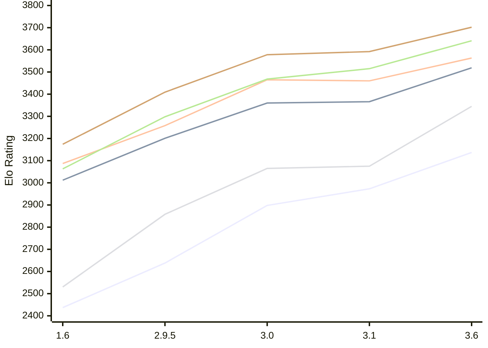

# Engine: Chessenger

Author: Dariusz Domagała

Home: https://github.com/chessengeriadoteu/chessenger

## Elo Ratings E1 (Ultra 7 265T (1.50 GHz) - E-Core)

| Version | Published | STC 8.0+0.08s  | LTC 60.0+0.60s | VLTC 2m24s+1.12s | Comment |
| --- | --- | --- | --- | --- | --- |
| 3.6 | 2026-11-01 | 3137(+164) | 3519(+153) | 3563(+103) |  |
| 3.1 | 2026-10-21 | 2973(+75) | 3366(+6) | 3460(-5) |  |
| 3.0 | 2026-10-17 | 2898(+260) | 3360(+159) | 3465(+207) |  |
| 2.9.5 | 2026-10-15 | 2638(+201) | 3201(+189) | 3258(+171) |  |
| 1.6 | 2026-10-07 | 2437 | 3012 | 3087 |  |
 | | | cElo (∆ prev) | cElo (∆ prev) | cElo (∆ prev) | 

## Elo Ratings P1 (Ultra 7 265T (1.50 GHz) - P-Core)

| Version | Published | STC 8.0+0.08s  | LTC 60.0+0.60s | VLTC 2m24s+1.12s | Comment |
| --- | --- | --- | --- | --- | --- |
| 3.6 | 2026-11-01 | 3345(+270) | 3641(+126) | 3702(+110) |  |
| 3.1 | 2026-10-21 | 3075(+10) | 3515(+47) | 3592(+14) |  |
| 3.0 | 2026-10-17 | 3065(+207) | 3468(+170) | 3578(+169) |  |
| 2.9.5 | 2026-10-15 | 2858(+328) | 3298(+235) | 3409(+235) |  |
| 1.6 | 2026-10-07 | 2530 | 3063 | 3174 |  |
 | | | cElo (∆ prev) | cElo (∆ prev) | cElo (∆ prev) | 

## Elo Ratings T1 (i5-7500T 2.70GHz)

| Version | Published | STC 8.0+0.08s  | LTC 60.0+0.60s | VLTC 2m24s+1.12s | Comment |
| --- | --- | --- | --- | --- | --- |
| 1.6 | 2026-10-07 | 2530 | 3063 | 3174 |  |
 | | | cElo (∆ prev) | cElo (∆ prev) | cElo (∆ prev) | 

<a href="https://github.com/computer-chess-index/cci/issues/new?template=submit-version.yml&title=[VERSION]+Chessenger+<version>&body=###%20Engine%20name%0AChessenger%0A%0A###%20Version%0A3.6" target="_blank">Submit new version</a>

 Test Conditions:

GUI/CLI: <a href=https://github.com/cutechess/cutechess target="_blank">Cute-Chess</a> 
Elo Calculation: <a href=https://www.remi-coulom.fr/Bayesian-Elo/ target="_blank">Bayesian-Elo</a> 
CPU for P1: Intel(R) Core(TM) Ultra 7 265T (1.50 GHz) - P-Core 
CPU for E1: Intel(R) Core(TM) Ultra 7 265T (1.50 GHz) - E-Core 
CPU for T1: Intel(R) Core(TM) i5-7500T 2.70GHz 
Opening book: 8_moves_v3 
\* STC: 8.0+0.08s, LTC: 60.0+0.60s, VLTC: 2m24s+1.12s

 Lists:
Ratings: <a href=https://github.com/computer-chess-index/cci/blob/main/lists/CCIRatings.csv target="_blank">Complete list</a>

Generated: 2026-11-07 05:37:06

## Ratings Verlauf E1 / P1

## Detailed Evaluation Results

| Version | Time Control | Variant | Elo  | Range +/- | Matches | Score | Average Opponent Elo | Draws |
| --- | --- |--- | --- | --- | --- | --- | --- | --- |
| 3.6 | VLTC (2m24s+1.12s) | P1 | 3702 | 38 | 168 | 53% | 3681 | 76% |
|  |  | E1 | 3563 | 34 | 208 | 53% | 3545 | 75% |
|  | LTC (60.0+0.60s) | P1 | 3641 | 42 | 136 | 52% | 3625 | 76% |
|  |  | E1 | 3519 | 29 | 288 | 53% | 3495 | 75% |
|  | STC (8.0+0.08s) | P1 | 3345 | 47 | 122 | 52% | 3329 | 61% |
|  |  | E1 | 3137 | 37 | 214 | 53% | 3116 | 49% |
| --- | --- |--- | --- | --- | --- | --- | --- | --- |
| 3.1 | VLTC (2m24s+1.12s) | P1 | 3592 | 29 | 300 | 54% | 3565 | 68% |
|  |  | E1 | 3460 | 29 | 306 | 52% | 3443 | 61% |
|  | LTC (60.0+0.60s) | P1 | 3515 | 34 | 228 | 50% | 3518 | 62% |
|  |  | E1 | 3366 | 34 | 224 | 50% | 3370 | 60% |
|  | STC (8.0+0.08s) | P1 | 3075 | 51 | 112 | 49% | 3085 | 47% |
|  |  | E1 | 2973 | 34 | 276 | 49% | 2978 | 36% |
| --- | --- |--- | --- | --- | --- | --- | --- | --- |
| 3.0 | VLTC (2m24s+1.12s) | P1 | 3578 | 46 | 122 | 50% | 3579 | 68% |
|  |  | E1 | 3465 | 31 | 270 | 50% | 3464 | 64% |
|  | LTC (60.0+0.60s) | E1 | 3360 | 31 | 274 | 49% | 3370 | 64% |
|  |  | P1 | 3468 | 49 | 106 | 56% | 3422 | 69% |
|  | STC (8.0+0.08s) | E1 | 2898 | 41 | 174 | 53% | 2870 | 45% |
|  |  | P1 | 3065 | 52 | 116 | 57% | 3005 | 38% |
| --- | --- |--- | --- | --- | --- | --- | --- | --- |
| 2.9.5 | VLTC (2m24s+1.12s) | P1 | 3409 | 37 | 196 | 52% | 3395 | 61% |
|  |  | E1 | 3258 | 34 | 244 | 50% | 3259 | 48% |
|  | LTC (60.0+0.60s) | P1 | 3298 | 50 | 118 | 54% | 3266 | 45% |
|  |  | E1 | 3201 | 41 | 168 | 51% | 3190 | 50% |
|  | STC (8.0+0.08s) | P1 | 2858 | 41 | 196 | 53% | 2828 | 34% |
|  |  | E1 | 2638 | 36 | 254 | 55% | 2592 | 27% |
| --- | --- |--- | --- | --- | --- | --- | --- | --- |
| 1.6 | VLTC (2m24s+1.12s) | P1 | 3174 | 50 | 130 | 55% | 3106 | 40% |
|  |  | E1 | 3087 | 43 | 168 | 55% | 3019 | 43% |
|  | LTC (60.0+0.60s) | P1 | 3063 | 57 | 116 | 63% | 2780 | 33% |
|  |  | E1 | 3012 | 40 | 218 | 57% | 2863 | 35% |
|  | STC (8.0+0.08s) | P1 | 2530 | 62 | 90 | 43% | 2593 | 24% |
|  |  | E1 | 2437 | 46 | 184 | 57% | 2314 | 23% |