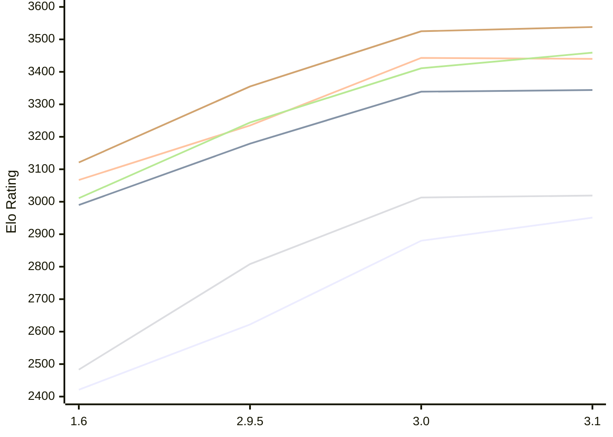

# Engine: Chessenger

Author: Dariusz Domagała

Home: https://github.com/chessengeriadoteu/chessenger

## Elo Ratings E1 (Ultra 7 265T (1.50 GHz) - E-Core)

| Version | Published | STC 8.0+0.08s  | LTC 60.0+0.60s | VLTC 2m24s+1.12s | Comment |
| --- | --- | --- | --- | --- | --- |
| 3.1 | 2026-10-21 | 2951(+71) | 3344(+5) | 3440(-3) |  |
| 3.0 | 2026-10-17 | 2880(+258) | 3339(+160) | 3443(+208) |  |
| 2.9.5 | 2026-10-15 | 2622(+201) | 3179(+189) | 3235(+168) |  |
| 1.6 | 2026-10-07 | 2421 | 2990 | 3067 |  |
 | | | cElo (∆ prev) | cElo (∆ prev) | cElo (∆ prev) | 

## Elo Ratings P1 (Ultra 7 265T (1.50 GHz) - P-Core)

| Version | Published | STC 8.0+0.08s  | LTC 60.0+0.60s | VLTC 2m24s+1.12s | Comment |
| --- | --- | --- | --- | --- | --- |
| 3.1 | 2026-10-21 | 3019(+6) | 3459(+48) | 3538(+13) |  |
| 3.0 | 2026-10-17 | 3013(+205) | 3411(+167) | 3525(+170) |  |
| 2.9.5 | 2026-10-15 | 2808(+325) | 3244(+233) | 3355(+234) |  |
| 1.6 | 2026-10-07 | 2483 | 3011 | 3121 |  |
 | | | cElo (∆ prev) | cElo (∆ prev) | cElo (∆ prev) | 

## Elo Ratings T1 (i5-7500T 2.70GHz)

| Version | Published | STC 8.0+0.08s  | LTC 60.0+0.60s | VLTC 2m24s+1.12s | Comment |
| --- | --- | --- | --- | --- | --- |
| 1.6 | 2026-10-07 | 2483 | 3011 | 3121 |  |
 | | | cElo (∆ prev) | cElo (∆ prev) | cElo (∆ prev) | 

<a href="https://github.com/computer-chess-index/cci/issues/new?template=submit-version.yml&title=[VERSION]+Chessenger+<version>&body=###%20Engine%20name%0AChessenger%0A%0A###%20Version%0A3.1" target="_blank">Submit new version</a>

 Test Conditions:

GUI/CLI: <a href=https://github.com/cutechess/cutechess target="_blank">Cute-Chess</a> 
Elo Calculation: <a href=https://www.remi-coulom.fr/Bayesian-Elo/ target="_blank">Bayesian-Elo</a> 
CPU for P1: Intel(R) Core(TM) Ultra 7 265T (1.50 GHz) - P-Core 
CPU for E1: Intel(R) Core(TM) Ultra 7 265T (1.50 GHz) - E-Core 
CPU for T1: Intel(R) Core(TM) i5-7500T 2.70GHz 
Opening book: 8_moves_v3 
\* STC: 8.0+0.08s, LTC: 60.0+0.60s, VLTC: 2m24s+1.12s

 Lists:
Ratings: <a href=https://github.com/computer-chess-index/cci/blob/main/lists/CCIRatings.csv target="_blank">Complete list</a>

Generated: 2026-11-03 05:37:11

## Ratings Verlauf E1 / P1

## Detailed Evaluation Results

| Version | Time Control | Variant | Elo  | Range +/- | Matches | Score | Average Opponent Elo | Draws |
| --- | --- |--- | --- | --- | --- | --- | --- | --- |
| 3.1 | VLTC (2m24s+1.12s) | E1 | 3440 | 30 | 290 | 53% | 3420 | 61% |
|  |  | P1 | 3538 | 29 | 300 | 54% | 3511 | 68% |
|  | LTC (60.0+0.60s) | E1 | 3344 | 34 | 224 | 50% | 3348 | 60% |
|  |  | P1 | 3459 | 34 | 224 | 50% | 3463 | 62% |
|  | STC (8.0+0.08s) | P1 | 3019 | 51 | 108 | 48% | 3033 | 48% |
|  |  | E1 | 2951 | 34 | 276 | 49% | 2957 | 36% |
| --- | --- |--- | --- | --- | --- | --- | --- | --- |
| 3.0 | VLTC (2m24s+1.12s) | P1 | 3525 | 46 | 122 | 50% | 3526 | 68% |
|  |  | E1 | 3443 | 31 | 270 | 50% | 3443 | 64% |
|  | LTC (60.0+0.60s) | P1 | 3411 | 49 | 106 | 56% | 3366 | 69% |
|  |  | E1 | 3339 | 31 | 274 | 49% | 3348 | 64% |
|  | STC (8.0+0.08s) | P1 | 3013 | 52 | 116 | 57% | 2954 | 38% |
|  |  | E1 | 2880 | 41 | 174 | 53% | 2850 | 45% |
| --- | --- |--- | --- | --- | --- | --- | --- | --- |
| 2.9.5 | VLTC (2m24s+1.12s) | P1 | 3355 | 37 | 196 | 52% | 3341 | 61% |
|  |  | E1 | 3235 | 34 | 244 | 50% | 3237 | 48% |
|  | LTC (60.0+0.60s) | P1 | 3244 | 50 | 118 | 54% | 3212 | 45% |
|  |  | E1 | 3179 | 41 | 168 | 51% | 3168 | 50% |
|  | STC (8.0+0.08s) | P1 | 2808 | 41 | 196 | 53% | 2778 | 34% |
|  |  | E1 | 2622 | 36 | 254 | 55% | 2576 | 27% |
| --- | --- |--- | --- | --- | --- | --- | --- | --- |
| 1.6 | VLTC (2m24s+1.12s) | P1 | 3121 | 50 | 130 | 55% | 3054 | 40% |
|  |  | E1 | 3067 | 43 | 168 | 55% | 2998 | 43% |
|  | LTC (60.0+0.60s) | P1 | 3011 | 57 | 116 | 63% | 2730 | 33% |
|  |  | E1 | 2990 | 40 | 218 | 57% | 2843 | 35% |
|  | STC (8.0+0.08s) | P1 | 2483 | 62 | 90 | 43% | 2546 | 24% |
|  |  | E1 | 2421 | 45 | 184 | 57% | 2299 | 23% |