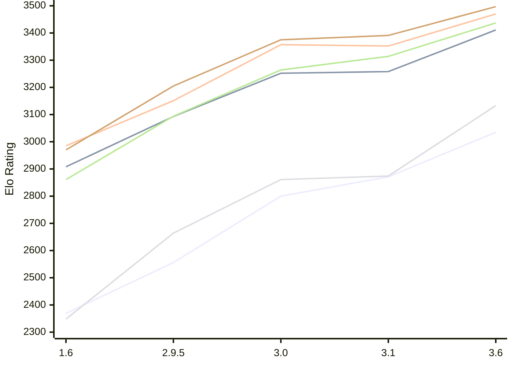

# Engine: Chessenger

Author: Dariusz Domagała

Home: https://github.com/chessengeriadoteu/chessenger

## Elo Ratings E1 (Ultra 7 265T (1.50 GHz) - E-Core)

| Version | Published | STC 8.0+0.08s  | LTC 60.0+0.60s | VLTC 2m24s+1.12s | Comment |
| --- | --- | --- | --- | --- | --- |
| 3.6 | 2026-11-01 | 3035(+164) | 3411(+153) | 3470(+118) |  |
| 3.1 | 2026-10-21 | 2871(+71) | 3258(+6) | 3352(-5) |  |
| 3.0 | 2026-10-17 | 2800(+244) | 3252(+159) | 3357(+206) |  |
| 2.9.5 | 2026-10-15 | 2556(+187) | 3093(+185) | 3151(+166) |  |
| 1.6 | 2026-10-07 | 2369 | 2908 | 2985 |  |
 | | | cElo (∆ prev) | cElo (∆ prev) | cElo (∆ prev) | 

## Elo Ratings P1 (Ultra 7 265T (1.50 GHz) - P-Core)

| Version | Published | STC 8.0+0.08s  | LTC 60.0+0.60s | VLTC 2m24s+1.12s | Comment |
| --- | --- | --- | --- | --- | --- |
| 3.6 | 2026-11-01 | 3133(+259) | 3437(+123) | 3497(+106) |  |
| 3.1 | 2026-10-21 | 2874(+13) | 3314(+50) | 3391(+16) |  |
| 3.0 | 2026-10-17 | 2861(+197) | 3264(+170) | 3375(+170) |  |
| 2.9.5 | 2026-10-15 | 2664(+316) | 3094(+233) | 3205(+235) |  |
| 1.6 | 2026-10-07 | 2348 | 2861 | 2970 |  |
 | | | cElo (∆ prev) | cElo (∆ prev) | cElo (∆ prev) | 

## Elo Ratings T1 (i5-7500T 2.70GHz)

| Version | Published | STC 8.0+0.08s  | LTC 60.0+0.60s | VLTC 2m24s+1.12s | Comment |
| --- | --- | --- | --- | --- | --- |
| 1.6 | 2026-10-07 | 2348 | 2861 | 2970 |  |
 | | | cElo (∆ prev) | cElo (∆ prev) | cElo (∆ prev) | 

<a href="https://github.com/computer-chess-index/cci/issues/new?template=submit-version.yml&title=[VERSION]+Chessenger+<version>&body=###%20Engine%20name%0AChessenger%0A%0A###%20Version%0A3.6" target="_blank">Submit new version</a>

 Test Conditions:

GUI/CLI: <a href=https://github.com/cutechess/cutechess target="_blank">Cute-Chess</a> 
Elo Calculation: <a href=https://www.remi-coulom.fr/Bayesian-Elo/ target="_blank">Bayesian-Elo</a> 
CPU for P1: Intel(R) Core(TM) Ultra 7 265T (1.50 GHz) - P-Core 
CPU for E1: Intel(R) Core(TM) Ultra 7 265T (1.50 GHz) - E-Core 
CPU for T1: Intel(R) Core(TM) i5-7500T 2.70GHz 
Opening book: 8_moves_v3 
\* STC: 8.0+0.08s, LTC: 60.0+0.60s, VLTC: 2m24s+1.12s

 Lists:
Ratings: <a href=https://github.com/computer-chess-index/cci/blob/main/lists/CCIRatings.csv target="_blank">Complete list</a>

Generated: 2026-11-13 05:37:16

## Ratings Verlauf E1 / P1

## Detailed Evaluation Results

| Version | Time Control | Variant | Elo  | Range +/- | Matches | Score | Average Opponent Elo | Draws |
| --- | --- |--- | --- | --- | --- | --- | --- | --- |
| 3.6 | VLTC (2m24s+1.12s) | P1 | 3497 | 37 | 180 | 53% | 3476 | 77% |
|  |  | E1 | 3470 | 30 | 264 | 53% | 3448 | 75% |
|  | LTC (60.0+0.60s) | P1 | 3437 | 38 | 172 | 51% | 3426 | 75% |
|  |  | E1 | 3411 | 28 | 310 | 53% | 3390 | 74% |
|  | STC (8.0+0.08s) | P1 | 3133 | 38 | 188 | 51% | 3124 | 54% |
|  |  | E1 | 3035 | 33 | 254 | 52% | 3017 | 51% |
| --- | --- |--- | --- | --- | --- | --- | --- | --- |
| 3.1 | VLTC (2m24s+1.12s) | P1 | 3391 | 29 | 300 | 54% | 3363 | 68% |
|  |  | E1 | 3352 | 29 | 306 | 52% | 3335 | 61% |
|  | LTC (60.0+0.60s) | P1 | 3314 | 34 | 232 | 50% | 3317 | 62% |
|  |  | E1 | 3258 | 34 | 224 | 50% | 3263 | 60% |
|  | STC (8.0+0.08s) | P1 | 2874 | 50 | 116 | 47% | 2898 | 47% |
|  |  | E1 | 2871 | 33 | 284 | 49% | 2876 | 36% |
| --- | --- |--- | --- | --- | --- | --- | --- | --- |
| 3.0 | VLTC (2m24s+1.12s) | P1 | 3375 | 46 | 122 | 50% | 3376 | 68% |
|  |  | E1 | 3357 | 31 | 270 | 50% | 3356 | 64% |
|  | LTC (60.0+0.60s) | E1 | 3252 | 31 | 274 | 49% | 3262 | 64% |
|  |  | P1 | 3264 | 49 | 106 | 56% | 3218 | 69% |
|  | STC (8.0+0.08s) | E1 | 2800 | 41 | 174 | 53% | 2770 | 45% |
|  |  | P1 | 2861 | 52 | 116 | 57% | 2803 | 38% |
| --- | --- |--- | --- | --- | --- | --- | --- | --- |
| 2.9.5 | VLTC (2m24s+1.12s) | P1 | 3205 | 37 | 196 | 52% | 3191 | 61% |
|  |  | E1 | 3151 | 34 | 244 | 50% | 3154 | 48% |
|  | LTC (60.0+0.60s) | P1 | 3094 | 50 | 118 | 54% | 3062 | 45% |
|  |  | E1 | 3093 | 41 | 168 | 51% | 3082 | 50% |
|  | STC (8.0+0.08s) | P1 | 2664 | 41 | 196 | 53% | 2633 | 34% |
|  |  | E1 | 2556 | 36 | 254 | 55% | 2510 | 27% |
| --- | --- |--- | --- | --- | --- | --- | --- | --- |
| 1.6 | VLTC (2m24s+1.12s) | P1 | 2970 | 50 | 130 | 55% | 2904 | 40% |
|  |  | E1 | 2985 | 43 | 168 | 55% | 2919 | 43% |
|  | LTC (60.0+0.60s) | P1 | 2861 | 57 | 116 | 63% | 2596 | 33% |
|  |  | E1 | 2908 | 40 | 218 | 57% | 2768 | 35% |
|  | STC (8.0+0.08s) | P1 | 2348 | 62 | 90 | 43% | 2411 | 24% |
|  |  | E1 | 2369 | 45 | 184 | 57% | 2252 | 23% |