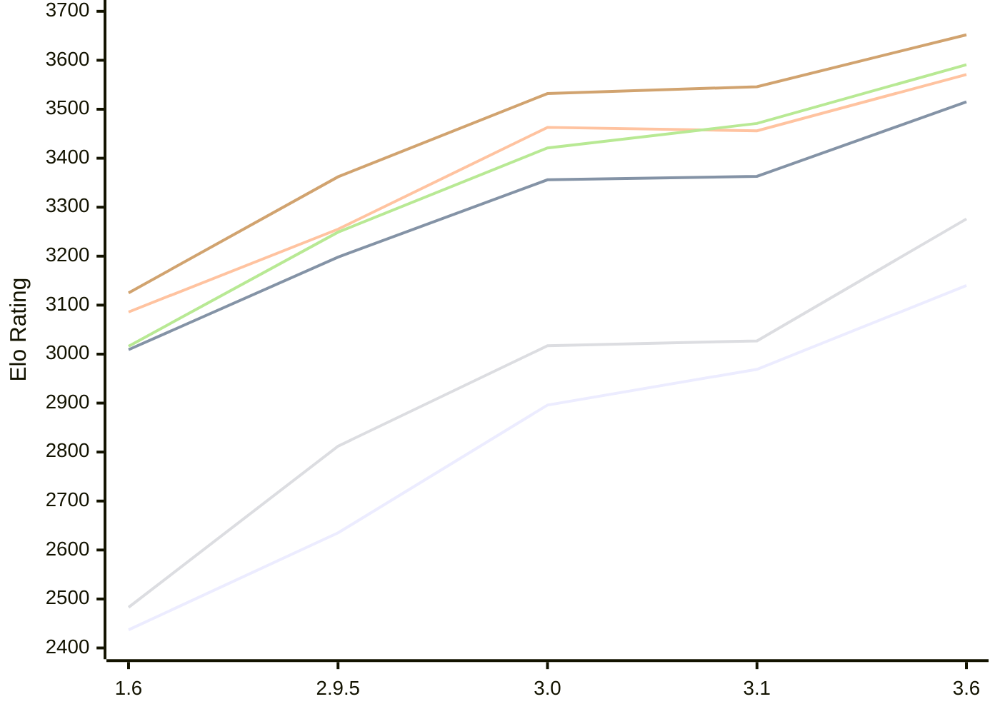

# Engine: Chessenger

Author: Dariusz Domagała

Home: https://github.com/chessengeriadoteu/chessenger

## Elo Ratings E1 (Ultra 7 265T (1.50 GHz) - E-Core)

| Version | Published | STC 8.0+0.08s  | LTC 60.0+0.60s | VLTC 2m24s+1.12s | Comment |
| --- | --- | --- | --- | --- | --- |
| 3.6 | 2026-11-01 | 3140(+171) | 3515(+152) | 3571(+115) |  |
| 3.1 | 2026-10-21 | 2969(+73) | 3363(+7) | 3456(-7) |  |
| 3.0 | 2026-10-17 | 2896(+261) | 3356(+158) | 3463(+208) |  |
| 2.9.5 | 2026-10-15 | 2635(+198) | 3198(+189) | 3255(+169) |  |
| 1.6 | 2026-10-07 | 2437 | 3009 | 3086 |  |
 | | | cElo (∆ prev) | cElo (∆ prev) | cElo (∆ prev) | 

## Elo Ratings P1 (Ultra 7 265T (1.50 GHz) - P-Core)

| Version | Published | STC 8.0+0.08s  | LTC 60.0+0.60s | VLTC 2m24s+1.12s | Comment |
| --- | --- | --- | --- | --- | --- |
| 3.6 | 2026-11-01 | 3276(+249) | 3591(+120) | 3652(+106) |  |
| 3.1 | 2026-10-21 | 3027(+10) | 3471(+50) | 3546(+14) |  |
| 3.0 | 2026-10-17 | 3017(+205) | 3421(+172) | 3532(+170) |  |
| 2.9.5 | 2026-10-15 | 2812(+329) | 3249(+233) | 3362(+237) |  |
| 1.6 | 2026-10-07 | 2483 | 3016 | 3125 |  |
 | | | cElo (∆ prev) | cElo (∆ prev) | cElo (∆ prev) | 

## Elo Ratings T1 (i5-7500T 2.70GHz)

| Version | Published | STC 8.0+0.08s  | LTC 60.0+0.60s | VLTC 2m24s+1.12s | Comment |
| --- | --- | --- | --- | --- | --- |
| 1.6 | 2026-10-07 | 2483 | 3016 | 3125 |  |
 | | | cElo (∆ prev) | cElo (∆ prev) | cElo (∆ prev) | 

<a href="https://github.com/computer-chess-index/cci/issues/new?template=submit-version.yml&title=[VERSION]+Chessenger+<version>&body=###%20Engine%20name%0AChessenger%0A%0A###%20Version%0A3.6" target="_blank">Submit new version</a>

 Test Conditions:

GUI/CLI: <a href=https://github.com/cutechess/cutechess target="_blank">Cute-Chess</a> 
Elo Calculation: <a href=https://www.remi-coulom.fr/Bayesian-Elo/ target="_blank">Bayesian-Elo</a> 
CPU for P1: Intel(R) Core(TM) Ultra 7 265T (1.50 GHz) - P-Core 
CPU for E1: Intel(R) Core(TM) Ultra 7 265T (1.50 GHz) - E-Core 
CPU for T1: Intel(R) Core(TM) i5-7500T 2.70GHz 
Opening book: 8_moves_v3 
\* STC: 8.0+0.08s, LTC: 60.0+0.60s, VLTC: 2m24s+1.12s

 Lists:
Ratings: <a href=https://github.com/computer-chess-index/cci/blob/main/lists/CCIRatings.csv target="_blank">Complete list</a>

Generated: 2026-11-11 05:37:08

## Ratings Verlauf E1 / P1

## Detailed Evaluation Results

| Version | Time Control | Variant | Elo  | Range +/- | Matches | Score | Average Opponent Elo | Draws |
| --- | --- |--- | --- | --- | --- | --- | --- | --- |
| 3.6 | VLTC (2m24s+1.12s) | E1 | 3571 | 31 | 252 | 53% | 3551 | 75% |
|  |  | P1 | 3652 | 37 | 180 | 53% | 3633 | 77% |
|  | LTC (60.0+0.60s) | E1 | 3515 | 28 | 306 | 53% | 3494 | 75% |
|  |  | P1 | 3591 | 40 | 156 | 51% | 3583 | 74% |
|  | STC (8.0+0.08s) | E1 | 3140 | 35 | 238 | 53% | 3116 | 50% |
|  |  | P1 | 3276 | 39 | 180 | 49% | 3281 | 55% |
| --- | --- |--- | --- | --- | --- | --- | --- | --- |
| 3.1 | VLTC (2m24s+1.12s) | P1 | 3546 | 29 | 300 | 54% | 3519 | 68% |
|  |  | E1 | 3456 | 29 | 306 | 52% | 3440 | 61% |
|  | LTC (60.0+0.60s) | P1 | 3471 | 34 | 228 | 50% | 3474 | 62% |
|  |  | E1 | 3363 | 34 | 224 | 50% | 3367 | 60% |
|  | STC (8.0+0.08s) | P1 | 3027 | 51 | 112 | 49% | 3038 | 47% |
|  |  | E1 | 2969 | 34 | 276 | 49% | 2975 | 36% |
| --- | --- |--- | --- | --- | --- | --- | --- | --- |
| 3.0 | VLTC (2m24s+1.12s) | P1 | 3532 | 46 | 122 | 50% | 3533 | 68% |
|  |  | E1 | 3463 | 31 | 270 | 50% | 3461 | 64% |
|  | LTC (60.0+0.60s) | P1 | 3421 | 49 | 106 | 56% | 3375 | 69% |
|  |  | E1 | 3356 | 31 | 274 | 49% | 3367 | 64% |
|  | STC (8.0+0.08s) | P1 | 3017 | 52 | 116 | 57% | 2959 | 38% |
|  |  | E1 | 2896 | 41 | 174 | 53% | 2867 | 45% |
| --- | --- |--- | --- | --- | --- | --- | --- | --- |
| 2.9.5 | VLTC (2m24s+1.12s) | E1 | 3255 | 34 | 244 | 50% | 3258 | 48% |
|  |  | P1 | 3362 | 37 | 196 | 52% | 3348 | 61% |
|  | LTC (60.0+0.60s) | E1 | 3198 | 41 | 168 | 51% | 3187 | 50% |
|  |  | P1 | 3249 | 50 | 118 | 54% | 3217 | 45% |
|  | STC (8.0+0.08s) | P1 | 2812 | 41 | 196 | 53% | 2782 | 34% |
|  |  | E1 | 2635 | 36 | 254 | 55% | 2589 | 27% |
| --- | --- |--- | --- | --- | --- | --- | --- | --- |
| 1.6 | VLTC (2m24s+1.12s) | E1 | 3086 | 43 | 168 | 55% | 3016 | 43% |
|  |  | P1 | 3125 | 50 | 130 | 55% | 3056 | 40% |
|  | LTC (60.0+0.60s) | E1 | 3009 | 40 | 218 | 57% | 2861 | 35% |
|  |  | P1 | 3016 | 57 | 116 | 63% | 2732 | 33% |
|  | STC (8.0+0.08s) | E1 | 2437 | 46 | 184 | 57% | 2314 | 23% |
|  |  | P1 | 2483 | 62 | 90 | 43% | 2547 | 24% |