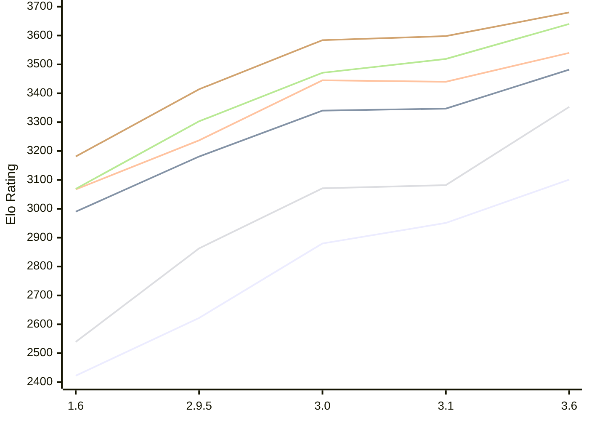

# Engine: Chessenger

Author: Dariusz Domagała

Home: https://github.com/chessengeriadoteu/chessenger

## Elo Ratings E1 (Ultra 7 265T (1.50 GHz) - E-Core)

| Version | Published | STC 8.0+0.08s  | LTC 60.0+0.60s | VLTC 2m24s+1.12s | Comment |
| --- | --- | --- | --- | --- | --- |
| 3.6 | 2026-11-01 | 3101(+150) | 3482(+135) | 3540(+100) |  |
| 3.1 | 2026-10-21 | 2951(+71) | 3347(+7) | 3440(-5) |  |
| 3.0 | 2026-10-17 | 2880(+258) | 3340(+159) | 3445(+208) |  |
| 2.9.5 | 2026-10-15 | 2622(+200) | 3181(+191) | 3237(+170) |  |
| 1.6 | 2026-10-07 | 2422 | 2990 | 3067 |  |
 | | | cElo (∆ prev) | cElo (∆ prev) | cElo (∆ prev) | 

## Elo Ratings P1 (Ultra 7 265T (1.50 GHz) - P-Core)

| Version | Published | STC 8.0+0.08s  | LTC 60.0+0.60s | VLTC 2m24s+1.12s | Comment |
| --- | --- | --- | --- | --- | --- |
| 3.6 | 2026-11-01 | 3353(+271) | 3640(+121) | 3680(+82) |  |
| 3.1 | 2026-10-21 | 3082(+11) | 3519(+48) | 3598(+14) |  |
| 3.0 | 2026-10-17 | 3071(+208) | 3471(+168) | 3584(+170) |  |
| 2.9.5 | 2026-10-15 | 2863(+324) | 3303(+234) | 3414(+233) |  |
| 1.6 | 2026-10-07 | 2539 | 3069 | 3181 |  |
 | | | cElo (∆ prev) | cElo (∆ prev) | cElo (∆ prev) | 

## Elo Ratings T1 (i5-7500T 2.70GHz)

| Version | Published | STC 8.0+0.08s  | LTC 60.0+0.60s | VLTC 2m24s+1.12s | Comment |
| --- | --- | --- | --- | --- | --- |
| 1.6 | 2026-10-07 | 2539 | 3069 | 3181 |  |
 | | | cElo (∆ prev) | cElo (∆ prev) | cElo (∆ prev) | 

<a href="https://github.com/computer-chess-index/cci/issues/new?template=submit-version.yml&title=[VERSION]+Chessenger+<version>&body=###%20Engine%20name%0AChessenger%0A%0A###%20Version%0A3.6" target="_blank">Submit new version</a>

 Test Conditions:

GUI/CLI: <a href=https://github.com/cutechess/cutechess target="_blank">Cute-Chess</a> 
Elo Calculation: <a href=https://www.remi-coulom.fr/Bayesian-Elo/ target="_blank">Bayesian-Elo</a> 
CPU for P1: Intel(R) Core(TM) Ultra 7 265T (1.50 GHz) - P-Core 
CPU for E1: Intel(R) Core(TM) Ultra 7 265T (1.50 GHz) - E-Core 
CPU for T1: Intel(R) Core(TM) i5-7500T 2.70GHz 
Opening book: 8_moves_v3 
\* STC: 8.0+0.08s, LTC: 60.0+0.60s, VLTC: 2m24s+1.12s

 Lists:
Ratings: <a href=https://github.com/computer-chess-index/cci/blob/main/lists/CCIRatings.csv target="_blank">Complete list</a>

Generated: 2026-11-05 05:37:07

## Ratings Verlauf E1 / P1

## Detailed Evaluation Results

| Version | Time Control | Variant | Elo  | Range +/- | Matches | Score | Average Opponent Elo | Draws |
| --- | --- |--- | --- | --- | --- | --- | --- | --- |
| 3.6 | VLTC (2m24s+1.12s) | E1 | 3540 | 45 | 124 | 54% | 3514 | 70% |
|  |  | P1 | 3680 | 64 | 58 | 53% | 3657 | 76% |
|  | LTC (60.0+0.60s) | P1 | 3640 | 55 | 80 | 53% | 3619 | 74% |
|  |  | E1 | 3482 | 51 | 96 | 56% | 3434 | 69% |
|  | STC (8.0+0.08s) | P1 | 3353 | 59 | 80 | 53% | 3324 | 54% |
|  |  | E1 | 3101 | 50 | 114 | 53% | 3077 | 48% |
| --- | --- |--- | --- | --- | --- | --- | --- | --- |
| 3.1 | VLTC (2m24s+1.12s) | P1 | 3598 | 29 | 300 | 54% | 3571 | 68% |
|  |  | E1 | 3440 | 29 | 306 | 52% | 3422 | 61% |
|  | LTC (60.0+0.60s) | P1 | 3519 | 34 | 228 | 50% | 3522 | 62% |
|  |  | E1 | 3347 | 34 | 224 | 50% | 3351 | 60% |
|  | STC (8.0+0.08s) | P1 | 3082 | 51 | 112 | 49% | 3092 | 47% |
|  |  | E1 | 2951 | 34 | 276 | 49% | 2957 | 36% |
| --- | --- |--- | --- | --- | --- | --- | --- | --- |
| 3.0 | VLTC (2m24s+1.12s) | P1 | 3584 | 46 | 122 | 50% | 3586 | 68% |
|  |  | E1 | 3445 | 31 | 270 | 50% | 3444 | 64% |
|  | LTC (60.0+0.60s) | P1 | 3471 | 49 | 106 | 56% | 3425 | 69% |
|  |  | E1 | 3340 | 31 | 274 | 49% | 3351 | 64% |
|  | STC (8.0+0.08s) | E1 | 2880 | 41 | 174 | 53% | 2850 | 45% |
|  |  | P1 | 3071 | 52 | 116 | 57% | 3012 | 38% |
| --- | --- |--- | --- | --- | --- | --- | --- | --- |
| 2.9.5 | VLTC (2m24s+1.12s) | P1 | 3414 | 37 | 196 | 52% | 3401 | 61% |
|  |  | E1 | 3237 | 34 | 244 | 50% | 3239 | 48% |
|  | LTC (60.0+0.60s) | P1 | 3303 | 50 | 118 | 54% | 3271 | 45% |
|  |  | E1 | 3181 | 41 | 168 | 51% | 3170 | 50% |
|  | STC (8.0+0.08s) | P1 | 2863 | 41 | 196 | 53% | 2834 | 34% |
|  |  | E1 | 2622 | 36 | 254 | 55% | 2576 | 27% |
| --- | --- |--- | --- | --- | --- | --- | --- | --- |
| 1.6 | VLTC (2m24s+1.12s) | E1 | 3067 | 43 | 168 | 55% | 2997 | 43% |
|  |  | P1 | 3181 | 50 | 130 | 55% | 3112 | 40% |
|  | LTC (60.0+0.60s) | P1 | 3069 | 57 | 116 | 63% | 2786 | 33% |
|  |  | E1 | 2990 | 40 | 218 | 57% | 2842 | 35% |
|  | STC (8.0+0.08s) | P1 | 2539 | 62 | 90 | 43% | 2603 | 24% |
|  |  | E1 | 2422 | 46 | 184 | 57% | 2299 | 23% |