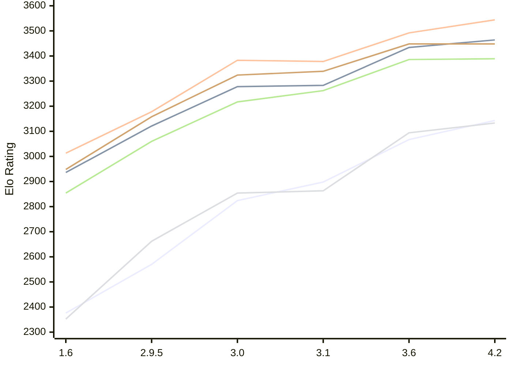

# Engine: Chessenger

Author: Dariusz Domagała

Home: https://github.com/chessengeriadoteu/chessenger

## Elo Ratings E1 (Ultra 7 265T (1.50 GHz) - E-Core)

| Version | Published | STC 8.0+0.08s  | LTC 60.0+0.60s | VLTC 2m24s+1.12s | Comment |
| --- | --- | --- | --- | --- | --- |
| 4.2 | 2026-11-12 | 3143(+76) | 3464(+30) | 3544(+52) |  |
| 3.6 | 2026-11-01 | 3067(+169) | 3434(+151) | 3492(+114) |  |
| 3.1 | 2026-10-21 | 2898(+74) | 3283(+5) | 3378(-5) |  |
| 3.0 | 2026-10-17 | 2824(+254) | 3278(+157) | 3383(+205) |  |
| 2.9.5 | 2026-10-15 | 2570(+194) | 3121(+185) | 3178(+165) |  |
| 1.6 | 2026-10-07 | 2376 | 2936 | 3013 |  |
 | | | cElo (∆ prev) | cElo (∆ prev) | cElo (∆ prev) | 

## Elo Ratings P1 (Ultra 7 265T (1.50 GHz) - P-Core)

| Version | Published | STC 8.0+0.08s  | LTC 60.0+0.60s | VLTC 2m24s+1.12s | Comment |
| --- | --- | --- | --- | --- | --- |
| 4.2 | 2026-11-12 | 3133(+39) | 3389(+3) | 3448(0) |  |
| 3.6 | 2026-11-01 | 3094(+231) | 3386(+124) | 3448(+109) |  |
| 3.1 | 2026-10-21 | 2863(+9) | 3262(+45) | 3339(+15) |  |
| 3.0 | 2026-10-17 | 2854(+192) | 3217(+157) | 3324(+166) |  |
| 2.9.5 | 2026-10-15 | 2662(+310) | 3060(+206) | 3158(+210) |  |
| 1.6 | 2026-10-07 | 2352 | 2854 | 2948 |  |
 | | | cElo (∆ prev) | cElo (∆ prev) | cElo (∆ prev) | 

## Elo Ratings T1 (i5-7500T 2.70GHz)

| Version | Published | STC 8.0+0.08s  | LTC 60.0+0.60s | VLTC 2m24s+1.12s | Comment |
| --- | --- | --- | --- | --- | --- |
| 1.6 | 2026-10-07 | 2352 | 2854 | 2948 |  |
 | | | cElo (∆ prev) | cElo (∆ prev) | cElo (∆ prev) | 

<a href="https://github.com/computer-chess-index/cci/issues/new?template=submit-version.yml&title=[VERSION]+Chessenger+<version>&body=###%20Engine%20name%0AChessenger%0A%0A###%20Version%0A4.2" target="_blank">Submit new version</a>

 Test Conditions:

GUI/CLI: <a href=https://github.com/cutechess/cutechess target="_blank">Cute-Chess</a> 
Elo Calculation: <a href=https://www.remi-coulom.fr/Bayesian-Elo/ target="_blank">Bayesian-Elo</a> 
CPU for P1: Intel(R) Core(TM) Ultra 7 265T (1.50 GHz) - P-Core 
CPU for E1: Intel(R) Core(TM) Ultra 7 265T (1.50 GHz) - E-Core 
CPU for T1: Intel(R) Core(TM) i5-7500T 2.70GHz 
Opening book: 8_moves_v3 
\* STC: 8.0+0.08s, LTC: 60.0+0.60s, VLTC: 2m24s+1.12s

 Lists:
Ratings: <a href=https://github.com/computer-chess-index/cci/blob/main/lists/CCIRatings.csv target="_blank">Complete list</a>

Generated: 2026-11-17 05:37:22

## Ratings Verlauf E1 / P1

## Detailed Evaluation Results

| Version | Time Control | Variant | Elo  | Range +/- | Matches | Score | Average Opponent Elo | Draws |
| --- | --- |--- | --- | --- | --- | --- | --- | --- |
| 4.2 | VLTC (2m24s+1.12s) | E1 | 3544 | 72 | 44 | 51% | 3534 | 84% |
|  |  | P1 | 3448 | 208 | 4 | 50% | 3448 | 100% |
|  | LTC (60.0+0.60s) | E1 | 3464 | 72 | 48 | 47% | 3486 | 69% |
|  |  | P1 | 3389 | 207 | 4 | 50% | 3389 | 100% |
|  | STC (8.0+0.08s) | E1 | 3143 | 75 | 48 | 52% | 3128 | 54% |
|  |  | P1 | 3133 | 98 | 28 | 46% | 3152 | 50% |
| --- | --- |--- | --- | --- | --- | --- | --- | --- |
| 3.6 | VLTC (2m24s+1.12s) | P1 | 3448 | 36 | 184 | 52% | 3430 | 77% |
|  |  | E1 | 3492 | 30 | 276 | 53% | 3474 | 75% |
|  | LTC (60.0+0.60s) | P1 | 3386 | 38 | 172 | 51% | 3376 | 75% |
|  |  | E1 | 3434 | 27 | 330 | 52% | 3418 | 73% |
|  | STC (8.0+0.08s) | P1 | 3094 | 38 | 192 | 51% | 3081 | 54% |
|  |  | E1 | 3067 | 33 | 270 | 52% | 3047 | 51% |
| --- | --- |--- | --- | --- | --- | --- | --- | --- |
| 3.1 | VLTC (2m24s+1.12s) | P1 | 3339 | 29 | 300 | 54% | 3310 | 68% |
|  |  | E1 | 3378 | 29 | 306 | 52% | 3360 | 61% |
|  | LTC (60.0+0.60s) | P1 | 3262 | 34 | 232 | 50% | 3264 | 62% |
|  |  | E1 | 3283 | 34 | 224 | 50% | 3289 | 60% |
|  | STC (8.0+0.08s) | E1 | 2898 | 33 | 284 | 49% | 2903 | 36% |
|  |  | P1 | 2863 | 50 | 116 | 47% | 2890 | 47% |
| --- | --- |--- | --- | --- | --- | --- | --- | --- |
| 3.0 | VLTC (2m24s+1.12s) | P1 | 3324 | 46 | 122 | 50% | 3325 | 68% |
|  |  | E1 | 3383 | 31 | 270 | 50% | 3382 | 64% |
|  | LTC (60.0+0.60s) | P1 | 3217 | 49 | 106 | 56% | 3171 | 69% |
|  |  | E1 | 3278 | 31 | 274 | 49% | 3287 | 64% |
|  | STC (8.0+0.08s) | P1 | 2854 | 52 | 116 | 57% | 2796 | 38% |
|  |  | E1 | 2824 | 41 | 174 | 53% | 2795 | 45% |
| --- | --- |--- | --- | --- | --- | --- | --- | --- |
| 2.9.5 | VLTC (2m24s+1.12s) | P1 | 3158 | 37 | 196 | 52% | 3144 | 61% |
|  |  | E1 | 3178 | 34 | 244 | 50% | 3181 | 48% |
|  | LTC (60.0+0.60s) | P1 | 3060 | 50 | 118 | 54% | 3028 | 45% |
|  |  | E1 | 3121 | 41 | 168 | 51% | 3110 | 50% |
|  | STC (8.0+0.08s) | P1 | 2662 | 41 | 196 | 53% | 2633 | 34% |
|  |  | E1 | 2570 | 37 | 254 | 55% | 2525 | 27% |
| --- | --- |--- | --- | --- | --- | --- | --- | --- |
| 1.6 | VLTC (2m24s+1.12s) | P1 | 2948 | 50 | 130 | 55% | 2884 | 40% |
|  |  | E1 | 3013 | 43 | 168 | 55% | 2944 | 43% |
|  | LTC (60.0+0.60s) | P1 | 2854 | 57 | 116 | 63% | 2592 | 33% |
|  |  | E1 | 2936 | 40 | 218 | 57% | 2790 | 35% |
|  | STC (8.0+0.08s) | P1 | 2352 | 62 | 90 | 43% | 2414 | 24% |
|  |  | E1 | 2376 | 45 | 184 | 57% | 2256 | 23% |