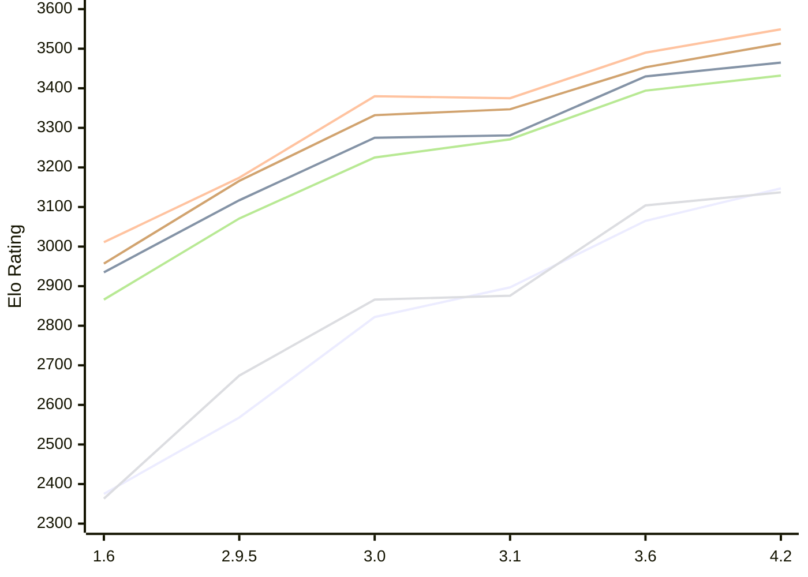

# Engine: Chessenger

Author: Dariusz Domagała

Home: https://github.com/chessengeriadoteu/chessenger

## Elo Ratings E1 (Ultra 7 265T (1.50 GHz) - E-Core)

| Version | Published | STC 8.0+0.08s  | LTC 60.0+0.60s | VLTC 2m24s+1.12s | Comment |
| --- | --- | --- | --- | --- | --- |
| 4.2 | 2026-11-12 | 3147(+82) | 3465(+35) | 3549(+59) |  |
| 3.6 | 2026-11-01 | 3065(+168) | 3430(+149) | 3490(+115) |  |
| 3.1 | 2026-10-21 | 2897(+75) | 3281(+6) | 3375(-5) |  |
| 3.0 | 2026-10-17 | 2822(+254) | 3275(+158) | 3380(+206) |  |
| 2.9.5 | 2026-10-15 | 2568(+193) | 3117(+182) | 3174(+163) |  |
| 1.6 | 2026-10-07 | 2375 | 2935 | 3011 |  |
 | | | cElo (∆ prev) | cElo (∆ prev) | cElo (∆ prev) | 

## Elo Ratings P1 (Ultra 7 265T (1.50 GHz) - P-Core)

| Version | Published | STC 8.0+0.08s  | LTC 60.0+0.60s | VLTC 2m24s+1.12s | Comment |
| --- | --- | --- | --- | --- | --- |
| 4.2 | 2026-11-12 | 3137(+33) | 3432(+38) | 3513(+60) |  |
| 3.6 | 2026-11-01 | 3104(+228) | 3394(+123) | 3453(+106) |  |
| 3.1 | 2026-10-21 | 2876(+10) | 3271(+46) | 3347(+15) |  |
| 3.0 | 2026-10-17 | 2866(+192) | 3225(+154) | 3332(+166) |  |
| 2.9.5 | 2026-10-15 | 2674(+311) | 3071(+205) | 3166(+209) |  |
| 1.6 | 2026-10-07 | 2363 | 2866 | 2957 |  |
 | | | cElo (∆ prev) | cElo (∆ prev) | cElo (∆ prev) | 

## Elo Ratings T1 (i5-7500T 2.70GHz)

| Version | Published | STC 8.0+0.08s  | LTC 60.0+0.60s | VLTC 2m24s+1.12s | Comment |
| --- | --- | --- | --- | --- | --- |
| 1.6 | 2026-10-07 | 2363 | 2866 | 2957 |  |
 | | | cElo (∆ prev) | cElo (∆ prev) | cElo (∆ prev) | 

<a href="https://github.com/computer-chess-index/cci/issues/new?template=submit-version.yml&title=[VERSION]+Chessenger+<version>&body=###%20Engine%20name%0AChessenger%0A%0A###%20Version%0A4.2" target="_blank">Submit new version</a>

 Test Conditions:

GUI/CLI: <a href=https://github.com/cutechess/cutechess target="_blank">Cute-Chess</a> 
Elo Calculation: <a href=https://www.remi-coulom.fr/Bayesian-Elo/ target="_blank">Bayesian-Elo</a> 
CPU for P1: Intel(R) Core(TM) Ultra 7 265T (1.50 GHz) - P-Core 
CPU for E1: Intel(R) Core(TM) Ultra 7 265T (1.50 GHz) - E-Core 
CPU for T1: Intel(R) Core(TM) i5-7500T 2.70GHz 
Opening book: 8_moves_v3 
\* STC: 8.0+0.08s, LTC: 60.0+0.60s, VLTC: 2m24s+1.12s

 Lists:
Ratings: <a href=https://github.com/computer-chess-index/cci/blob/main/lists/CCIRatings.csv target="_blank">Complete list</a>

Generated: 2026-11-20 05:37:15

## Ratings Verlauf E1 / P1

## Detailed Evaluation Results

| Version | Time Control | Variant | Elo  | Range +/- | Matches | Score | Average Opponent Elo | Draws |
| --- | --- |--- | --- | --- | --- | --- | --- | --- |
| 4.2 | VLTC (2m24s+1.12s) | P1 | 3513 | 59 | 68 | 52% | 3499 | 81% |
|  |  | E1 | 3549 | 35 | 190 | 51% | 3542 | 80% |
|  | LTC (60.0+0.60s) | P1 | 3432 | 57 | 72 | 53% | 3416 | 81% |
|  |  | E1 | 3465 | 42 | 132 | 49% | 3471 | 79% |
|  | STC (8.0+0.08s) | E1 | 3147 | 36 | 218 | 52% | 3132 | 52% |
|  |  | P1 | 3137 | 66 | 60 | 48% | 3148 | 60% |
| --- | --- |--- | --- | --- | --- | --- | --- | --- |
| 3.6 | VLTC (2m24s+1.12s) | P1 | 3453 | 36 | 184 | 52% | 3437 | 77% |
|  |  | E1 | 3490 | 30 | 276 | 53% | 3471 | 75% |
|  | LTC (60.0+0.60s) | P1 | 3394 | 38 | 172 | 51% | 3384 | 75% |
|  |  | E1 | 3430 | 27 | 334 | 52% | 3416 | 73% |
|  | STC (8.0+0.08s) | P1 | 3104 | 38 | 192 | 51% | 3090 | 54% |
|  |  | E1 | 3065 | 33 | 270 | 52% | 3044 | 51% |
| --- | --- |--- | --- | --- | --- | --- | --- | --- |
| 3.1 | VLTC (2m24s+1.12s) | P1 | 3347 | 29 | 300 | 54% | 3320 | 68% |
|  |  | E1 | 3375 | 29 | 306 | 52% | 3357 | 61% |
|  | LTC (60.0+0.60s) | P1 | 3271 | 34 | 232 | 50% | 3272 | 62% |
|  |  | E1 | 3281 | 34 | 224 | 50% | 3285 | 60% |
|  | STC (8.0+0.08s) | P1 | 2876 | 50 | 116 | 47% | 2903 | 47% |
|  |  | E1 | 2897 | 33 | 284 | 49% | 2901 | 36% |
| --- | --- |--- | --- | --- | --- | --- | --- | --- |
| 3.0 | VLTC (2m24s+1.12s) | E1 | 3380 | 31 | 270 | 50% | 3379 | 64% |
|  |  | P1 | 3332 | 46 | 122 | 50% | 3333 | 68% |
|  | LTC (60.0+0.60s) | E1 | 3275 | 31 | 274 | 49% | 3285 | 64% |
|  |  | P1 | 3225 | 49 | 106 | 56% | 3179 | 69% |
|  | STC (8.0+0.08s) | P1 | 2866 | 52 | 116 | 57% | 2808 | 38% |
|  |  | E1 | 2822 | 41 | 174 | 53% | 2793 | 45% |
| --- | --- |--- | --- | --- | --- | --- | --- | --- |
| 2.9.5 | VLTC (2m24s+1.12s) | P1 | 3166 | 37 | 196 | 52% | 3154 | 61% |
|  |  | E1 | 3174 | 34 | 244 | 50% | 3177 | 48% |
|  | LTC (60.0+0.60s) | P1 | 3071 | 50 | 118 | 54% | 3039 | 45% |
|  |  | E1 | 3117 | 41 | 168 | 51% | 3106 | 50% |
|  | STC (8.0+0.08s) | P1 | 2674 | 41 | 196 | 53% | 2645 | 34% |
|  |  | E1 | 2568 | 37 | 254 | 55% | 2522 | 27% |
| --- | --- |--- | --- | --- | --- | --- | --- | --- |
| 1.6 | VLTC (2m24s+1.12s) | P1 | 2957 | 50 | 130 | 55% | 2893 | 40% |
|  |  | E1 | 3011 | 43 | 168 | 55% | 2942 | 43% |
|  | LTC (60.0+0.60s) | P1 | 2866 | 57 | 116 | 63% | 2601 | 33% |
|  |  | E1 | 2935 | 40 | 218 | 57% | 2788 | 35% |
|  | STC (8.0+0.08s) | P1 | 2363 | 62 | 90 | 43% | 2426 | 24% |
|  |  | E1 | 2375 | 46 | 184 | 57% | 2253 | 23% |