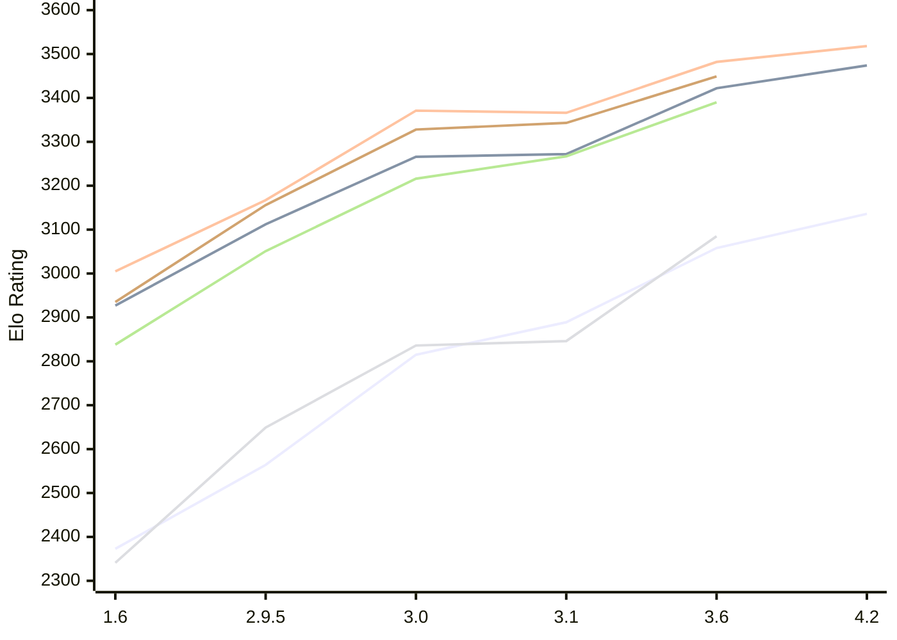

# Engine: Chessenger

Author: Dariusz Domagała

Home: https://github.com/chessengeriadoteu/chessenger

## Elo Ratings E1 (Ultra 7 265T (1.50 GHz) - E-Core)

| Version | Published | STC 8.0+0.08s  | LTC 60.0+0.60s | VLTC 2m24s+1.12s | Comment |
| --- | --- | --- | --- | --- | --- |
| 4.2 | 2026-11-12 | 3136(+78) | 3474(+52) | 3518(+36) |  |
| 3.6 | 2026-11-01 | 3058(+169) | 3422(+150) | 3482(+116) |  |
| 3.1 | 2026-10-21 | 2889(+74) | 3272(+6) | 3366(-5) |  |
| 3.0 | 2026-10-17 | 2815(+251) | 3266(+154) | 3371(+204) |  |
| 2.9.5 | 2026-10-15 | 2564(+191) | 3112(+185) | 3167(+162) |  |
| 1.6 | 2026-10-07 | 2373 | 2927 | 3005 |  |
 | | | cElo (∆ prev) | cElo (∆ prev) | cElo (∆ prev) | 

## Elo Ratings P1 (Ultra 7 265T (1.50 GHz) - P-Core)

| Version | Published | STC 8.0+0.08s  | LTC 60.0+0.60s | VLTC 2m24s+1.12s | Comment |
| --- | --- | --- | --- | --- | --- |
| 3.6 | 2026-11-01 | 3085(+239) | 3390(+123) | 3449(+106) |  |
| 3.1 | 2026-10-21 | 2846(+10) | 3267(+51) | 3343(+15) |  |
| 3.0 | 2026-10-17 | 2836(+187) | 3216(+165) | 3328(+172) |  |
| 2.9.5 | 2026-10-15 | 2649(+308) | 3051(+213) | 3156(+221) |  |
| 1.6 | 2026-10-07 | 2341 | 2838 | 2935 |  |
 | | | cElo (∆ prev) | cElo (∆ prev) | cElo (∆ prev) | 

## Elo Ratings T1 (i5-7500T 2.70GHz)

| Version | Published | STC 8.0+0.08s  | LTC 60.0+0.60s | VLTC 2m24s+1.12s | Comment |
| --- | --- | --- | --- | --- | --- |
| 1.6 | 2026-10-07 | 2341 | 2838 | 2935 |  |
 | | | cElo (∆ prev) | cElo (∆ prev) | cElo (∆ prev) | 

<a href="https://github.com/computer-chess-index/cci/issues/new?template=submit-version.yml&title=[VERSION]+Chessenger+<version>&body=###%20Engine%20name%0AChessenger%0A%0A###%20Version%0A3.6" target="_blank">Submit new version</a>

 Test Conditions:

GUI/CLI: <a href=https://github.com/cutechess/cutechess target="_blank">Cute-Chess</a> 
Elo Calculation: <a href=https://www.remi-coulom.fr/Bayesian-Elo/ target="_blank">Bayesian-Elo</a> 
CPU for P1: Intel(R) Core(TM) Ultra 7 265T (1.50 GHz) - P-Core 
CPU for E1: Intel(R) Core(TM) Ultra 7 265T (1.50 GHz) - E-Core 
CPU for T1: Intel(R) Core(TM) i5-7500T 2.70GHz 
Opening book: 8_moves_v3 
\* STC: 8.0+0.08s, LTC: 60.0+0.60s, VLTC: 2m24s+1.12s

 Lists:
Ratings: <a href=https://github.com/computer-chess-index/cci/blob/main/lists/CCIRatings.csv target="_blank">Complete list</a>

Generated: 2026-11-15 05:37:14

## Ratings Verlauf E1 / P1

## Detailed Evaluation Results

| Version | Time Control | Variant | Elo  | Range +/- | Matches | Score | Average Opponent Elo | Draws |
| --- | --- |--- | --- | --- | --- | --- | --- | --- |
| 4.2 | VLTC (2m24s+1.12s) | E1 | 3518 | 159 | 8 | 56% | 3482 | 88% |
|  | LTC (60.0+0.60s) | E1 | 3474 | 109 | 20 | 50% | 3475 | 70% |
|  | STC (8.0+0.08s) | P1 | 3174 | 247 | 4 | 63% | 3085 | 25% |
|  |  | E1 | 3136 | 119 | 20 | 55% | 3102 | 40% |
| --- | --- |--- | --- | --- | --- | --- | --- | --- |
| 3.6 | VLTC (2m24s+1.12s) | P1 | 3449 | 37 | 180 | 53% | 3430 | 77% |
|  |  | E1 | 3482 | 30 | 268 | 53% | 3461 | 75% |
|  | LTC (60.0+0.60s) | P1 | 3390 | 38 | 172 | 51% | 3380 | 75% |
|  |  | E1 | 3422 | 28 | 318 | 52% | 3406 | 74% |
|  | STC (8.0+0.08s) | P1 | 3085 | 38 | 188 | 51% | 3075 | 54% |
|  |  | E1 | 3058 | 33 | 266 | 52% | 3038 | 51% |
| --- | --- |--- | --- | --- | --- | --- | --- | --- |
| 3.1 | VLTC (2m24s+1.12s) | P1 | 3343 | 29 | 300 | 54% | 3316 | 68% |
|  |  | E1 | 3366 | 29 | 306 | 52% | 3348 | 61% |
|  | LTC (60.0+0.60s) | P1 | 3267 | 34 | 232 | 50% | 3268 | 62% |
|  |  | E1 | 3272 | 34 | 224 | 50% | 3276 | 60% |
|  | STC (8.0+0.08s) | P1 | 2846 | 50 | 116 | 47% | 2871 | 47% |
|  |  | E1 | 2889 | 33 | 284 | 49% | 2893 | 36% |
| --- | --- |--- | --- | --- | --- | --- | --- | --- |
| 3.0 | VLTC (2m24s+1.12s) | E1 | 3371 | 31 | 270 | 50% | 3370 | 64% |
|  |  | P1 | 3328 | 46 | 122 | 50% | 3329 | 68% |
|  | LTC (60.0+0.60s) | E1 | 3266 | 31 | 274 | 49% | 3276 | 64% |
|  |  | P1 | 3216 | 49 | 106 | 56% | 3170 | 69% |
|  | STC (8.0+0.08s) | E1 | 2815 | 41 | 174 | 53% | 2786 | 45% |
|  |  | P1 | 2836 | 52 | 116 | 57% | 2778 | 38% |
| --- | --- |--- | --- | --- | --- | --- | --- | --- |
| 2.9.5 | VLTC (2m24s+1.12s) | P1 | 3156 | 37 | 196 | 52% | 3143 | 61% |
|  |  | E1 | 3167 | 34 | 244 | 50% | 3170 | 48% |
|  | LTC (60.0+0.60s) | P1 | 3051 | 50 | 118 | 54% | 3019 | 45% |
|  |  | E1 | 3112 | 41 | 168 | 51% | 3101 | 50% |
|  | STC (8.0+0.08s) | P1 | 2649 | 41 | 196 | 53% | 2619 | 34% |
|  |  | E1 | 2564 | 37 | 254 | 55% | 2518 | 27% |
| --- | --- |--- | --- | --- | --- | --- | --- | --- |
| 1.6 | VLTC (2m24s+1.12s) | P1 | 2935 | 50 | 130 | 55% | 2871 | 40% |
|  |  | E1 | 3005 | 43 | 168 | 55% | 2938 | 43% |
|  | LTC (60.0+0.60s) | P1 | 2838 | 57 | 116 | 63% | 2577 | 33% |
|  |  | E1 | 2927 | 40 | 218 | 57% | 2782 | 35% |
|  | STC (8.0+0.08s) | P1 | 2341 | 62 | 90 | 43% | 2404 | 24% |
|  |  | E1 | 2373 | 45 | 184 | 57% | 2253 | 23% |