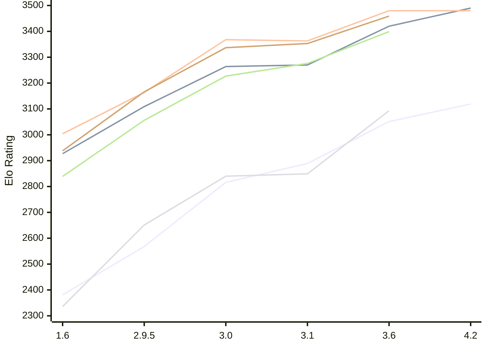

# Engine: Chessenger

Author: Dariusz Domagała

Home: https://github.com/chessengeriadoteu/chessenger

## Elo Ratings E1 (Ultra 7 265T (1.50 GHz) - E-Core)

| Version | Published | STC 8.0+0.08s  | LTC 60.0+0.60s | VLTC 2m24s+1.12s | Comment |
| --- | --- | --- | --- | --- | --- |
| 4.2 | 2026-11-12 | 3119(+68) | 3490(+70) | 3480(0) |  |
| 3.6 | 2026-11-01 | 3051(+162) | 3420(+150) | 3480(+117) |  |
| 3.1 | 2026-10-21 | 2889(+73) | 3270(+6) | 3363(-5) |  |
| 3.0 | 2026-10-17 | 2816(+248) | 3264(+155) | 3368(+204) |  |
| 2.9.5 | 2026-10-15 | 2568(+187) | 3109(+182) | 3164(+160) |  |
| 1.6 | 2026-10-07 | 2381 | 2927 | 3004 |  |
 | | | cElo (∆ prev) | cElo (∆ prev) | cElo (∆ prev) | 

## Elo Ratings P1 (Ultra 7 265T (1.50 GHz) - P-Core)

| Version | Published | STC 8.0+0.08s  | LTC 60.0+0.60s | VLTC 2m24s+1.12s | Comment |
| --- | --- | --- | --- | --- | --- |
| 3.6 | 2026-11-01 | 3093(+244) | 3399(+123) | 3459(+106) |  |
| 3.1 | 2026-10-21 | 2849(+9) | 3276(+49) | 3353(+16) |  |
| 3.0 | 2026-10-17 | 2840(+189) | 3227(+171) | 3337(+171) |  |
| 2.9.5 | 2026-10-15 | 2651(+315) | 3056(+217) | 3166(+228) |  |
| 1.6 | 2026-10-07 | 2336 | 2839 | 2938 |  |
 | | | cElo (∆ prev) | cElo (∆ prev) | cElo (∆ prev) | 

## Elo Ratings T1 (i5-7500T 2.70GHz)

| Version | Published | STC 8.0+0.08s  | LTC 60.0+0.60s | VLTC 2m24s+1.12s | Comment |
| --- | --- | --- | --- | --- | --- |
| 1.6 | 2026-10-07 | 2336 | 2839 | 2938 |  |
 | | | cElo (∆ prev) | cElo (∆ prev) | cElo (∆ prev) | 

<a href="https://github.com/computer-chess-index/cci/issues/new?template=submit-version.yml&title=[VERSION]+Chessenger+<version>&body=###%20Engine%20name%0AChessenger%0A%0A###%20Version%0A3.6" target="_blank">Submit new version</a>

 Test Conditions:

GUI/CLI: <a href=https://github.com/cutechess/cutechess target="_blank">Cute-Chess</a> 
Elo Calculation: <a href=https://www.remi-coulom.fr/Bayesian-Elo/ target="_blank">Bayesian-Elo</a> 
CPU for P1: Intel(R) Core(TM) Ultra 7 265T (1.50 GHz) - P-Core 
CPU for E1: Intel(R) Core(TM) Ultra 7 265T (1.50 GHz) - E-Core 
CPU for T1: Intel(R) Core(TM) i5-7500T 2.70GHz 
Opening book: 8_moves_v3 
\* STC: 8.0+0.08s, LTC: 60.0+0.60s, VLTC: 2m24s+1.12s

 Lists:
Ratings: <a href=https://github.com/computer-chess-index/cci/blob/main/lists/CCIRatings.csv target="_blank">Complete list</a>

Generated: 2026-11-14 05:37:09

## Ratings Verlauf E1 / P1

## Detailed Evaluation Results

| Version | Time Control | Variant | Elo  | Range +/- | Matches | Score | Average Opponent Elo | Draws |
| --- | --- |--- | --- | --- | --- | --- | --- | --- |
| 4.2 | VLTC (2m24s+1.12s) | E1 | 3480 | 208 | 4 | 50% | 3480 | 100% |
|  | LTC (60.0+0.60s) | E1 | 3490 | 219 | 4 | 63% | 3420 | 75% |
|  | STC (8.0+0.08s) | P1 | 3183 | 247 | 4 | 63% | 3094 | 25% |
|  |  | E1 | 3119 | 176 | 8 | 63% | 3039 | 50% |
| --- | --- |--- | --- | --- | --- | --- | --- | --- |
| 3.6 | VLTC (2m24s+1.12s) | E1 | 3480 | 30 | 264 | 53% | 3459 | 75% |
|  |  | P1 | 3459 | 37 | 180 | 53% | 3440 | 77% |
|  | LTC (60.0+0.60s) | E1 | 3420 | 28 | 314 | 52% | 3402 | 74% |
|  |  | P1 | 3399 | 38 | 172 | 51% | 3390 | 75% |
|  | STC (8.0+0.08s) | E1 | 3051 | 33 | 254 | 52% | 3033 | 51% |
|  |  | P1 | 3093 | 38 | 188 | 51% | 3085 | 54% |
| --- | --- |--- | --- | --- | --- | --- | --- | --- |
| 3.1 | VLTC (2m24s+1.12s) | P1 | 3353 | 29 | 300 | 54% | 3325 | 68% |
|  |  | E1 | 3363 | 29 | 306 | 52% | 3345 | 61% |
|  | LTC (60.0+0.60s) | P1 | 3276 | 34 | 232 | 50% | 3279 | 62% |
|  |  | E1 | 3270 | 34 | 224 | 50% | 3274 | 60% |
|  | STC (8.0+0.08s) | P1 | 2849 | 50 | 116 | 47% | 2874 | 47% |
|  |  | E1 | 2889 | 33 | 284 | 49% | 2893 | 36% |
| --- | --- |--- | --- | --- | --- | --- | --- | --- |
| 3.0 | VLTC (2m24s+1.12s) | P1 | 3337 | 46 | 122 | 50% | 3339 | 68% |
|  |  | E1 | 3368 | 31 | 270 | 50% | 3367 | 64% |
|  | LTC (60.0+0.60s) | P1 | 3227 | 49 | 106 | 56% | 3181 | 69% |
|  |  | E1 | 3264 | 31 | 274 | 49% | 3274 | 64% |
|  | STC (8.0+0.08s) | P1 | 2840 | 52 | 116 | 57% | 2781 | 38% |
|  |  | E1 | 2816 | 41 | 174 | 53% | 2786 | 45% |
| --- | --- |--- | --- | --- | --- | --- | --- | --- |
| 2.9.5 | VLTC (2m24s+1.12s) | E1 | 3164 | 34 | 244 | 50% | 3167 | 48% |
|  |  | P1 | 3166 | 37 | 196 | 52% | 3152 | 61% |
|  | LTC (60.0+0.60s) | E1 | 3109 | 41 | 168 | 51% | 3098 | 50% |
|  |  | P1 | 3056 | 50 | 118 | 54% | 3024 | 45% |
|  | STC (8.0+0.08s) | P1 | 2651 | 41 | 196 | 53% | 2620 | 34% |
|  |  | E1 | 2568 | 36 | 254 | 55% | 2522 | 27% |
| --- | --- |--- | --- | --- | --- | --- | --- | --- |
| 1.6 | VLTC (2m24s+1.12s) | E1 | 3004 | 43 | 168 | 55% | 2936 | 43% |
|  |  | P1 | 2938 | 50 | 130 | 55% | 2873 | 40% |
|  | LTC (60.0+0.60s) | E1 | 2927 | 40 | 218 | 57% | 2784 | 35% |
|  |  | P1 | 2839 | 57 | 116 | 63% | 2579 | 33% |
|  | STC (8.0+0.08s) | E1 | 2381 | 45 | 184 | 57% | 2261 | 23% |
|  |  | P1 | 2336 | 62 | 90 | 43% | 2399 | 24% |