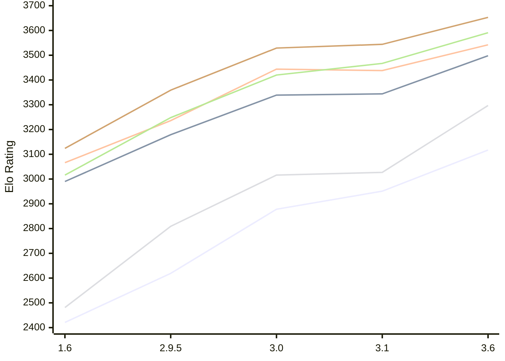

# Engine: Chessenger

Author: Dariusz Domagała

Home: https://github.com/chessengeriadoteu/chessenger

## Elo Ratings E1 (Ultra 7 265T (1.50 GHz) - E-Core)

| Version | Published | STC 8.0+0.08s  | LTC 60.0+0.60s | VLTC 2m24s+1.12s | Comment |
| --- | --- | --- | --- | --- | --- |
| 3.6 | 2026-11-01 | 3117(+166) | 3498(+154) | 3542(+104) |  |
| 3.1 | 2026-10-21 | 2951(+73) | 3344(+5) | 3438(-6) |  |
| 3.0 | 2026-10-17 | 2878(+259) | 3339(+160) | 3444(+208) |  |
| 2.9.5 | 2026-10-15 | 2619(+198) | 3179(+189) | 3236(+170) |  |
| 1.6 | 2026-10-07 | 2421 | 2990 | 3066 |  |
 | | | cElo (∆ prev) | cElo (∆ prev) | cElo (∆ prev) | 

## Elo Ratings P1 (Ultra 7 265T (1.50 GHz) - P-Core)

| Version | Published | STC 8.0+0.08s  | LTC 60.0+0.60s | VLTC 2m24s+1.12s | Comment |
| --- | --- | --- | --- | --- | --- |
| 3.6 | 2026-11-01 | 3297(+270) | 3591(+124) | 3653(+109) |  |
| 3.1 | 2026-10-21 | 3027(+11) | 3467(+47) | 3544(+15) |  |
| 3.0 | 2026-10-17 | 3016(+207) | 3420(+172) | 3529(+170) |  |
| 2.9.5 | 2026-10-15 | 2809(+328) | 3248(+232) | 3359(+235) |  |
| 1.6 | 2026-10-07 | 2481 | 3016 | 3124 |  |
 | | | cElo (∆ prev) | cElo (∆ prev) | cElo (∆ prev) | 

## Elo Ratings T1 (i5-7500T 2.70GHz)

| Version | Published | STC 8.0+0.08s  | LTC 60.0+0.60s | VLTC 2m24s+1.12s | Comment |
| --- | --- | --- | --- | --- | --- |
| 1.6 | 2026-10-07 | 2481 | 3016 | 3124 |  |
 | | | cElo (∆ prev) | cElo (∆ prev) | cElo (∆ prev) | 

<a href="https://github.com/computer-chess-index/cci/issues/new?template=submit-version.yml&title=[VERSION]+Chessenger+<version>&body=###%20Engine%20name%0AChessenger%0A%0A###%20Version%0A3.6" target="_blank">Submit new version</a>

 Test Conditions:

GUI/CLI: <a href=https://github.com/cutechess/cutechess target="_blank">Cute-Chess</a> 
Elo Calculation: <a href=https://www.remi-coulom.fr/Bayesian-Elo/ target="_blank">Bayesian-Elo</a> 
CPU for P1: Intel(R) Core(TM) Ultra 7 265T (1.50 GHz) - P-Core 
CPU for E1: Intel(R) Core(TM) Ultra 7 265T (1.50 GHz) - E-Core 
CPU for T1: Intel(R) Core(TM) i5-7500T 2.70GHz 
Opening book: 8_moves_v3 
\* STC: 8.0+0.08s, LTC: 60.0+0.60s, VLTC: 2m24s+1.12s

 Lists:
Ratings: <a href=https://github.com/computer-chess-index/cci/blob/main/lists/CCIRatings.csv target="_blank">Complete list</a>

Generated: 2026-11-08 05:37:01

## Ratings Verlauf E1 / P1

## Detailed Evaluation Results

| Version | Time Control | Variant | Elo  | Range +/- | Matches | Score | Average Opponent Elo | Draws |
| --- | --- |--- | --- | --- | --- | --- | --- | --- |
| 3.6 | VLTC (2m24s+1.12s) | P1 | 3653 | 37 | 172 | 53% | 3633 | 77% |
|  |  | E1 | 3542 | 34 | 208 | 53% | 3525 | 75% |
|  | LTC (60.0+0.60s) | P1 | 3591 | 42 | 140 | 52% | 3576 | 76% |
|  |  | E1 | 3498 | 29 | 288 | 53% | 3474 | 75% |
|  | STC (8.0+0.08s) | P1 | 3297 | 47 | 122 | 52% | 3279 | 61% |
|  |  | E1 | 3117 | 36 | 218 | 53% | 3096 | 50% |
| --- | --- |--- | --- | --- | --- | --- | --- | --- |
| 3.1 | VLTC (2m24s+1.12s) | P1 | 3544 | 29 | 300 | 54% | 3517 | 68% |
|  |  | E1 | 3438 | 29 | 306 | 52% | 3421 | 61% |
|  | LTC (60.0+0.60s) | P1 | 3467 | 34 | 228 | 50% | 3468 | 62% |
|  |  | E1 | 3344 | 34 | 224 | 50% | 3348 | 60% |
|  | STC (8.0+0.08s) | P1 | 3027 | 51 | 112 | 49% | 3038 | 47% |
|  |  | E1 | 2951 | 34 | 276 | 49% | 2958 | 36% |
| --- | --- |--- | --- | --- | --- | --- | --- | --- |
| 3.0 | VLTC (2m24s+1.12s) | E1 | 3444 | 31 | 270 | 50% | 3443 | 64% |
|  |  | P1 | 3529 | 46 | 122 | 50% | 3530 | 68% |
|  | LTC (60.0+0.60s) | E1 | 3339 | 31 | 274 | 49% | 3348 | 64% |
|  |  | P1 | 3420 | 49 | 106 | 56% | 3372 | 69% |
|  | STC (8.0+0.08s) | E1 | 2878 | 41 | 174 | 53% | 2849 | 45% |
|  |  | P1 | 3016 | 52 | 116 | 57% | 2958 | 38% |
| --- | --- |--- | --- | --- | --- | --- | --- | --- |
| 2.9.5 | VLTC (2m24s+1.12s) | P1 | 3359 | 37 | 196 | 52% | 3347 | 61% |
|  |  | E1 | 3236 | 34 | 244 | 50% | 3239 | 48% |
|  | LTC (60.0+0.60s) | P1 | 3248 | 50 | 118 | 54% | 3216 | 45% |
|  |  | E1 | 3179 | 41 | 168 | 51% | 3168 | 50% |
|  | STC (8.0+0.08s) | P1 | 2809 | 41 | 196 | 53% | 2780 | 34% |
|  |  | E1 | 2619 | 36 | 254 | 55% | 2573 | 27% |
| --- | --- |--- | --- | --- | --- | --- | --- | --- |
| 1.6 | VLTC (2m24s+1.12s) | P1 | 3124 | 50 | 130 | 55% | 3056 | 40% |
|  |  | E1 | 3066 | 43 | 168 | 55% | 2997 | 43% |
|  | LTC (60.0+0.60s) | P1 | 3016 | 57 | 116 | 63% | 2732 | 33% |
|  |  | E1 | 2990 | 40 | 218 | 57% | 2843 | 35% |
|  | STC (8.0+0.08s) | P1 | 2481 | 62 | 90 | 43% | 2545 | 24% |
|  |  | E1 | 2421 | 46 | 184 | 57% | 2298 | 23% |