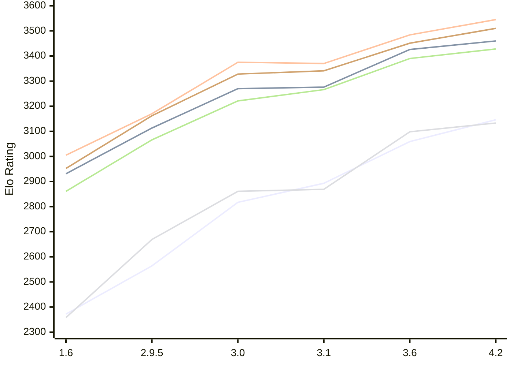

# Engine: Chessenger

Author: Dariusz Domagała

Home: https://github.com/chessengeriadoteu/chessenger

## Elo Ratings E1 (Ultra 7 265T (1.50 GHz) - E-Core)

| Version | Published | STC 8.0+0.08s  | LTC 60.0+0.60s | VLTC 2m24s+1.12s | Comment |
| --- | --- | --- | --- | --- | --- |
| 4.2 | 2026-11-12 | 3146(+87) | 3460(+34) | 3545(+61) |  |
| 3.6 | 2026-11-01 | 3059(+166) | 3426(+150) | 3484(+114) |  |
| 3.1 | 2026-10-21 | 2893(+76) | 3276(+6) | 3370(-5) |  |
| 3.0 | 2026-10-17 | 2817(+253) | 3270(+157) | 3375(+205) |  |
| 2.9.5 | 2026-10-15 | 2564(+192) | 3113(+182) | 3170(+165) |  |
| 1.6 | 2026-10-07 | 2372 | 2931 | 3005 |  |
 | | | cElo (∆ prev) | cElo (∆ prev) | cElo (∆ prev) | 

## Elo Ratings P1 (Ultra 7 265T (1.50 GHz) - P-Core)

| Version | Published | STC 8.0+0.08s  | LTC 60.0+0.60s | VLTC 2m24s+1.12s | Comment |
| --- | --- | --- | --- | --- | --- |
| 4.2 | 2026-11-12 | 3133(+35) | 3428(+38) | 3510(+59) |  |
| 3.6 | 2026-11-01 | 3098(+229) | 3390(+124) | 3451(+110) |  |
| 3.1 | 2026-10-21 | 2869(+8) | 3266(+45) | 3341(+13) |  |
| 3.0 | 2026-10-17 | 2861(+192) | 3221(+155) | 3328(+166) |  |
| 2.9.5 | 2026-10-15 | 2669(+311) | 3066(+205) | 3162(+210) |  |
| 1.6 | 2026-10-07 | 2358 | 2861 | 2952 |  |
 | | | cElo (∆ prev) | cElo (∆ prev) | cElo (∆ prev) | 

## Elo Ratings T1 (i5-7500T 2.70GHz)

| Version | Published | STC 8.0+0.08s  | LTC 60.0+0.60s | VLTC 2m24s+1.12s | Comment |
| --- | --- | --- | --- | --- | --- |
| 1.6 | 2026-10-07 | 2358 | 2861 | 2952 |  |
 | | | cElo (∆ prev) | cElo (∆ prev) | cElo (∆ prev) | 

<a href="https://github.com/computer-chess-index/cci/issues/new?template=submit-version.yml&title=[VERSION]+Chessenger+<version>&body=###%20Engine%20name%0AChessenger%0A%0A###%20Version%0A4.2" target="_blank">Submit new version</a>

 Test Conditions:

GUI/CLI: <a href=https://github.com/cutechess/cutechess target="_blank">Cute-Chess</a> 
Elo Calculation: <a href=https://www.remi-coulom.fr/Bayesian-Elo/ target="_blank">Bayesian-Elo</a> 
CPU for P1: Intel(R) Core(TM) Ultra 7 265T (1.50 GHz) - P-Core 
CPU for E1: Intel(R) Core(TM) Ultra 7 265T (1.50 GHz) - E-Core 
CPU for T1: Intel(R) Core(TM) i5-7500T 2.70GHz 
Opening book: 8_moves_v3 
\* STC: 8.0+0.08s, LTC: 60.0+0.60s, VLTC: 2m24s+1.12s

 Lists:
Ratings: <a href=https://github.com/computer-chess-index/cci/blob/main/lists/CCIRatings.csv target="_blank">Complete list</a>

Generated: 2026-11-19 05:37:18

## Ratings Verlauf E1 / P1

## Detailed Evaluation Results

| Version | Time Control | Variant | Elo  | Range +/- | Matches | Score | Average Opponent Elo | Draws |
| --- | --- |--- | --- | --- | --- | --- | --- | --- |
| 4.2 | VLTC (2m24s+1.12s) | P1 | 3510 | 69 | 48 | 53% | 3488 | 85% |
|  |  | E1 | 3545 | 36 | 188 | 51% | 3537 | 80% |
|  | LTC (60.0+0.60s) | P1 | 3428 | 57 | 72 | 53% | 3411 | 81% |
|  |  | E1 | 3460 | 43 | 128 | 49% | 3465 | 78% |
|  | STC (8.0+0.08s) | P1 | 3133 | 66 | 60 | 48% | 3143 | 60% |
|  |  | E1 | 3146 | 39 | 184 | 53% | 3123 | 52% |
| --- | --- |--- | --- | --- | --- | --- | --- | --- |
| 3.6 | VLTC (2m24s+1.12s) | P1 | 3451 | 36 | 184 | 52% | 3433 | 77% |
|  |  | E1 | 3484 | 30 | 276 | 53% | 3465 | 75% |
|  | LTC (60.0+0.60s) | P1 | 3390 | 38 | 172 | 51% | 3379 | 75% |
|  |  | E1 | 3426 | 27 | 334 | 52% | 3410 | 73% |
|  | STC (8.0+0.08s) | E1 | 3059 | 33 | 270 | 52% | 3039 | 51% |
|  |  | P1 | 3098 | 38 | 192 | 51% | 3086 | 54% |
| --- | --- |--- | --- | --- | --- | --- | --- | --- |
| 3.1 | VLTC (2m24s+1.12s) | P1 | 3341 | 29 | 300 | 54% | 3314 | 68% |
|  |  | E1 | 3370 | 29 | 306 | 52% | 3352 | 61% |
|  | LTC (60.0+0.60s) | P1 | 3266 | 34 | 232 | 50% | 3268 | 62% |
|  |  | E1 | 3276 | 34 | 224 | 50% | 3281 | 60% |
|  | STC (8.0+0.08s) | P1 | 2869 | 50 | 116 | 47% | 2897 | 47% |
|  |  | E1 | 2893 | 33 | 284 | 49% | 2897 | 36% |
| --- | --- |--- | --- | --- | --- | --- | --- | --- |
| 3.0 | VLTC (2m24s+1.12s) | P1 | 3328 | 46 | 122 | 50% | 3329 | 68% |
|  |  | E1 | 3375 | 31 | 270 | 50% | 3374 | 64% |
|  | LTC (60.0+0.60s) | P1 | 3221 | 49 | 106 | 56% | 3175 | 69% |
|  |  | E1 | 3270 | 31 | 274 | 49% | 3281 | 64% |
|  | STC (8.0+0.08s) | P1 | 2861 | 52 | 116 | 57% | 2803 | 38% |
|  |  | E1 | 2817 | 41 | 174 | 53% | 2788 | 45% |
| --- | --- |--- | --- | --- | --- | --- | --- | --- |
| 2.9.5 | VLTC (2m24s+1.12s) | P1 | 3162 | 37 | 196 | 52% | 3148 | 61% |
|  |  | E1 | 3170 | 34 | 244 | 50% | 3173 | 48% |
|  | LTC (60.0+0.60s) | E1 | 3113 | 41 | 168 | 51% | 3102 | 50% |
|  |  | P1 | 3066 | 50 | 118 | 54% | 3033 | 45% |
|  | STC (8.0+0.08s) | E1 | 2564 | 37 | 254 | 55% | 2518 | 27% |
|  |  | P1 | 2669 | 41 | 196 | 53% | 2639 | 34% |
| --- | --- |--- | --- | --- | --- | --- | --- | --- |
| 1.6 | VLTC (2m24s+1.12s) | P1 | 2952 | 50 | 130 | 55% | 2888 | 40% |
|  |  | E1 | 3005 | 43 | 168 | 55% | 2938 | 43% |
|  | LTC (60.0+0.60s) | P1 | 2861 | 57 | 116 | 63% | 2596 | 33% |
|  |  | E1 | 2931 | 40 | 218 | 57% | 2784 | 35% |
|  | STC (8.0+0.08s) | E1 | 2372 | 45 | 184 | 57% | 2250 | 23% |
|  |  | P1 | 2358 | 62 | 90 | 43% | 2422 | 24% |