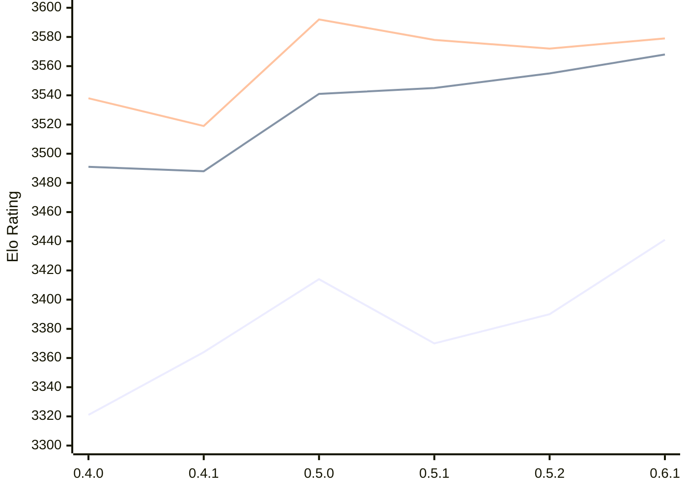

# Engine: Cinder

Author: Bruno Dutra

Home: https://github.com/brunocodutra/cinder

## Elo Ratings E1 (Ultra 7 265T (1.50 GHz) - E-Core)

| Version | Published | STC 8.0+0.08s  | LTC 60.0+0.60s | VLTC 2m24s+1.12s | Comment |
| --- | --- | --- | --- | --- | --- |
| 0.6.1 | 2026-08-16 | 3474 | 3675 | 3706 |  |
 | | | cElo (∆ prev) | cElo (∆ prev) | cElo (∆ prev) | 

## Elo Ratings P1 (Ultra 7 265T (1.50 GHz) - P-Core)

| Version | Published | STC 8.0+0.08s  | LTC 60.0+0.60s | VLTC 2m24s+1.12s | Comment |
| --- | --- | --- | --- | --- | --- |
| 0.6.1 | 2026-08-16 | 3578 | 3726 | 3735 |  |
 | | | cElo (∆ prev) | cElo (∆ prev) | cElo (∆ prev) | 

## Elo Ratings T1 (i5-7500T 2.70GHz)

| Version | Published | STC 8.0+0.08s  | LTC 60.0+0.60s | VLTC 2m24s+1.12s | Comment |
| --- | --- | --- | --- | --- | --- |
| 0.6.1 | 2026-08-16 | 3441(+51) | 3568(+13) | 3579(+7) |  |
| 0.5.2 | 2026-07-12 | 3390(+20) | 3555(+10) | 3572(-6) |  |
| 0.5.1 | 2026-07-08 | 3370(-44) | 3545(+4) | 3578(-14) |  |
| 0.5.0 | 2026-07-04 | 3414(+50) | 3541(+53) | 3592(+73) |  |
| 0.4.1 | 2025-12-05 | 3364(+43) | 3488(-3) | 3519(-19) |  |
| 0.4.0 | 2025-12-04 | 3321 | 3491 | 3538 |  |
 | | | cElo (∆ prev) | cElo (∆ prev) | cElo (∆ prev) | 

<a href="https://github.com/computer-chess-index/cci/issues/new?template=submit-version.yml&title=[VERSION]+Cinder+<version>&body=###%20Engine%20name%0ACinder%0A%0A###%20Version%0A0.6.1" target="_blank">Submit new version</a>

 Test Conditions:

GUI/CLI: <a href=https://github.com/cutechess/cutechess target="_blank">Cute-Chess</a> 
Elo Calculation: <a href=https://www.remi-coulom.fr/Bayesian-Elo/ target="_blank">Bayesian-Elo</a> 
CPU for P1: Intel(R) Core(TM) Ultra 7 265T (1.50 GHz) - P-Core 
CPU for E1: Intel(R) Core(TM) Ultra 7 265T (1.50 GHz) - E-Core 
CPU for T1: Intel(R) Core(TM) i5-7500T 2.70GHz 
Opening book: 8_moves_v3 
\* STC: 8.0+0.08s, LTC: 60.0+0.60s, VLTC: 2m24s+1.12s

 Lists:
Ratings: <a href=https://github.com/computer-chess-index/cci/blob/main/lists/CCIRatings.csv target="_blank">Complete list</a>

Generated: 2026-10-23 04:37:25

## Ratings Verlauf T1

## Detailed Evaluation Results

| Version | Time Control | Variant | Elo  | Range +/- | Matches | Score | Average Opponent Elo | Draws |
| --- | --- |--- | --- | --- | --- | --- | --- | --- |
| 0.6.1 | VLTC (2m24s+1.12s) | T1 | 3579 | 32 | 220 | 51% | 3573 | 92% |
|  |  | P1 | 3735 | 42 | 126 | 50% | 3733 | 90% |
|  |  | E1 | 3706 | 37 | 166 | 51% | 3699 | 89% |
|  | LTC (60.0+0.60s) | T1 | 3568 | 29 | 276 | 51% | 3563 | 88% |
|  |  | P1 | 3726 | 44 | 116 | 51% | 3721 | 91% |
|  |  | E1 | 3675 | 33 | 214 | 49% | 3679 | 86% |
|  | STC (8.0+0.08s) | T1 | 3441 | 27 | 330 | 50% | 3443 | 76% |
|  |  | P1 | 3578 | 37 | 172 | 51% | 3571 | 83% |
|  |  | E1 | 3474 | 28 | 316 | 48% | 3484 | 72% |
| --- | --- |--- | --- | --- | --- | --- | --- | --- |
| 0.5.2 | VLTC (2m24s+1.12s) | T1 | 3572 | 29 | 264 | 50% | 3572 | 91% |
|  | LTC (60.0+0.60s) | T1 | 3555 | 25 | 354 | 51% | 3549 | 91% |
|  | STC (8.0+0.08s) | T1 | 3390 | 27 | 322 | 49% | 3399 | 83% |
| --- | --- |--- | --- | --- | --- | --- | --- | --- |
| 0.5.1 | VLTC (2m24s+1.12s) | T1 | 3578 | 39 | 152 | 49% | 3584 | 89% |
|  | LTC (60.0+0.60s) | T1 | 3545 | 43 | 120 | 50% | 3545 | 93% |
|  | STC (8.0+0.08s) | T1 | 3370 | 44 | 124 | 49% | 3378 | 78% |
| --- | --- |--- | --- | --- | --- | --- | --- | --- |
| 0.5.0 | VLTC (2m24s+1.12s) | T1 | 3592 | 44 | 118 | 50% | 3588 | 89% |
|  | LTC (60.0+0.60s) | T1 | 3541 | 44 | 120 | 52% | 3530 | 85% |
|  | STC (8.0+0.08s) | T1 | 3414 | 35 | 192 | 48% | 3426 | 80% |
| --- | --- |--- | --- | --- | --- | --- | --- | --- |
| 0.4.1 | VLTC (2m24s+1.12s) | T1 | 3519 | 23 | 424 | 50% | 3518 | 86% |
|  | LTC (60.0+0.60s) | T1 | 3488 | 25 | 368 | 50% | 3488 | 86% |
|  | STC (8.0+0.08s) | T1 | 3364 | 21 | 564 | 49% | 3371 | 70% |
| --- | --- |--- | --- | --- | --- | --- | --- | --- |
| 0.4.0 | VLTC (2m24s+1.12s) | T1 | 3538 | 43 | 128 | 54% | 3503 | 82% |
|  | LTC (60.0+0.60s) | T1 | 3491 | 50 | 108 | 56% | 3386 | 71% |
|  | STC (8.0+0.08s) | T1 | 3321 | 68 | 72 | 65% | 3073 | 51% |