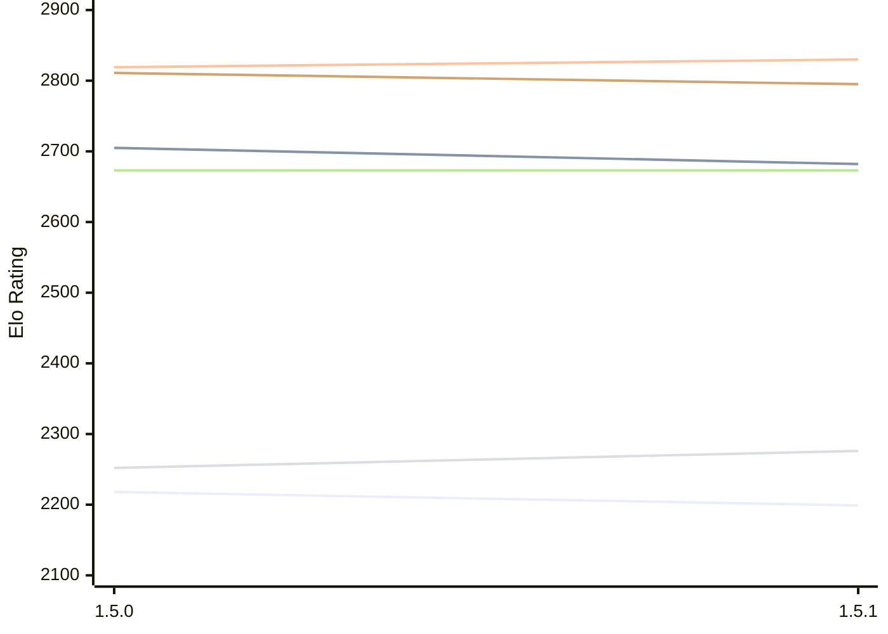
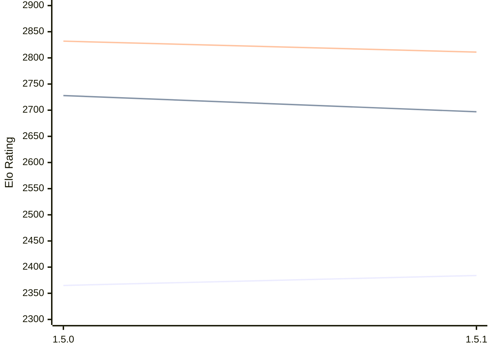

# Engine: Coco

Author: 

Home: https://github.com/NotKaede-11/Coco-Engine

## Elo Ratings E1 (Ultra 7 265T (1.50 GHz) - E-Core)

| Version | Published | STC 8.0+0.08s  | LTC 60.0+0.60s | VLTC 2m24s+1.12s | Comment |
| --- | --- | --- | --- | --- | --- |
| 1.5.1 | 2026-09-27 | 2199(-19) | 2682(-23) | 2830(+11) |  |
| 1.5.0 | 2026-09-14 | 2218 | 2705 | 2819 |  |
 | | | cElo (∆ prev) | cElo (∆ prev) | cElo (∆ prev) | 

## Elo Ratings P1 (Ultra 7 265T (1.50 GHz) - P-Core)

| Version | Published | STC 8.0+0.08s  | LTC 60.0+0.60s | VLTC 2m24s+1.12s | Comment |
| --- | --- | --- | --- | --- | --- |
| 1.5.1 | 2026-09-27 | 2276(+24) | 2673(0) | 2795(-16) |  |
| 1.5.0 | 2026-09-14 | 2252 | 2673 | 2811 |  |
 | | | cElo (∆ prev) | cElo (∆ prev) | cElo (∆ prev) | 

## Elo Ratings T1 (i5-7500T 2.70GHz)

| Version | Published | STC 8.0+0.08s  | LTC 60.0+0.60s | VLTC 2m24s+1.12s | Comment |
| --- | --- | --- | --- | --- | --- |
| 1.5.1 | 2026-09-27 | 2384(+19) | 2697(-31) | 2811(-21) |  |
| 1.5.0 | 2026-09-14 | 2365 | 2728 | 2832 |  |
 | | | cElo (∆ prev) | cElo (∆ prev) | cElo (∆ prev) | 

<a href="https://github.com/computer-chess-index/cci/issues/new?template=submit-version.yml&title=[VERSION]+Coco+<version>&body=###%20Engine%20name%0ACoco%0A%0A###%20Version%0A1.5.1" target="_blank">Submit new version</a>

 Test Conditions:

GUI/CLI: <a href=https://github.com/cutechess/cutechess target="_blank">Cute-Chess</a> 
Elo Calculation: <a href=https://www.remi-coulom.fr/Bayesian-Elo/ target="_blank">Bayesian-Elo</a> 
CPU for P1: Intel(R) Core(TM) Ultra 7 265T (1.50 GHz) - P-Core 
CPU for E1: Intel(R) Core(TM) Ultra 7 265T (1.50 GHz) - E-Core 
CPU for T1: Intel(R) Core(TM) i5-7500T 2.70GHz 
Opening book: 8_moves_v3 
\* STC: 8.0+0.08s, LTC: 60.0+0.60s, VLTC: 2m24s+1.12s

 Lists:
Ratings: <a href=https://github.com/computer-chess-index/cci/blob/main/lists/CCIRatings.csv target="_blank">Complete list</a>

Generated: 2026-11-25 05:37:38

## Ratings Verlauf E1 / P1

## Ratings Verlauf T1

## Detailed Evaluation Results

| Version | Time Control | Variant | Elo  | Range +/- | Matches | Score | Average Opponent Elo | Draws |
| --- | --- |--- | --- | --- | --- | --- | --- | --- |
| 1.5.1 | VLTC (2m24s+1.12s) | T1 | 2811 | 41 | 190 | 49% | 2816 | 31% |
|  |  | P1 | 2795 | 32 | 330 | 45% | 2816 | 32% |
|  |  | E1 | 2830 | 29 | 394 | 48% | 2855 | 34% |
|  | LTC (60.0+0.60s) | T1 | 2697 | 41 | 194 | 50% | 2699 | 34% |
|  |  | P1 | 2673 | 36 | 264 | 49% | 2691 | 28% |
|  |  | E1 | 2682 | 32 | 316 | 52% | 2665 | 32% |
|  | STC (8.0+0.08s) | T1 | 2384 | 36 | 280 | 45% | 2435 | 24% |
|  |  | P1 | 2276 | 35 | 296 | 54% | 2240 | 20% |
|  |  | E1 | 2199 | 30 | 400 | 50% | 2206 | 19% |
| --- | --- |--- | --- | --- | --- | --- | --- | --- |
| 1.5.0 | VLTC (2m24s+1.12s) | P1 | 2811 | 38 | 212 | 47% | 2844 | 40% |
|  |  | E1 | 2819 | 30 | 370 | 46% | 2858 | 30% |
|  |  | T1 | 2832 | 37 | 238 | 50% | 2824 | 30% |
|  | LTC (60.0+0.60s) | P1 | 2673 | 35 | 272 | 47% | 2709 | 27% |
|  |  | E1 | 2705 | 32 | 328 | 46% | 2730 | 30% |
|  |  | T1 | 2728 | 35 | 260 | 50% | 2726 | 33% |
|  | STC (8.0+0.08s) | E1 | 2218 | 32 | 356 | 42% | 2325 | 21% |
|  |  | T1 | 2365 | 35 | 280 | 50% | 2361 | 25% |
|  |  | P1 | 2252 | 37 | 270 | 45% | 2298 | 18% |