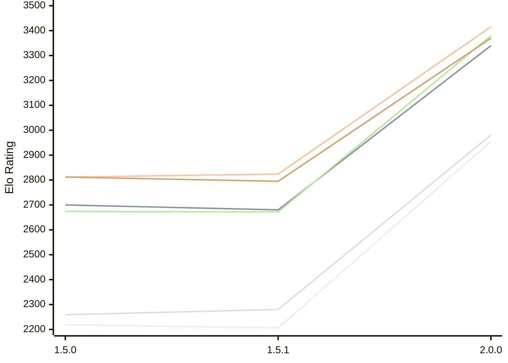
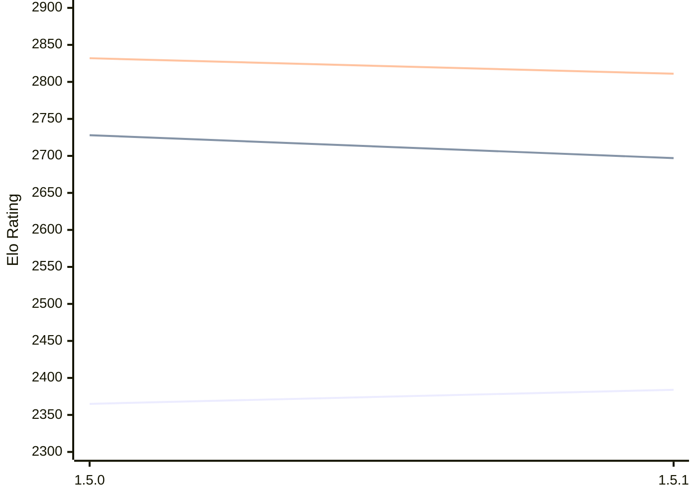

# Engine: Coco

Author: 

Home: https://github.com/NotKaede-11/Coco-Engine

## Elo Ratings E1 (Ultra 7 265T (1.50 GHz) - E-Core)

| Version | Published | STC 8.0+0.08s  | LTC 60.0+0.60s | VLTC 2m24s+1.12s | Comment |
| --- | --- | --- | --- | --- | --- |
| 2.0.0 | 2026-11-25 | 2955(+749) | 3340(+660) | 3416(+592) |  |
| 1.5.1 | 2026-09-27 | 2206(-13) | 2680(-20) | 2824(+12) |  |
| 1.5.0 | 2026-09-14 | 2219 | 2700 | 2812 |  |
 | | | cElo (∆ prev) | cElo (∆ prev) | cElo (∆ prev) | 

## Elo Ratings P1 (Ultra 7 265T (1.50 GHz) - P-Core)

| Version | Published | STC 8.0+0.08s  | LTC 60.0+0.60s | VLTC 2m24s+1.12s | Comment |
| --- | --- | --- | --- | --- | --- |
| 2.0.0 | 2026-11-25 | 2981(+701) | 3380(+708) | 3370(+575) |  |
| 1.5.1 | 2026-09-27 | 2280(+21) | 2672(-2) | 2795(-17) |  |
| 1.5.0 | 2026-09-14 | 2259 | 2674 | 2812 |  |
 | | | cElo (∆ prev) | cElo (∆ prev) | cElo (∆ prev) | 

## Elo Ratings T1 (i5-7500T 2.70GHz)

| Version | Published | STC 8.0+0.08s  | LTC 60.0+0.60s | VLTC 2m24s+1.12s | Comment |
| --- | --- | --- | --- | --- | --- |
| 1.5.1 | 2026-09-27 | 2384(+19) | 2697(-31) | 2811(-21) |  |
| 1.5.0 | 2026-09-14 | 2365 | 2728 | 2832 |  |
 | | | cElo (∆ prev) | cElo (∆ prev) | cElo (∆ prev) | 

<a href="https://github.com/computer-chess-index/cci/issues/new?template=submit-version.yml&title=[VERSION]+Coco+<version>&body=###%20Engine%20name%0ACoco%0A%0A###%20Version%0A1.5.1" target="_blank">Submit new version</a>

 Test Conditions:

GUI/CLI: <a href=https://github.com/cutechess/cutechess target="_blank">Cute-Chess</a> 
Elo Calculation: <a href=https://www.remi-coulom.fr/Bayesian-Elo/ target="_blank">Bayesian-Elo</a> 
CPU for P1: Intel(R) Core(TM) Ultra 7 265T (1.50 GHz) - P-Core 
CPU for E1: Intel(R) Core(TM) Ultra 7 265T (1.50 GHz) - E-Core 
CPU for T1: Intel(R) Core(TM) i5-7500T 2.70GHz 
Opening book: 8_moves_v3 
\* STC: 8.0+0.08s, LTC: 60.0+0.60s, VLTC: 2m24s+1.12s

 Lists:
Ratings: <a href=https://github.com/computer-chess-index/cci/blob/main/lists/CCIRatings.csv target="_blank">Complete list</a>

Generated: 2026-11-28 05:37:42

## Ratings Verlauf E1 / P1

## Ratings Verlauf T1

## Detailed Evaluation Results

| Version | Time Control | Variant | Elo  | Range +/- | Matches | Score | Average Opponent Elo | Draws |
| --- | --- |--- | --- | --- | --- | --- | --- | --- |
| 2.0.0 | VLTC (2m24s+1.12s) | P1 | 3370 | 31 | 252 | 57% | 3316 | 75% |
|  |  | E1 | 3416 | 36 | 208 | 51% | 3391 | 65% |
|  | LTC (60.0+0.60s) | P1 | 3380 | 54 | 88 | 56% | 3312 | 72% |
|  |  | E1 | 3340 | 31 | 284 | 57% | 3267 | 67% |
|  | STC (8.0+0.08s) | P1 | 2981 | 48 | 136 | 60% | 2866 | 44% |
|  |  | E1 | 2955 | 34 | 270 | 56% | 2889 | 42% |
| --- | --- |--- | --- | --- | --- | --- | --- | --- |
| 1.5.1 | VLTC (2m24s+1.12s) | T1 | 2811 | 41 | 190 | 49% | 2816 | 31% |
|  |  | P1 | 2795 | 32 | 330 | 45% | 2817 | 32% |
|  |  | E1 | 2824 | 29 | 394 | 48% | 2849 | 34% |
|  | LTC (60.0+0.60s) | T1 | 2697 | 41 | 194 | 50% | 2699 | 34% |
|  |  | P1 | 2672 | 35 | 272 | 49% | 2691 | 29% |
|  |  | E1 | 2680 | 32 | 316 | 52% | 2662 | 32% |
|  | STC (8.0+0.08s) | T1 | 2384 | 36 | 280 | 45% | 2435 | 24% |
|  |  | P1 | 2280 | 35 | 296 | 54% | 2245 | 20% |
|  |  | E1 | 2206 | 30 | 404 | 50% | 2207 | 19% |
| --- | --- |--- | --- | --- | --- | --- | --- | --- |
| 1.5.0 | VLTC (2m24s+1.12s) | P1 | 2812 | 38 | 212 | 47% | 2846 | 40% |
|  |  | E1 | 2812 | 30 | 378 | 46% | 2851 | 31% |
|  |  | T1 | 2832 | 37 | 238 | 50% | 2824 | 30% |
|  | LTC (60.0+0.60s) | P1 | 2674 | 35 | 276 | 47% | 2709 | 27% |
|  |  | E1 | 2700 | 32 | 332 | 47% | 2724 | 30% |
|  |  | T1 | 2728 | 35 | 260 | 50% | 2726 | 33% |
|  | STC (8.0+0.08s) | E1 | 2219 | 32 | 356 | 42% | 2325 | 21% |
|  |  | T1 | 2365 | 35 | 280 | 50% | 2361 | 25% |
|  |  | P1 | 2259 | 37 | 274 | 46% | 2302 | 18% |