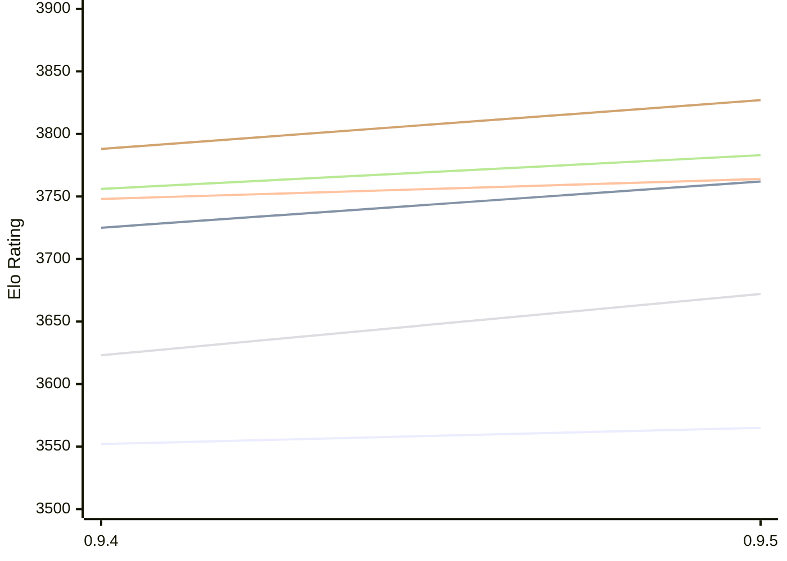
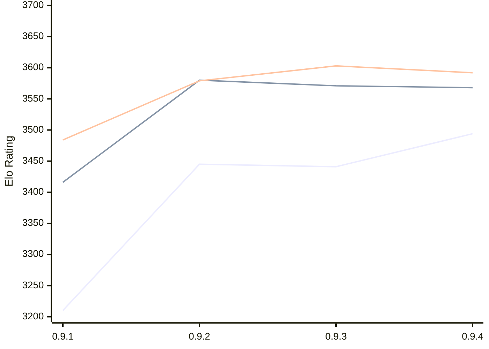

# Engine: Coda

Author: Adam Twiss

Home: https://github.com/adamtwiss/coda

## Elo Ratings E1 (Ultra 7 265T (1.50 GHz) - E-Core)

| Version | Published | STC 8.0+0.08s  | LTC 60.0+0.60s | VLTC 2m24s+1.12s | Comment |
| --- | --- | --- | --- | --- | --- |
| 0.9.5 | 2026-10-21 | 3565(+13) | 3762(+37) | 3764(+16) |  |
| 0.9.4 | 2026-08-22 | 3552 | 3725 | 3748 |  |
 | | | cElo (∆ prev) | cElo (∆ prev) | cElo (∆ prev) | 

## Elo Ratings P1 (Ultra 7 265T (1.50 GHz) - P-Core)

| Version | Published | STC 8.0+0.08s  | LTC 60.0+0.60s | VLTC 2m24s+1.12s | Comment |
| --- | --- | --- | --- | --- | --- |
| 0.9.5 | 2026-10-21 | 3672(+49) | 3783(+27) | 3827(+39) |  |
| 0.9.4 | 2026-08-22 | 3623 | 3756 | 3788 |  |
 | | | cElo (∆ prev) | cElo (∆ prev) | cElo (∆ prev) | 

## Elo Ratings T1 (i5-7500T 2.70GHz)

| Version | Published | STC 8.0+0.08s  | LTC 60.0+0.60s | VLTC 2m24s+1.12s | Comment |
| --- | --- | --- | --- | --- | --- |
| 0.9.4 | 2026-08-22 | 3494(+53) | 3568(-3) | 3592(-11) |  |
| 0.9.3 | 2026-07-26 | 3441(-4) | 3571(-9) | 3603(+24) |  |
| 0.9.2 | 2026-07-16 | 3445(+235) | 3580(+164) | 3579(+95) |  |
| 0.9.1 | 2026-07-14 | 3210 | 3416 | 3484 |  |
 | | | cElo (∆ prev) | cElo (∆ prev) | cElo (∆ prev) | 

<a href="https://github.com/computer-chess-index/cci/issues/new?template=submit-version.yml&title=[VERSION]+Coda+<version>&body=###%20Engine%20name%0ACoda%0A%0A###%20Version%0A0.9.4" target="_blank">Submit new version</a>

 Test Conditions:

GUI/CLI: <a href=https://github.com/cutechess/cutechess target="_blank">Cute-Chess</a> 
Elo Calculation: <a href=https://www.remi-coulom.fr/Bayesian-Elo/ target="_blank">Bayesian-Elo</a> 
CPU for P1: Intel(R) Core(TM) Ultra 7 265T (1.50 GHz) - P-Core 
CPU for E1: Intel(R) Core(TM) Ultra 7 265T (1.50 GHz) - E-Core 
CPU for T1: Intel(R) Core(TM) i5-7500T 2.70GHz 
Opening book: 8_moves_v3 
\* STC: 8.0+0.08s, LTC: 60.0+0.60s, VLTC: 2m24s+1.12s

 Lists:
Ratings: <a href=https://github.com/computer-chess-index/cci/blob/main/lists/CCIRatings.csv target="_blank">Complete list</a>

Generated: 2026-10-24 04:37:42

## Ratings Verlauf E1 / P1

## Ratings Verlauf T1

## Detailed Evaluation Results

| Version | Time Control | Variant | Elo  | Range +/- | Matches | Score | Average Opponent Elo | Draws |
| --- | --- |--- | --- | --- | --- | --- | --- | --- |
| 0.9.5 | VLTC (2m24s+1.12s) | P1 | 3827 | 63 | 56 | 53% | 3810 | 91% |
|  |  | E1 | 3764 | 47 | 104 | 52% | 3752 | 88% |
|  | LTC (60.0+0.60s) | E1 | 3762 | 37 | 168 | 54% | 3738 | 86% |
|  |  | P1 | 3783 | 59 | 62 | 52% | 3772 | 94% |
|  | STC (8.0+0.08s) | E1 | 3565 | 40 | 152 | 52% | 3555 | 80% |
|  |  | P1 | 3672 | 36 | 176 | 46% | 3696 | 82% |
| --- | --- |--- | --- | --- | --- | --- | --- | --- |
| 0.9.4 | VLTC (2m24s+1.12s) | T1 | 3592 | 37 | 168 | 51% | 3584 | 90% |
|  |  | P1 | 3788 | 45 | 108 | 53% | 3768 | 92% |
|  |  | E1 | 3748 | 32 | 212 | 52% | 3734 | 92% |
|  | LTC (60.0+0.60s) | T1 | 3568 | 31 | 244 | 51% | 3564 | 83% |
|  |  | P1 | 3756 | 40 | 142 | 51% | 3746 | 92% |
|  |  | E1 | 3725 | 36 | 180 | 52% | 3711 | 87% |
|  | STC (8.0+0.08s) | T1 | 3494 | 27 | 318 | 51% | 3488 | 85% |
|  |  | P1 | 3623 | 35 | 192 | 48% | 3638 | 84% |
|  |  | E1 | 3552 | 28 | 316 | 47% | 3571 | 74% |
| --- | --- |--- | --- | --- | --- | --- | --- | --- |
| 0.9.3 | VLTC (2m24s+1.12s) | T1 | 3603 | 43 | 124 | 53% | 3584 | 90% |
|  | LTC (60.0+0.60s) | T1 | 3571 | 32 | 228 | 51% | 3563 | 86% |
|  | STC (8.0+0.08s) | T1 | 3441 | 30 | 276 | 50% | 3440 | 75% |
| --- | --- |--- | --- | --- | --- | --- | --- | --- |
| 0.9.2 | VLTC (2m24s+1.12s) | T1 | 3579 | 32 | 214 | 51% | 3572 | 91% |
|  | LTC (60.0+0.60s) | T1 | 3580 | 36 | 178 | 50% | 3579 | 89% |
|  | STC (8.0+0.08s) | T1 | 3445 | 27 | 328 | 48% | 3459 | 77% |
| --- | --- |--- | --- | --- | --- | --- | --- | --- |
| 0.9.1 | VLTC (2m24s+1.12s) | T1 | 3484 | 39 | 166 | 55% | 3434 | 73% |
|  | LTC (60.0+0.60s) | T1 | 3416 | 42 | 152 | 55% | 3355 | 63% |
|  | STC (8.0+0.08s) | T1 | 3210 | 41 | 172 | 52% | 3177 | 53% |