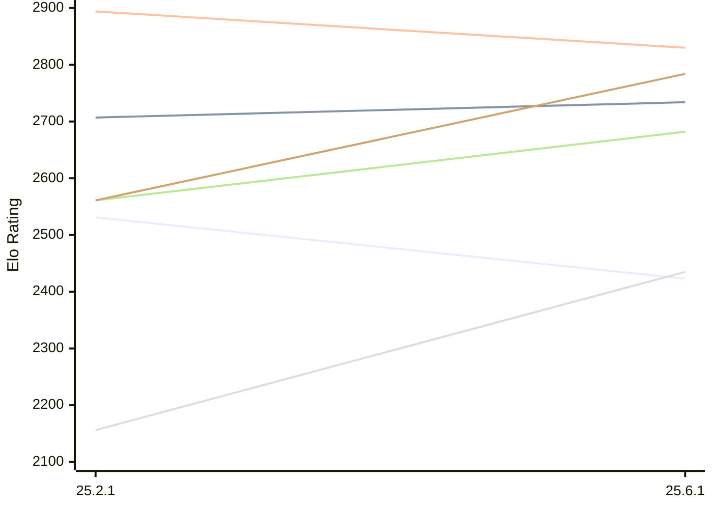
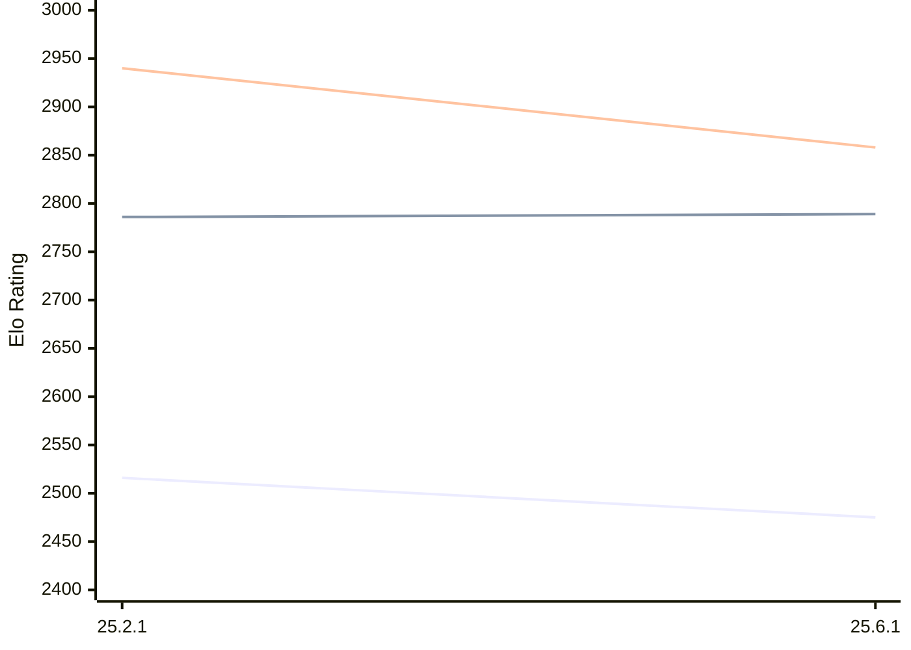

# Engine: Crafty

Author: Robert M. Hyatt

Home: https://github.com/stevemaughan/Crafty-Chess

## Elo Ratings E1 (Ultra 7 265T (1.50 GHz) - E-Core)

| Version | Published | STC 8.0+0.08s  | LTC 60.0+0.60s | VLTC 2m24s+1.12s | Comment |
| --- | --- | --- | --- | --- | --- |
| 25.6.1 | 2026-06-24 | 2423(-108) | 2734(+27) | 2830(-64) |  |
| 25.2.1 | 2026-06-20 | 2531 | 2707 | 2894 |  |
 | | | cElo (∆ prev) | cElo (∆ prev) | cElo (∆ prev) | 

## Elo Ratings P1 (Ultra 7 265T (1.50 GHz) - P-Core)

| Version | Published | STC 8.0+0.08s  | LTC 60.0+0.60s | VLTC 2m24s+1.12s | Comment |
| --- | --- | --- | --- | --- | --- |
| 25.6.1 | 2026-06-24 | 2435(+279) | 2682(+121) | 2784(+223) |  |
| 25.2.1 | 2026-06-20 | 2156 | 2561 | 2561 |  |
 | | | cElo (∆ prev) | cElo (∆ prev) | cElo (∆ prev) | 

## Elo Ratings T1 (i5-7500T 2.70GHz)

| Version | Published | STC 8.0+0.08s  | LTC 60.0+0.60s | VLTC 2m24s+1.12s | Comment |
| --- | --- | --- | --- | --- | --- |
| 25.6.1 | 2026-06-24 | 2475(-41) | 2789(+3) | 2858(-82) |  |
| 25.2.1 | 2026-06-20 | 2516 | 2786 | 2940 |  |
 | | | cElo (∆ prev) | cElo (∆ prev) | cElo (∆ prev) | 

<a href="https://github.com/computer-chess-index/cci/issues/new?template=submit-version.yml&title=[VERSION]+Crafty+<version>&body=###%20Engine%20name%0ACrafty%0A%0A###%20Version%0A25.6.1" target="_blank">Submit new version</a>

 Test Conditions:

GUI/CLI: <a href=https://github.com/cutechess/cutechess target="_blank">Cute-Chess</a> 
Elo Calculation: <a href=https://www.remi-coulom.fr/Bayesian-Elo/ target="_blank">Bayesian-Elo</a> 
CPU for P1: Intel(R) Core(TM) Ultra 7 265T (1.50 GHz) - P-Core 
CPU for E1: Intel(R) Core(TM) Ultra 7 265T (1.50 GHz) - E-Core 
CPU for T1: Intel(R) Core(TM) i5-7500T 2.70GHz 
Opening book: 8_moves_v3 
\* STC: 8.0+0.08s, LTC: 60.0+0.60s, VLTC: 2m24s+1.12s

 Lists:
Ratings: <a href=https://github.com/computer-chess-index/cci/blob/main/lists/CCIRatings.csv target="_blank">Complete list</a>

Generated: 2026-11-13 05:37:38

## Ratings Verlauf E1 / P1

## Ratings Verlauf T1

## Detailed Evaluation Results

| Version | Time Control | Variant | Elo  | Range +/- | Matches | Score | Average Opponent Elo | Draws |
| --- | --- |--- | --- | --- | --- | --- | --- | --- |
| 25.6.1 | VLTC (2m24s+1.12s) | T1 | 2858 | 27 | 424 | 49% | 2871 | 35% |
|  |  | P1 | 2784 | 35 | 268 | 47% | 2816 | 32% |
|  |  | E1 | 2830 | 30 | 362 | 49% | 2843 | 32% |
|  | LTC (60.0+0.60s) | T1 | 2789 | 32 | 328 | 50% | 2786 | 30% |
|  |  | P1 | 2682 | 34 | 300 | 49% | 2701 | 30% |
|  |  | E1 | 2734 | 27 | 454 | 47% | 2769 | 31% |
|  | STC (8.0+0.08s) | T1 | 2475 | 31 | 356 | 50% | 2473 | 28% |
|  |  | P1 | 2435 | 37 | 260 | 52% | 2411 | 27% |
|  |  | E1 | 2423 | 32 | 346 | 49% | 2427 | 26% |
| --- | --- |--- | --- | --- | --- | --- | --- | --- |
| 25.2.1 | VLTC (2m24s+1.12s) | P1 | 2561 | 151 | 16 | 44% | 2565 | 25% |
|  |  | E1 | 2894 | 99 | 40 | 51% | 2836 | 28% |
|  |  | T1 | 2940 | 51 | 130 | 50% | 2943 | 28% |
|  | LTC (60.0+0.60s) | E1 | 2707 | 104 | 36 | 53% | 2547 | 22% |
|  |  | T1 | 2786 | 56 | 112 | 49% | 2801 | 24% |
|  |  | P1 | 2561 | 159 | 32 | 75% | 2029 | 0% |
|  | STC (8.0+0.08s) | E1 | 2531 | 98 | 38 | 39% | 2651 | 21% |
|  |  | T1 | 2516 | 59 | 96 | 52% | 2499 | 26% |
|  |  | P1 | 2156 | 139 | 32 | 52% | 2078 | 9% |