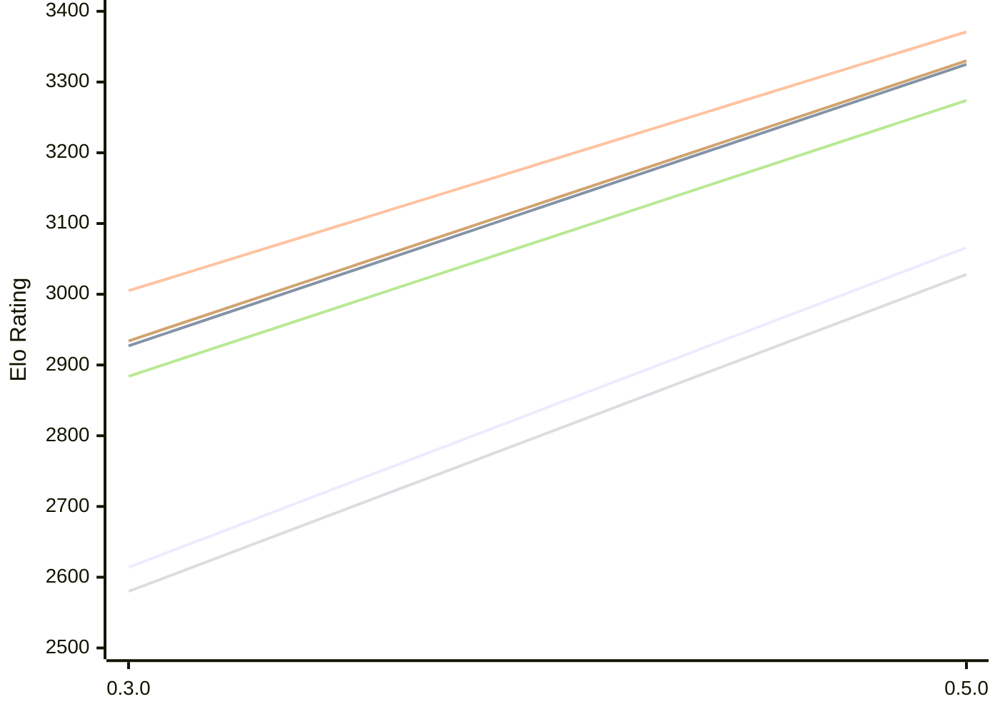

# Engine: Crustik

Author: Dejon Eltahan

Home: https://github.com/Dejon51/Crustik

## Elo Ratings E1 (Ultra 7 265T (1.50 GHz) - E-Core)

| Version | Published | STC 8.0+0.08s  | LTC 60.0+0.60s | VLTC 2m24s+1.12s | Comment |
| --- | --- | --- | --- | --- | --- |
| 0.5.0 | 2026-11-16 | 3066(+452) | 3325(+398) | 3371(+366) |  |
| 0.3.0 | 2026-08-27 | 2614 | 2927 | 3005 |  |
 | | | cElo (∆ prev) | cElo (∆ prev) | cElo (∆ prev) | 

## Elo Ratings P1 (Ultra 7 265T (1.50 GHz) - P-Core)

| Version | Published | STC 8.0+0.08s  | LTC 60.0+0.60s | VLTC 2m24s+1.12s | Comment |
| --- | --- | --- | --- | --- | --- |
| 0.5.0 | 2026-11-16 | 3028(+448) | 3274(+390) | 3330(+396) |  |
| 0.3.0 | 2026-08-27 | 2580 | 2884 | 2934 |  |
 | | | cElo (∆ prev) | cElo (∆ prev) | cElo (∆ prev) | 

## Elo Ratings T1 (i5-7500T 2.70GHz)

| Version | Published | STC 8.0+0.08s  | LTC 60.0+0.60s | VLTC 2m24s+1.12s | Comment |
| --- | --- | --- | --- | --- | --- |
| 0.3.0 | 2026-08-27 | 2655 | 2928 | 3004 |  |
 | | | cElo (∆ prev) | cElo (∆ prev) | cElo (∆ prev) | 

<a href="https://github.com/computer-chess-index/cci/issues/new?template=submit-version.yml&title=[VERSION]+Crustik+<version>&body=###%20Engine%20name%0ACrustik%0A%0A###%20Version%0A0.3.0" target="_blank">Submit new version</a>

 Test Conditions:

GUI/CLI: <a href=https://github.com/cutechess/cutechess target="_blank">Cute-Chess</a> 
Elo Calculation: <a href=https://www.remi-coulom.fr/Bayesian-Elo/ target="_blank">Bayesian-Elo</a> 
CPU for P1: Intel(R) Core(TM) Ultra 7 265T (1.50 GHz) - P-Core 
CPU for E1: Intel(R) Core(TM) Ultra 7 265T (1.50 GHz) - E-Core 
CPU for T1: Intel(R) Core(TM) i5-7500T 2.70GHz 
Opening book: 8_moves_v3 
\* STC: 8.0+0.08s, LTC: 60.0+0.60s, VLTC: 2m24s+1.12s

 Lists:
Ratings: <a href=https://github.com/computer-chess-index/cci/blob/main/lists/CCIRatings.csv target="_blank">Complete list</a>

Generated: 2026-11-19 05:37:43

## Ratings Verlauf E1 / P1

## Detailed Evaluation Results

| Version | Time Control | Variant | Elo  | Range +/- | Matches | Score | Average Opponent Elo | Draws |
| --- | --- |--- | --- | --- | --- | --- | --- | --- |
| 0.5.0 | VLTC (2m24s+1.12s) | P1 | 3330 | 40 | 160 | 53% | 3302 | 69% |
|  |  | E1 | 3371 | 38 | 180 | 53% | 3351 | 67% |
|  | LTC (60.0+0.60s) | P1 | 3274 | 47 | 122 | 52% | 3251 | 60% |
|  |  | E1 | 3325 | 36 | 200 | 52% | 3314 | 64% |
|  | STC (8.0+0.08s) | P1 | 3028 | 62 | 72 | 52% | 3004 | 54% |
|  |  | E1 | 3066 | 40 | 184 | 53% | 3040 | 48% |
| --- | --- |--- | --- | --- | --- | --- | --- | --- |
| 0.3.0 | VLTC (2m24s+1.12s) | T1 | 3004 | 33 | 282 | 51% | 3000 | 43% |
|  |  | P1 | 2934 | 35 | 242 | 50% | 2928 | 46% |
|  |  | E1 | 3005 | 27 | 420 | 49% | 3011 | 46% |
|  | LTC (60.0+0.60s) | T1 | 2928 | 33 | 270 | 51% | 2916 | 46% |
|  |  | P1 | 2884 | 36 | 238 | 50% | 2881 | 42% |
|  |  | E1 | 2927 | 28 | 386 | 49% | 2939 | 41% |
|  | STC (8.0+0.08s) | P1 | 2580 | 33 | 294 | 50% | 2580 | 38% |
|  |  | E1 | 2614 | 29 | 370 | 48% | 2637 | 35% |
|  |  | T1 | 2655 | 34 | 272 | 50% | 2651 | 38% |