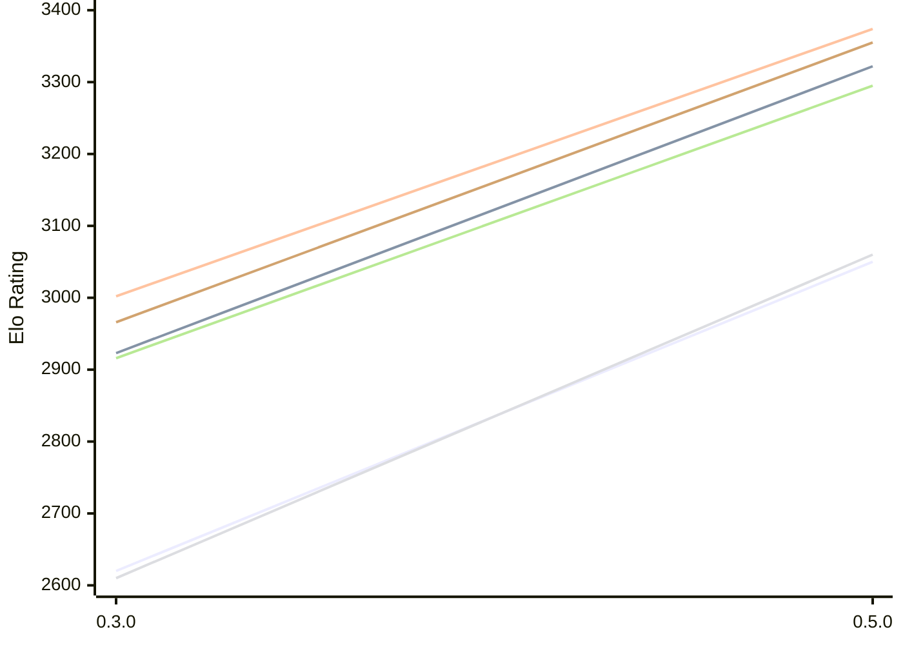

# Engine: Crustik

Author: Dejon Eltahan

Home: https://github.com/Dejon51/Crustik

## Elo Ratings E1 (Ultra 7 265T (1.50 GHz) - E-Core)

| Version | Published | STC 8.0+0.08s  | LTC 60.0+0.60s | VLTC 2m24s+1.12s | Comment |
| --- | --- | --- | --- | --- | --- |
| 0.5.0 | 2026-11-16 | 3050(+430) | 3322(+399) | 3374(+372) |  |
| 0.3.0 | 2026-08-27 | 2620 | 2923 | 3002 |  |
 | | | cElo (∆ prev) | cElo (∆ prev) | cElo (∆ prev) | 

## Elo Ratings P1 (Ultra 7 265T (1.50 GHz) - P-Core)

| Version | Published | STC 8.0+0.08s  | LTC 60.0+0.60s | VLTC 2m24s+1.12s | Comment |
| --- | --- | --- | --- | --- | --- |
| 0.5.0 | 2026-11-16 | 3060(+450) | 3295(+379) | 3355(+389) |  |
| 0.3.0 | 2026-08-27 | 2610 | 2916 | 2966 |  |
 | | | cElo (∆ prev) | cElo (∆ prev) | cElo (∆ prev) | 

## Elo Ratings T1 (i5-7500T 2.70GHz)

| Version | Published | STC 8.0+0.08s  | LTC 60.0+0.60s | VLTC 2m24s+1.12s | Comment |
| --- | --- | --- | --- | --- | --- |
| 0.3.0 | 2026-08-27 | 2655 | 2928 | 3004 |  |
 | | | cElo (∆ prev) | cElo (∆ prev) | cElo (∆ prev) | 

<a href="https://github.com/computer-chess-index/cci/issues/new?template=submit-version.yml&title=[VERSION]+Crustik+<version>&body=###%20Engine%20name%0ACrustik%0A%0A###%20Version%0A0.3.0" target="_blank">Submit new version</a>

 Test Conditions:

GUI/CLI: <a href=https://github.com/cutechess/cutechess target="_blank">Cute-Chess</a> 
Elo Calculation: <a href=https://www.remi-coulom.fr/Bayesian-Elo/ target="_blank">Bayesian-Elo</a> 
CPU for P1: Intel(R) Core(TM) Ultra 7 265T (1.50 GHz) - P-Core 
CPU for E1: Intel(R) Core(TM) Ultra 7 265T (1.50 GHz) - E-Core 
CPU for T1: Intel(R) Core(TM) i5-7500T 2.70GHz 
Opening book: 8_moves_v3 
\* STC: 8.0+0.08s, LTC: 60.0+0.60s, VLTC: 2m24s+1.12s

 Lists:
Ratings: <a href=https://github.com/computer-chess-index/cci/blob/main/lists/CCIRatings.csv target="_blank">Complete list</a>

Generated: 2026-11-26 05:37:51

## Ratings Verlauf E1 / P1

## Detailed Evaluation Results

| Version | Time Control | Variant | Elo  | Range +/- | Matches | Score | Average Opponent Elo | Draws |
| --- | --- |--- | --- | --- | --- | --- | --- | --- |
| 0.5.0 | VLTC (2m24s+1.12s) | P1 | 3355 | 39 | 168 | 53% | 3329 | 70% |
|  |  | E1 | 3374 | 35 | 208 | 52% | 3355 | 68% |
|  | LTC (60.0+0.60s) | P1 | 3295 | 42 | 150 | 51% | 3283 | 61% |
|  |  | E1 | 3322 | 33 | 244 | 51% | 3316 | 64% |
|  | STC (8.0+0.08s) | P1 | 3060 | 41 | 164 | 50% | 3056 | 52% |
|  |  | E1 | 3050 | 35 | 236 | 51% | 3039 | 49% |
| --- | --- |--- | --- | --- | --- | --- | --- | --- |
| 0.3.0 | VLTC (2m24s+1.12s) | E1 | 3002 | 27 | 428 | 49% | 3009 | 46% |
|  |  | T1 | 3004 | 33 | 282 | 51% | 3000 | 43% |
|  |  | P1 | 2966 | 35 | 242 | 50% | 2961 | 46% |
|  | LTC (60.0+0.60s) | E1 | 2923 | 28 | 398 | 48% | 2938 | 41% |
|  |  | T1 | 2928 | 33 | 270 | 51% | 2916 | 46% |
|  |  | P1 | 2916 | 35 | 242 | 50% | 2912 | 41% |
|  | STC (8.0+0.08s) | T1 | 2655 | 34 | 272 | 50% | 2651 | 38% |
|  |  | P1 | 2610 | 31 | 330 | 51% | 2606 | 39% |
|  |  | E1 | 2620 | 29 | 374 | 48% | 2641 | 35% |