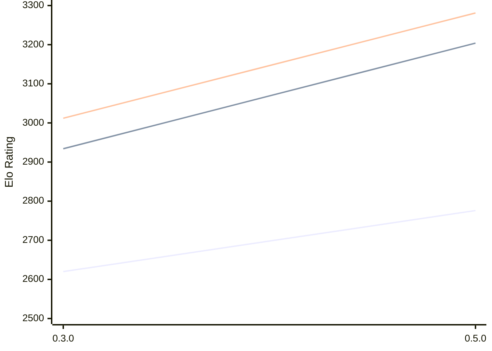

# Engine: Crustik

Author: Dejon Eltahan

Home: https://github.com/Dejon51/Crustik

## Elo Ratings E1 (Ultra 7 265T (1.50 GHz) - E-Core)

| Version | Published | STC 8.0+0.08s  | LTC 60.0+0.60s | VLTC 2m24s+1.12s | Comment |
| --- | --- | --- | --- | --- | --- |
| 0.5.0 | 2026-11-16 | 2776(+156) | 3204(+270) | 3281(+269) |  |
| 0.3.0 | 2026-08-27 | 2620 | 2934 | 3012 |  |
 | | | cElo (∆ prev) | cElo (∆ prev) | cElo (∆ prev) | 

## Elo Ratings P1 (Ultra 7 265T (1.50 GHz) - P-Core)

| Version | Published | STC 8.0+0.08s  | LTC 60.0+0.60s | VLTC 2m24s+1.12s | Comment |
| --- | --- | --- | --- | --- | --- |
| 0.3.0 | 2026-08-27 | 2572 | 2876 | 2928 |  |
 | | | cElo (∆ prev) | cElo (∆ prev) | cElo (∆ prev) | 

## Elo Ratings T1 (i5-7500T 2.70GHz)

| Version | Published | STC 8.0+0.08s  | LTC 60.0+0.60s | VLTC 2m24s+1.12s | Comment |
| --- | --- | --- | --- | --- | --- |
| 0.3.0 | 2026-08-27 | 2655 | 2928 | 3004 |  |
 | | | cElo (∆ prev) | cElo (∆ prev) | cElo (∆ prev) | 

<a href="https://github.com/computer-chess-index/cci/issues/new?template=submit-version.yml&title=[VERSION]+Crustik+<version>&body=###%20Engine%20name%0ACrustik%0A%0A###%20Version%0A0.3.0" target="_blank">Submit new version</a>

 Test Conditions:

GUI/CLI: <a href=https://github.com/cutechess/cutechess target="_blank">Cute-Chess</a> 
Elo Calculation: <a href=https://www.remi-coulom.fr/Bayesian-Elo/ target="_blank">Bayesian-Elo</a> 
CPU for P1: Intel(R) Core(TM) Ultra 7 265T (1.50 GHz) - P-Core 
CPU for E1: Intel(R) Core(TM) Ultra 7 265T (1.50 GHz) - E-Core 
CPU for T1: Intel(R) Core(TM) i5-7500T 2.70GHz 
Opening book: 8_moves_v3 
\* STC: 8.0+0.08s, LTC: 60.0+0.60s, VLTC: 2m24s+1.12s

 Lists:
Ratings: <a href=https://github.com/computer-chess-index/cci/blob/main/lists/CCIRatings.csv target="_blank">Complete list</a>

Generated: 2026-11-17 05:37:46

## Ratings Verlauf E1 / P1

## Detailed Evaluation Results

| Version | Time Control | Variant | Elo  | Range +/- | Matches | Score | Average Opponent Elo | Draws |
| --- | --- |--- | --- | --- | --- | --- | --- | --- |
| 0.5.0 | VLTC (2m24s+1.12s) | E1 | 3281 | 269 | 4 | 88% | 3013 | 25% |
|  | LTC (60.0+0.60s) | E1 | 3204 | 269 | 4 | 88% | 2935 | 25% |
|  | STC (8.0+0.08s) | E1 | 2776 | 238 | 4 | 75% | 2624 | 50% |
|  |  | P1 | 3015 | 346 | 4 | 100% | 2573 | 0% |
| --- | --- |--- | --- | --- | --- | --- | --- | --- |
| 0.3.0 | VLTC (2m24s+1.12s) | T1 | 3004 | 33 | 282 | 51% | 3000 | 43% |
|  |  | P1 | 2928 | 35 | 242 | 50% | 2923 | 46% |
|  |  | E1 | 3012 | 27 | 420 | 49% | 3017 | 46% |
|  | LTC (60.0+0.60s) | T1 | 2928 | 33 | 270 | 51% | 2916 | 46% |
|  |  | P1 | 2876 | 36 | 238 | 50% | 2874 | 42% |
|  |  | E1 | 2934 | 28 | 386 | 49% | 2944 | 41% |
|  | STC (8.0+0.08s) | T1 | 2655 | 34 | 272 | 50% | 2651 | 38% |
|  |  | P1 | 2572 | 33 | 294 | 50% | 2573 | 38% |
|  |  | E1 | 2620 | 29 | 370 | 48% | 2643 | 35% |