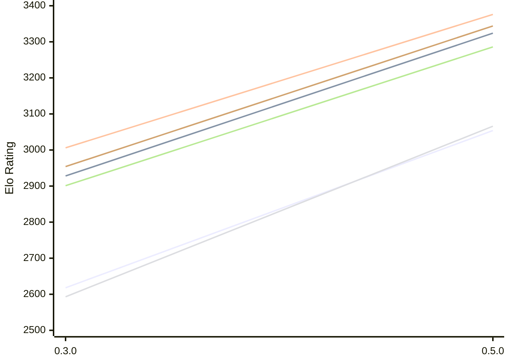

# Engine: Crustik

Author: Dejon Eltahan

Home: https://github.com/Dejon51/Crustik

## Elo Ratings E1 (Ultra 7 265T (1.50 GHz) - E-Core)

| Version | Published | STC 8.0+0.08s  | LTC 60.0+0.60s | VLTC 2m24s+1.12s | Comment |
| --- | --- | --- | --- | --- | --- |
| 0.5.0 | 2026-11-16 | 3054(+436) | 3324(+396) | 3376(+370) |  |
| 0.3.0 | 2026-08-27 | 2618 | 2928 | 3006 |  |
 | | | cElo (∆ prev) | cElo (∆ prev) | cElo (∆ prev) | 

## Elo Ratings P1 (Ultra 7 265T (1.50 GHz) - P-Core)

| Version | Published | STC 8.0+0.08s  | LTC 60.0+0.60s | VLTC 2m24s+1.12s | Comment |
| --- | --- | --- | --- | --- | --- |
| 0.5.0 | 2026-11-16 | 3066(+473) | 3286(+385) | 3344(+390) |  |
| 0.3.0 | 2026-08-27 | 2593 | 2901 | 2954 |  |
 | | | cElo (∆ prev) | cElo (∆ prev) | cElo (∆ prev) | 

## Elo Ratings T1 (i5-7500T 2.70GHz)

| Version | Published | STC 8.0+0.08s  | LTC 60.0+0.60s | VLTC 2m24s+1.12s | Comment |
| --- | --- | --- | --- | --- | --- |
| 0.3.0 | 2026-08-27 | 2655 | 2928 | 3004 |  |
 | | | cElo (∆ prev) | cElo (∆ prev) | cElo (∆ prev) | 

<a href="https://github.com/computer-chess-index/cci/issues/new?template=submit-version.yml&title=[VERSION]+Crustik+<version>&body=###%20Engine%20name%0ACrustik%0A%0A###%20Version%0A0.3.0" target="_blank">Submit new version</a>

 Test Conditions:

GUI/CLI: <a href=https://github.com/cutechess/cutechess target="_blank">Cute-Chess</a> 
Elo Calculation: <a href=https://www.remi-coulom.fr/Bayesian-Elo/ target="_blank">Bayesian-Elo</a> 
CPU for P1: Intel(R) Core(TM) Ultra 7 265T (1.50 GHz) - P-Core 
CPU for E1: Intel(R) Core(TM) Ultra 7 265T (1.50 GHz) - E-Core 
CPU for T1: Intel(R) Core(TM) i5-7500T 2.70GHz 
Opening book: 8_moves_v3 
\* STC: 8.0+0.08s, LTC: 60.0+0.60s, VLTC: 2m24s+1.12s

 Lists:
Ratings: <a href=https://github.com/computer-chess-index/cci/blob/main/lists/CCIRatings.csv target="_blank">Complete list</a>

Generated: 2026-11-23 05:37:39

## Ratings Verlauf E1 / P1

## Detailed Evaluation Results

| Version | Time Control | Variant | Elo  | Range +/- | Matches | Score | Average Opponent Elo | Draws |
| --- | --- |--- | --- | --- | --- | --- | --- | --- |
| 0.5.0 | VLTC (2m24s+1.12s) | E1 | 3376 | 36 | 200 | 53% | 3356 | 68% |
|  |  | P1 | 3344 | 39 | 164 | 53% | 3318 | 69% |
|  | LTC (60.0+0.60s) | P1 | 3286 | 43 | 142 | 51% | 3272 | 61% |
|  |  | E1 | 3324 | 34 | 224 | 51% | 3317 | 65% |
|  | STC (8.0+0.08s) | P1 | 3066 | 44 | 144 | 53% | 3042 | 51% |
|  |  | E1 | 3054 | 38 | 204 | 51% | 3042 | 49% |
| --- | --- |--- | --- | --- | --- | --- | --- | --- |
| 0.3.0 | VLTC (2m24s+1.12s) | T1 | 3004 | 33 | 282 | 51% | 3000 | 43% |
|  |  | P1 | 2954 | 35 | 242 | 50% | 2948 | 46% |
|  |  | E1 | 3006 | 27 | 420 | 49% | 3012 | 46% |
|  | LTC (60.0+0.60s) | T1 | 2928 | 33 | 270 | 51% | 2916 | 46% |
|  |  | P1 | 2901 | 36 | 238 | 50% | 2900 | 42% |
|  |  | E1 | 2928 | 28 | 386 | 49% | 2940 | 41% |
|  | STC (8.0+0.08s) | T1 | 2655 | 34 | 272 | 50% | 2651 | 38% |
|  |  | P1 | 2593 | 31 | 314 | 50% | 2593 | 39% |
|  |  | E1 | 2618 | 29 | 370 | 48% | 2639 | 35% |