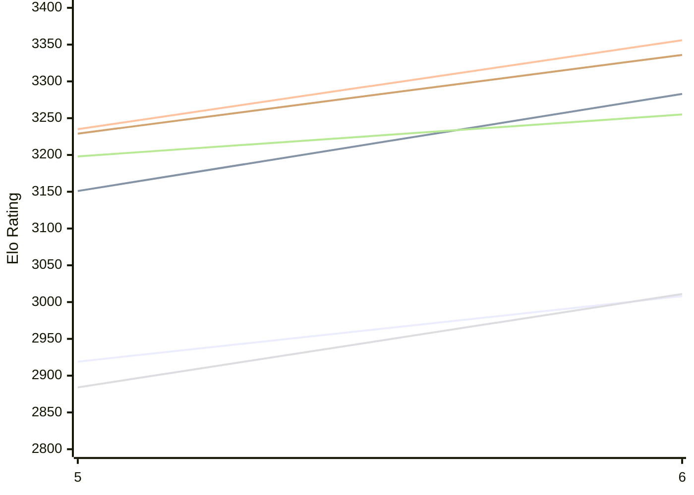
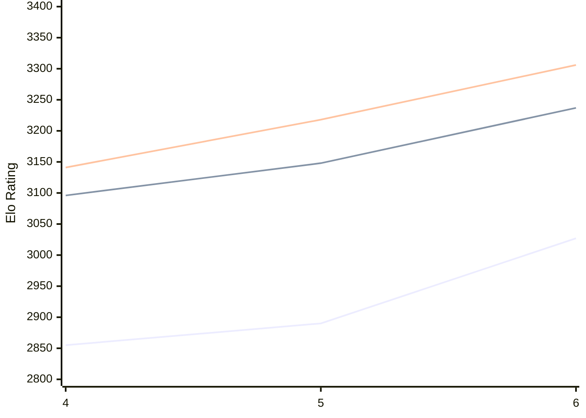

# Engine: Cwtch

Author: Colin Jenkins

Home: https://github.com/op12no2/cwtch

## Elo Ratings E1 (Ultra 7 265T (1.50 GHz) - E-Core)

| Version | Published | STC 8.0+0.08s  | LTC 60.0+0.60s | VLTC 2m24s+1.12s | Comment |
| --- | --- | --- | --- | --- | --- |
| 6 | 2026-07-06 | 3008(+89) | 3283(+132) | 3356(+121) |  |
| 5 | 2026-04-06 | 2919 | 3151 | 3235 |  |
 | | | cElo (∆ prev) | cElo (∆ prev) | cElo (∆ prev) | 

## Elo Ratings P1 (Ultra 7 265T (1.50 GHz) - P-Core)

| Version | Published | STC 8.0+0.08s  | LTC 60.0+0.60s | VLTC 2m24s+1.12s | Comment |
| --- | --- | --- | --- | --- | --- |
| 6 | 2026-07-06 | 3011(+127) | 3255(+57) | 3336(+107) |  |
| 5 | 2026-04-06 | 2884 | 3198 | 3229 |  |
 | | | cElo (∆ prev) | cElo (∆ prev) | cElo (∆ prev) | 

## Elo Ratings T1 (i5-7500T 2.70GHz)

| Version | Published | STC 8.0+0.08s  | LTC 60.0+0.60s | VLTC 2m24s+1.12s | Comment |
| --- | --- | --- | --- | --- | --- |
| 6 | 2026-07-06 | 3027(+137) | 3237(+89) | 3306(+88) |  |
| 5 | 2026-04-06 | 2890(+35) | 3148(+52) | 3218(+77) |  |
| 4 | 2025-12-05 | 2855 | 3096 | 3141 |  |
 | | | cElo (∆ prev) | cElo (∆ prev) | cElo (∆ prev) | 

<a href="https://github.com/computer-chess-index/cci/issues/new?template=submit-version.yml&title=[VERSION]+Cwtch+<version>&body=###%20Engine%20name%0ACwtch%0A%0A###%20Version%0A6" target="_blank">Submit new version</a>

 Test Conditions:

GUI/CLI: <a href=https://github.com/cutechess/cutechess target="_blank">Cute-Chess</a> 
Elo Calculation: <a href=https://www.remi-coulom.fr/Bayesian-Elo/ target="_blank">Bayesian-Elo</a> 
CPU for P1: Intel(R) Core(TM) Ultra 7 265T (1.50 GHz) - P-Core 
CPU for E1: Intel(R) Core(TM) Ultra 7 265T (1.50 GHz) - E-Core 
CPU for T1: Intel(R) Core(TM) i5-7500T 2.70GHz 
Opening book: 8_moves_v3 
\* STC: 8.0+0.08s, LTC: 60.0+0.60s, VLTC: 2m24s+1.12s

 Lists:
Ratings: <a href=https://github.com/computer-chess-index/cci/blob/main/lists/CCIRatings.csv target="_blank">Complete list</a>

Generated: 2026-11-27 05:37:51

## Ratings Verlauf E1 / P1

## Ratings Verlauf T1

## Detailed Evaluation Results

| Version | Time Control | Variant | Elo  | Range +/- | Matches | Score | Average Opponent Elo | Draws |
| --- | --- |--- | --- | --- | --- | --- | --- | --- |
| 6 | VLTC (2m24s+1.12s) | T1 | 3306 | 26 | 396 | 52% | 3295 | 66% |
|  |  | P1 | 3336 | 28 | 336 | 51% | 3333 | 62% |
|  |  | E1 | 3356 | 26 | 396 | 51% | 3351 | 64% |
|  | LTC (60.0+0.60s) | T1 | 3237 | 25 | 416 | 49% | 3245 | 61% |
|  |  | P1 | 3255 | 29 | 320 | 53% | 3235 | 54% |
|  |  | E1 | 3283 | 25 | 440 | 51% | 3276 | 53% |
|  | STC (8.0+0.08s) | T1 | 3027 | 24 | 488 | 48% | 3039 | 49% |
|  |  | P1 | 3011 | 29 | 360 | 53% | 2981 | 44% |
|  |  | E1 | 3008 | 25 | 494 | 49% | 3016 | 41% |
| --- | --- |--- | --- | --- | --- | --- | --- | --- |
| 5 | VLTC (2m24s+1.12s) | T1 | 3218 | 25 | 438 | 48% | 3240 | 59% |
|  |  | P1 | 3229 | 66 | 72 | 57% | 3105 | 44% |
|  |  | E1 | 3235 | 47 | 132 | 55% | 3179 | 54% |
|  | LTC (60.0+0.60s) | T1 | 3148 | 28 | 358 | 50% | 3147 | 56% |
|  |  | P1 | 3198 | 64 | 84 | 65% | 2948 | 43% |
|  |  | E1 | 3151 | 49 | 132 | 52% | 3125 | 42% |
|  | STC (8.0+0.08s) | T1 | 2890 | 28 | 396 | 49% | 2903 | 40% |
|  |  | P1 | 2884 | 62 | 90 | 46% | 2923 | 31% |
|  |  | E1 | 2919 | 40 | 197 | 46% | 2934 | 39% |
| --- | --- |--- | --- | --- | --- | --- | --- | --- |
| 4 | VLTC (2m24s+1.12s) | T1 | 3141 | 26 | 428 | 50% | 3141 | 50% |
|  | LTC (60.0+0.60s) | T1 | 3096 | 27 | 376 | 53% | 3070 | 55% |
|  | STC (8.0+0.08s) | T1 | 2855 | 25 | 482 | 53% | 2823 | 41% |