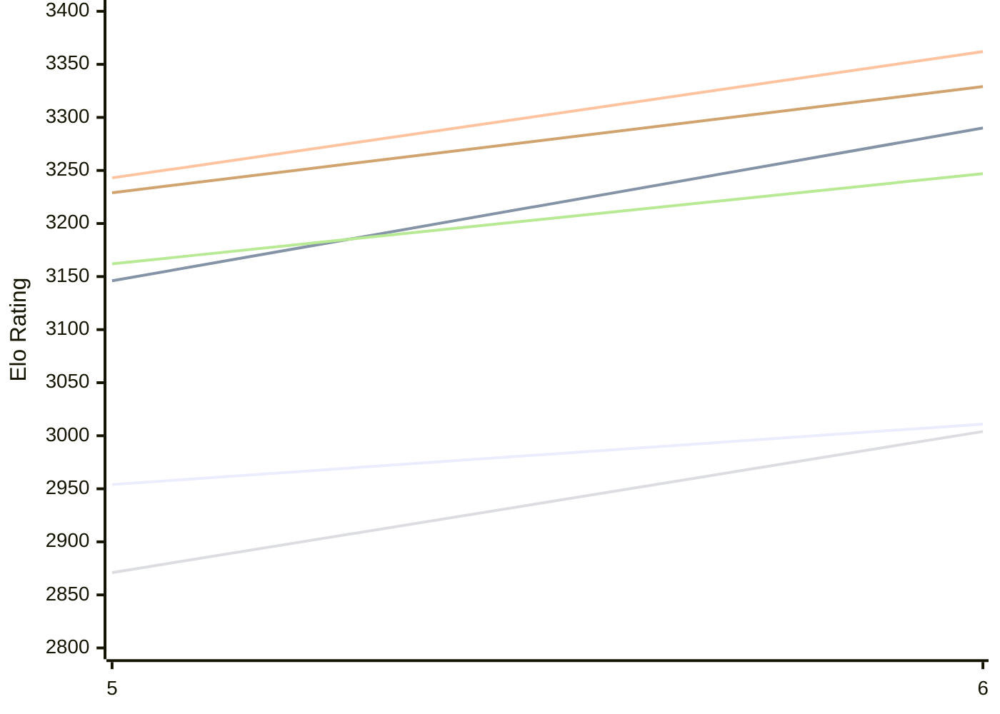
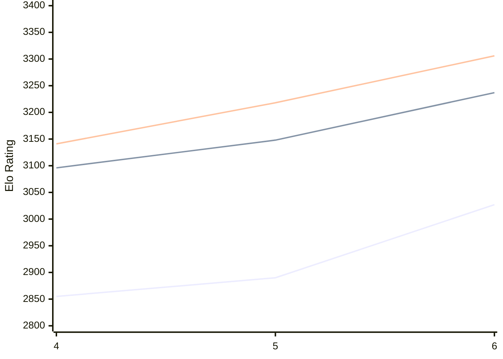

# Engine: Cwtch

Author: Colin Jenkins

Home: https://github.com/op12no2/cwtch

## Elo Ratings E1 (Ultra 7 265T (1.50 GHz) - E-Core)

| Version | Published | STC 8.0+0.08s  | LTC 60.0+0.60s | VLTC 2m24s+1.12s | Comment |
| --- | --- | --- | --- | --- | --- |
| 6 | 2026-07-06 | 3011(+57) | 3290(+144) | 3362(+119) |  |
| 5 | 2026-04-06 | 2954 | 3146 | 3243 |  |
 | | | cElo (∆ prev) | cElo (∆ prev) | cElo (∆ prev) | 

## Elo Ratings P1 (Ultra 7 265T (1.50 GHz) - P-Core)

| Version | Published | STC 8.0+0.08s  | LTC 60.0+0.60s | VLTC 2m24s+1.12s | Comment |
| --- | --- | --- | --- | --- | --- |
| 6 | 2026-07-06 | 3004(+133) | 3247(+85) | 3329(+100) |  |
| 5 | 2026-04-06 | 2871 | 3162 | 3229 |  |
 | | | cElo (∆ prev) | cElo (∆ prev) | cElo (∆ prev) | 

## Elo Ratings T1 (i5-7500T 2.70GHz)

| Version | Published | STC 8.0+0.08s  | LTC 60.0+0.60s | VLTC 2m24s+1.12s | Comment |
| --- | --- | --- | --- | --- | --- |
| 6 | 2026-07-06 | 3027(+137) | 3237(+89) | 3306(+88) |  |
| 5 | 2026-04-06 | 2890(+35) | 3148(+52) | 3218(+77) |  |
| 4 | 2025-12-05 | 2855 | 3096 | 3141 |  |
 | | | cElo (∆ prev) | cElo (∆ prev) | cElo (∆ prev) | 

<a href="https://github.com/computer-chess-index/cci/issues/new?template=submit-version.yml&title=[VERSION]+Cwtch+<version>&body=###%20Engine%20name%0ACwtch%0A%0A###%20Version%0A6" target="_blank">Submit new version</a>

 Test Conditions:

GUI/CLI: <a href=https://github.com/cutechess/cutechess target="_blank">Cute-Chess</a> 
Elo Calculation: <a href=https://www.remi-coulom.fr/Bayesian-Elo/ target="_blank">Bayesian-Elo</a> 
CPU for P1: Intel(R) Core(TM) Ultra 7 265T (1.50 GHz) - P-Core 
CPU for E1: Intel(R) Core(TM) Ultra 7 265T (1.50 GHz) - E-Core 
CPU for T1: Intel(R) Core(TM) i5-7500T 2.70GHz 
Opening book: 8_moves_v3 
\* STC: 8.0+0.08s, LTC: 60.0+0.60s, VLTC: 2m24s+1.12s

 Lists:
Ratings: <a href=https://github.com/computer-chess-index/cci/blob/main/lists/CCIRatings.csv target="_blank">Complete list</a>

Generated: 2026-11-24 05:37:50

## Ratings Verlauf E1 / P1

## Ratings Verlauf T1

## Detailed Evaluation Results

| Version | Time Control | Variant | Elo  | Range +/- | Matches | Score | Average Opponent Elo | Draws |
| --- | --- |--- | --- | --- | --- | --- | --- | --- |
| 6 | VLTC (2m24s+1.12s) | P1 | 3329 | 28 | 328 | 51% | 3325 | 61% |
|  |  | E1 | 3362 | 26 | 392 | 51% | 3355 | 64% |
|  |  | T1 | 3306 | 26 | 396 | 52% | 3295 | 66% |
|  | LTC (60.0+0.60s) | P1 | 3247 | 30 | 316 | 53% | 3225 | 54% |
|  |  | E1 | 3290 | 26 | 428 | 51% | 3279 | 54% |
|  |  | T1 | 3237 | 25 | 416 | 49% | 3245 | 61% |
|  | STC (8.0+0.08s) | E1 | 3011 | 25 | 482 | 49% | 3019 | 41% |
|  |  | T1 | 3027 | 24 | 488 | 48% | 3039 | 49% |
|  |  | P1 | 3004 | 29 | 356 | 54% | 2969 | 45% |
| --- | --- |--- | --- | --- | --- | --- | --- | --- |
| 5 | VLTC (2m24s+1.12s) | T1 | 3218 | 25 | 438 | 48% | 3240 | 59% |
|  |  | P1 | 3229 | 71 | 64 | 59% | 3077 | 44% |
|  |  | E1 | 3243 | 53 | 104 | 57% | 3166 | 51% |
|  | LTC (60.0+0.60s) | T1 | 3148 | 28 | 358 | 50% | 3147 | 56% |
|  |  | P1 | 3162 | 75 | 64 | 67% | 2866 | 41% |
|  |  | E1 | 3146 | 54 | 108 | 52% | 3121 | 43% |
|  | STC (8.0+0.08s) | T1 | 2890 | 28 | 396 | 49% | 2903 | 40% |
|  |  | P1 | 2871 | 65 | 82 | 45% | 2915 | 29% |
|  |  | E1 | 2954 | 51 | 120 | 48% | 2939 | 38% |
| --- | --- |--- | --- | --- | --- | --- | --- | --- |
| 4 | VLTC (2m24s+1.12s) | T1 | 3141 | 26 | 428 | 50% | 3141 | 50% |
|  | LTC (60.0+0.60s) | T1 | 3096 | 27 | 376 | 53% | 3070 | 55% |
|  | STC (8.0+0.08s) | T1 | 2855 | 25 | 482 | 53% | 2823 | 41% |