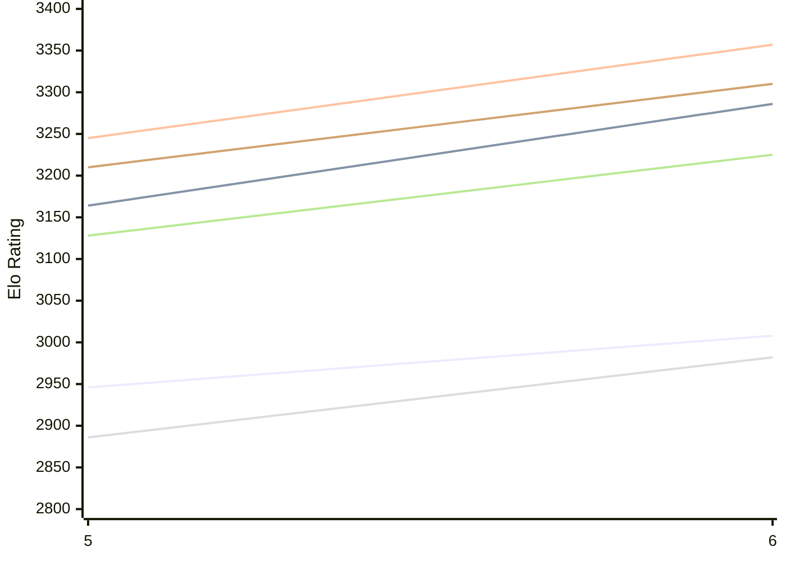
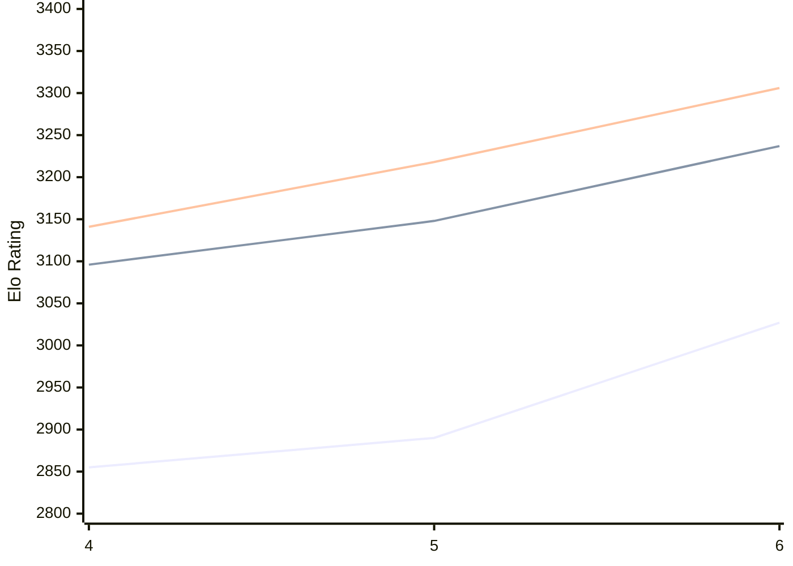

# Engine: Cwtch

Author: Colin Jenkins

Home: https://github.com/op12no2/cwtch

## Elo Ratings E1 (Ultra 7 265T (1.50 GHz) - E-Core)

| Version | Published | STC 8.0+0.08s  | LTC 60.0+0.60s | VLTC 2m24s+1.12s | Comment |
| --- | --- | --- | --- | --- | --- |
| 6 | 2026-07-06 | 3008(+62) | 3286(+122) | 3357(+112) |  |
| 5 | 2026-04-06 | 2946 | 3164 | 3245 |  |
 | | | cElo (∆ prev) | cElo (∆ prev) | cElo (∆ prev) | 

## Elo Ratings P1 (Ultra 7 265T (1.50 GHz) - P-Core)

| Version | Published | STC 8.0+0.08s  | LTC 60.0+0.60s | VLTC 2m24s+1.12s | Comment |
| --- | --- | --- | --- | --- | --- |
| 6 | 2026-07-06 | 2982(+96) | 3225(+97) | 3310(+100) |  |
| 5 | 2026-04-06 | 2886 | 3128 | 3210 |  |
 | | | cElo (∆ prev) | cElo (∆ prev) | cElo (∆ prev) | 

## Elo Ratings T1 (i5-7500T 2.70GHz)

| Version | Published | STC 8.0+0.08s  | LTC 60.0+0.60s | VLTC 2m24s+1.12s | Comment |
| --- | --- | --- | --- | --- | --- |
| 6 | 2026-07-06 | 3027(+137) | 3237(+89) | 3306(+88) |  |
| 5 | 2026-04-06 | 2890(+35) | 3148(+52) | 3218(+77) |  |
| 4 | 2025-12-05 | 2855 | 3096 | 3141 |  |
 | | | cElo (∆ prev) | cElo (∆ prev) | cElo (∆ prev) | 

<a href="https://github.com/computer-chess-index/cci/issues/new?template=submit-version.yml&title=[VERSION]+Cwtch+<version>&body=###%20Engine%20name%0ACwtch%0A%0A###%20Version%0A6" target="_blank">Submit new version</a>

 Test Conditions:

GUI/CLI: <a href=https://github.com/cutechess/cutechess target="_blank">Cute-Chess</a> 
Elo Calculation: <a href=https://www.remi-coulom.fr/Bayesian-Elo/ target="_blank">Bayesian-Elo</a> 
CPU for P1: Intel(R) Core(TM) Ultra 7 265T (1.50 GHz) - P-Core 
CPU for E1: Intel(R) Core(TM) Ultra 7 265T (1.50 GHz) - E-Core 
CPU for T1: Intel(R) Core(TM) i5-7500T 2.70GHz 
Opening book: 8_moves_v3 
\* STC: 8.0+0.08s, LTC: 60.0+0.60s, VLTC: 2m24s+1.12s

 Lists:
Ratings: <a href=https://github.com/computer-chess-index/cci/blob/main/lists/CCIRatings.csv target="_blank">Complete list</a>

Generated: 2026-11-19 05:37:48

## Ratings Verlauf E1 / P1

## Ratings Verlauf T1

## Detailed Evaluation Results

| Version | Time Control | Variant | Elo  | Range +/- | Matches | Score | Average Opponent Elo | Draws |
| --- | --- |--- | --- | --- | --- | --- | --- | --- |
| 6 | VLTC (2m24s+1.12s) | P1 | 3310 | 29 | 324 | 51% | 3305 | 62% |
|  |  | E1 | 3357 | 26 | 392 | 51% | 3351 | 64% |
|  |  | T1 | 3306 | 26 | 396 | 52% | 3295 | 66% |
|  | LTC (60.0+0.60s) | P1 | 3225 | 31 | 288 | 53% | 3201 | 53% |
|  |  | E1 | 3286 | 26 | 420 | 51% | 3276 | 54% |
|  |  | T1 | 3237 | 25 | 416 | 49% | 3245 | 61% |
|  | STC (8.0+0.08s) | E1 | 3008 | 26 | 454 | 49% | 3017 | 41% |
|  |  | T1 | 3027 | 24 | 488 | 48% | 3039 | 49% |
|  |  | P1 | 2982 | 30 | 340 | 54% | 2944 | 45% |
| --- | --- |--- | --- | --- | --- | --- | --- | --- |
| 5 | VLTC (2m24s+1.12s) | T1 | 3218 | 25 | 438 | 48% | 3240 | 59% |
|  |  | P1 | 3210 | 77 | 56 | 62% | 3032 | 41% |
|  |  | E1 | 3245 | 58 | 92 | 59% | 3152 | 48% |
|  | LTC (60.0+0.60s) | T1 | 3148 | 28 | 358 | 50% | 3147 | 56% |
|  |  | P1 | 3128 | 82 | 56 | 69% | 2804 | 38% |
|  |  | E1 | 3164 | 60 | 88 | 56% | 3105 | 43% |
|  | STC (8.0+0.08s) | T1 | 2890 | 28 | 396 | 49% | 2903 | 40% |
|  |  | P1 | 2886 | 73 | 66 | 48% | 2894 | 27% |
|  |  | E1 | 2946 | 58 | 100 | 47% | 2932 | 32% |
| --- | --- |--- | --- | --- | --- | --- | --- | --- |
| 4 | VLTC (2m24s+1.12s) | T1 | 3141 | 26 | 428 | 50% | 3141 | 50% |
|  | LTC (60.0+0.60s) | T1 | 3096 | 27 | 376 | 53% | 3070 | 55% |
|  | STC (8.0+0.08s) | T1 | 2855 | 25 | 482 | 53% | 2823 | 41% |