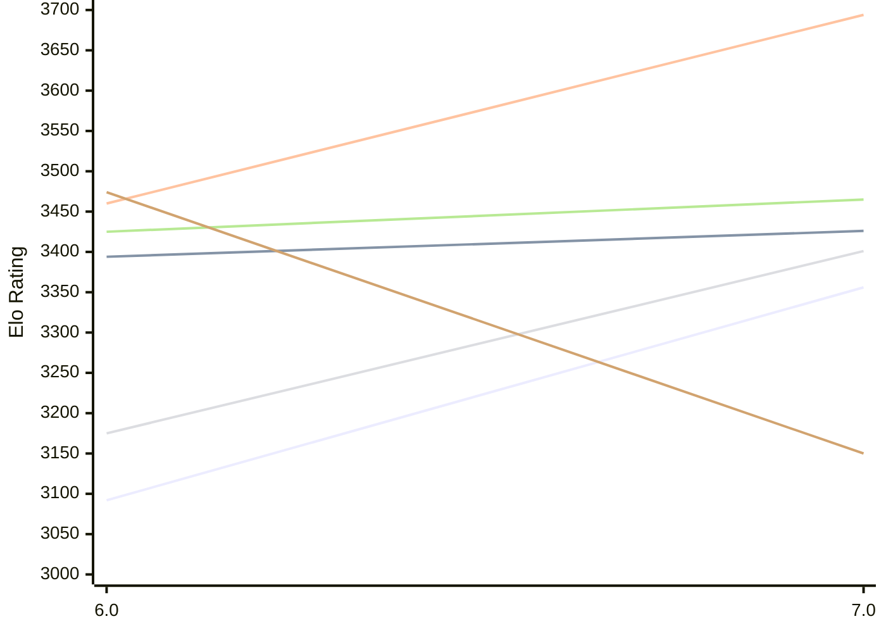
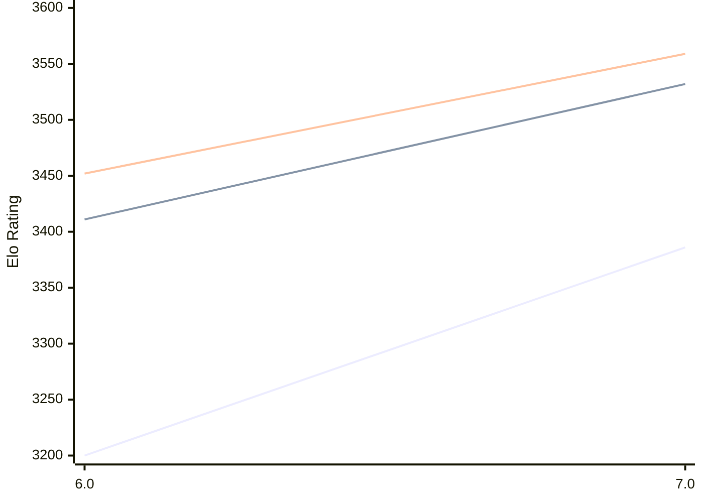

# Engine: Devre

Author: Ömer Faruk Tutkun

Home: https://github.com/OmerFarukTutkun/Devre

## Elo Ratings E1 (Ultra 7 265T (1.50 GHz) - E-Core)

| Version | Published | STC 8.0+0.08s  | LTC 60.0+0.60s | VLTC 2m24s+1.12s | Comment |
| --- | --- | --- | --- | --- | --- |
| 7.0 | 2026-08-07 | 3356(+264) | 3426(+32) | 3694(+234) |  |
| 6.0 | 2024-08-10 | 3092 | 3394 | 3460 |  |
 | | | cElo (∆ prev) | cElo (∆ prev) | cElo (∆ prev) | 

## Elo Ratings P1 (Ultra 7 265T (1.50 GHz) - P-Core)

| Version | Published | STC 8.0+0.08s  | LTC 60.0+0.60s | VLTC 2m24s+1.12s | Comment |
| --- | --- | --- | --- | --- | --- |
| 7.0 | 2026-08-07 | 3401(+226) | 3465(+40) | 3150(-324) |  |
| 6.0 | 2024-08-10 | 3175 | 3425 | 3474 |  |
 | | | cElo (∆ prev) | cElo (∆ prev) | cElo (∆ prev) | 

## Elo Ratings T1 (i5-7500T 2.70GHz)

| Version | Published | STC 8.0+0.08s  | LTC 60.0+0.60s | VLTC 2m24s+1.12s | Comment |
| --- | --- | --- | --- | --- | --- |
| 7.0 | 2026-08-07 | 3386(+186) | 3532(+121) | 3559(+107) |  |
| 6.0 | 2024-08-10 | 3200 | 3411 | 3452 |  |
 | | | cElo (∆ prev) | cElo (∆ prev) | cElo (∆ prev) | 

<a href="https://github.com/computer-chess-index/cci/issues/new?template=submit-version.yml&title=[VERSION]+Devre+<version>&body=###%20Engine%20name%0ADevre%0A%0A###%20Version%0A7.0" target="_blank">Submit new version</a>

 Test Conditions:

GUI/CLI: <a href=https://github.com/cutechess/cutechess target="_blank">Cute-Chess</a> 
Elo Calculation: <a href=https://www.remi-coulom.fr/Bayesian-Elo/ target="_blank">Bayesian-Elo</a> 
CPU for P1: Intel(R) Core(TM) Ultra 7 265T (1.50 GHz) - P-Core 
CPU for E1: Intel(R) Core(TM) Ultra 7 265T (1.50 GHz) - E-Core 
CPU for T1: Intel(R) Core(TM) i5-7500T 2.70GHz 
Opening book: 8_moves_v3 
\* STC: 8.0+0.08s, LTC: 60.0+0.60s, VLTC: 2m24s+1.12s

 Lists:
Ratings: <a href=https://github.com/computer-chess-index/cci/blob/main/lists/CCIRatings.csv target="_blank">Complete list</a>

Generated: 2026-11-13 05:37:49

## Ratings Verlauf E1 / P1

## Ratings Verlauf T1

## Detailed Evaluation Results

| Version | Time Control | Variant | Elo  | Range +/- | Matches | Score | Average Opponent Elo | Draws |
| --- | --- |--- | --- | --- | --- | --- | --- | --- |
| 7.0 | VLTC (2m24s+1.12s) | E1 | 3694 | 235 | 20 | 98% | 2769 | 5% |
|  |  | T1 | 3559 | 30 | 258 | 51% | 3545 | 84% |
|  |  | P1 | 3150 | 187 | 8 | 75% | 2894 | 50% |
|  | LTC (60.0+0.60s) | T1 | 3532 | 26 | 346 | 51% | 3511 | 81% |
|  |  | P1 | 3465 | 224 | 16 | 97% | 2865 | 6% |
|  |  | E1 | 3426 | 145 | 24 | 88% | 2869 | 25% |
|  | STC (8.0+0.08s) | T1 | 3386 | 26 | 378 | 54% | 3339 | 70% |
|  |  | P1 | 3401 | 124 | 18 | 69% | 3249 | 50% |
|  |  | E1 | 3356 | 110 | 24 | 63% | 3224 | 50% |
| --- | --- |--- | --- | --- | --- | --- | --- | --- |
| 6.0 | VLTC (2m24s+1.12s) | T1 | 3452 | 32 | 244 | 49% | 3456 | 76% |
|  |  | P1 | 3474 | 35 | 196 | 49% | 3479 | 75% |
|  |  | E1 | 3460 | 25 | 382 | 50% | 3463 | 73% |
|  | LTC (60.0+0.60s) | T1 | 3411 | 30 | 286 | 50% | 3411 | 71% |
|  |  | P1 | 3425 | 32 | 242 | 49% | 3432 | 75% |
|  |  | E1 | 3394 | 25 | 382 | 49% | 3406 | 74% |
|  | STC (8.0+0.08s) | T1 | 3200 | 32 | 268 | 48% | 3213 | 61% |
|  |  | P1 | 3175 | 31 | 276 | 49% | 3185 | 62% |
|  |  | E1 | 3092 | 25 | 452 | 44% | 3133 | 52% |