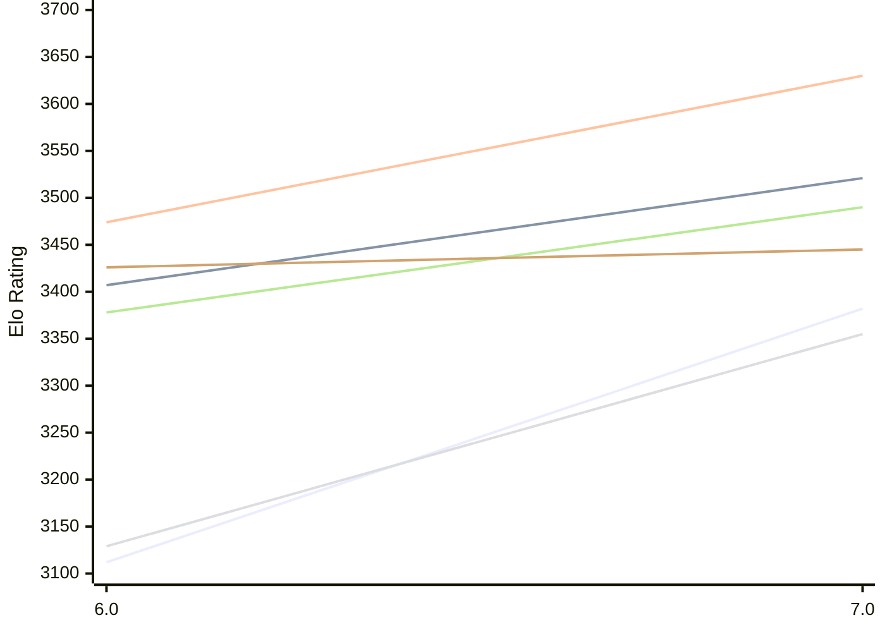
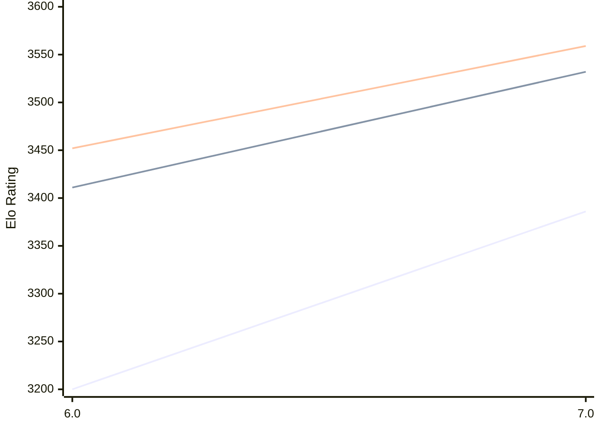

# Engine: Devre

Author: Ömer Faruk Tutkun

Home: https://github.com/OmerFarukTutkun/Devre

## Elo Ratings E1 (Ultra 7 265T (1.50 GHz) - E-Core)

| Version | Published | STC 8.0+0.08s  | LTC 60.0+0.60s | VLTC 2m24s+1.12s | Comment |
| --- | --- | --- | --- | --- | --- |
| 7.0 | 2026-08-07 | 3382(+270) | 3521(+114) | 3630(+156) |  |
| 6.0 | 2024-08-10 | 3112 | 3407 | 3474 |  |
 | | | cElo (∆ prev) | cElo (∆ prev) | cElo (∆ prev) | 

## Elo Ratings P1 (Ultra 7 265T (1.50 GHz) - P-Core)

| Version | Published | STC 8.0+0.08s  | LTC 60.0+0.60s | VLTC 2m24s+1.12s | Comment |
| --- | --- | --- | --- | --- | --- |
| 7.0 | 2026-08-07 | 3355(+226) | 3490(+112) | 3445(+19) |  |
| 6.0 | 2024-08-10 | 3129 | 3378 | 3426 |  |
 | | | cElo (∆ prev) | cElo (∆ prev) | cElo (∆ prev) | 

## Elo Ratings T1 (i5-7500T 2.70GHz)

| Version | Published | STC 8.0+0.08s  | LTC 60.0+0.60s | VLTC 2m24s+1.12s | Comment |
| --- | --- | --- | --- | --- | --- |
| 7.0 | 2026-08-07 | 3386(+186) | 3532(+121) | 3559(+107) |  |
| 6.0 | 2024-08-10 | 3200 | 3411 | 3452 |  |
 | | | cElo (∆ prev) | cElo (∆ prev) | cElo (∆ prev) | 

<a href="https://github.com/computer-chess-index/cci/issues/new?template=submit-version.yml&title=[VERSION]+Devre+<version>&body=###%20Engine%20name%0ADevre%0A%0A###%20Version%0A7.0" target="_blank">Submit new version</a>

 Test Conditions:

GUI/CLI: <a href=https://github.com/cutechess/cutechess target="_blank">Cute-Chess</a> 
Elo Calculation: <a href=https://www.remi-coulom.fr/Bayesian-Elo/ target="_blank">Bayesian-Elo</a> 
CPU for P1: Intel(R) Core(TM) Ultra 7 265T (1.50 GHz) - P-Core 
CPU for E1: Intel(R) Core(TM) Ultra 7 265T (1.50 GHz) - E-Core 
CPU for T1: Intel(R) Core(TM) i5-7500T 2.70GHz 
Opening book: 8_moves_v3 
\* STC: 8.0+0.08s, LTC: 60.0+0.60s, VLTC: 2m24s+1.12s

 Lists:
Ratings: <a href=https://github.com/computer-chess-index/cci/blob/main/lists/CCIRatings.csv target="_blank">Complete list</a>

Generated: 2026-11-15 05:37:46

## Ratings Verlauf E1 / P1

## Ratings Verlauf T1

## Detailed Evaluation Results

| Version | Time Control | Variant | Elo  | Range +/- | Matches | Score | Average Opponent Elo | Draws |
| --- | --- |--- | --- | --- | --- | --- | --- | --- |
| 7.0 | VLTC (2m24s+1.12s) | T1 | 3559 | 30 | 258 | 51% | 3545 | 84% |
|  |  | P1 | 3445 | 136 | 20 | 83% | 3097 | 35% |
|  |  | E1 | 3630 | 108 | 36 | 69% | 3173 | 33% |
|  | LTC (60.0+0.60s) | T1 | 3532 | 26 | 346 | 51% | 3511 | 81% |
|  |  | P1 | 3490 | 231 | 16 | 97% | 2861 | 6% |
|  |  | E1 | 3521 | 106 | 36 | 81% | 3089 | 39% |
|  | STC (8.0+0.08s) | T1 | 3386 | 26 | 378 | 54% | 3339 | 70% |
|  |  | P1 | 3355 | 124 | 18 | 69% | 3204 | 50% |
|  |  | E1 | 3382 | 69 | 56 | 58% | 3303 | 63% |
| --- | --- |--- | --- | --- | --- | --- | --- | --- |
| 6.0 | VLTC (2m24s+1.12s) | T1 | 3452 | 32 | 244 | 49% | 3456 | 76% |
|  |  | P1 | 3426 | 35 | 196 | 49% | 3433 | 75% |
|  |  | E1 | 3474 | 25 | 390 | 50% | 3475 | 73% |
|  | LTC (60.0+0.60s) | T1 | 3411 | 30 | 286 | 50% | 3411 | 71% |
|  |  | P1 | 3378 | 32 | 242 | 49% | 3386 | 75% |
|  |  | E1 | 3407 | 25 | 390 | 49% | 3418 | 74% |
|  | STC (8.0+0.08s) | T1 | 3200 | 32 | 268 | 48% | 3213 | 61% |
|  |  | P1 | 3129 | 31 | 280 | 49% | 3137 | 62% |
|  |  | E1 | 3112 | 25 | 452 | 44% | 3154 | 52% |