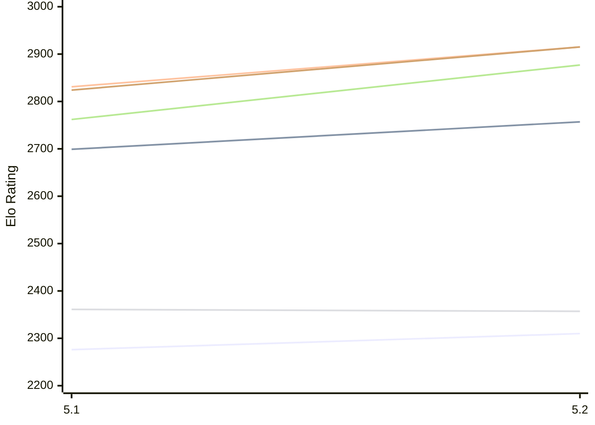
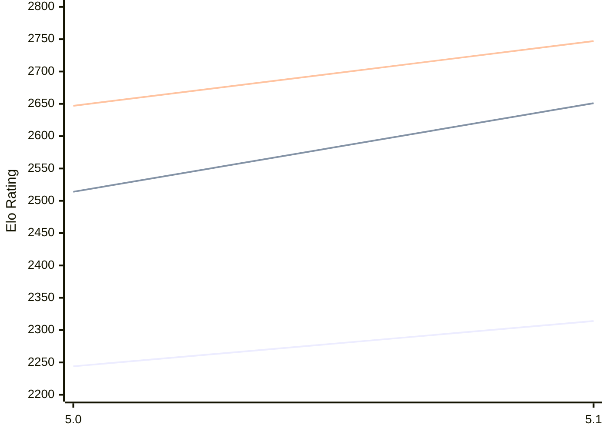

# Engine: Dorky

Author: Matt KcKnight

Home: https://github.com/matt-dot-net/dorky-release

## Elo Ratings E1 (Ultra 7 265T (1.50 GHz) - E-Core)

| Version | Published | STC 8.0+0.08s  | LTC 60.0+0.60s | VLTC 2m24s+1.12s | Comment |
| --- | --- | --- | --- | --- | --- |
| 5.2 | 2026-10-23 | 2310(+34) | 2757(+58) | 2915(+84) |  |
| 5.1 | 2026-08-21 | 2276 | 2699 | 2831 |  |
 | | | cElo (∆ prev) | cElo (∆ prev) | cElo (∆ prev) | 

## Elo Ratings P1 (Ultra 7 265T (1.50 GHz) - P-Core)

| Version | Published | STC 8.0+0.08s  | LTC 60.0+0.60s | VLTC 2m24s+1.12s | Comment |
| --- | --- | --- | --- | --- | --- |
| 5.2 | 2026-10-23 | 2357(-4) | 2877(+115) | 2915(+91) |  |
| 5.1 | 2026-08-21 | 2361 | 2762 | 2824 |  |
 | | | cElo (∆ prev) | cElo (∆ prev) | cElo (∆ prev) | 

## Elo Ratings T1 (i5-7500T 2.70GHz)

| Version | Published | STC 8.0+0.08s  | LTC 60.0+0.60s | VLTC 2m24s+1.12s | Comment |
| --- | --- | --- | --- | --- | --- |
| 5.1 | 2026-08-21 | 2314(+70) | 2651(+137) | 2747(+100) |  |
| 5.0 | 2026-08-08 | 2244 | 2514 | 2647 |  |
 | | | cElo (∆ prev) | cElo (∆ prev) | cElo (∆ prev) | 

<a href="https://github.com/computer-chess-index/cci/issues/new?template=submit-version.yml&title=[VERSION]+Dorky+<version>&body=###%20Engine%20name%0ADorky%0A%0A###%20Version%0A5.1" target="_blank">Submit new version</a>

 Test Conditions:

GUI/CLI: <a href=https://github.com/cutechess/cutechess target="_blank">Cute-Chess</a> 
Elo Calculation: <a href=https://www.remi-coulom.fr/Bayesian-Elo/ target="_blank">Bayesian-Elo</a> 
CPU for P1: Intel(R) Core(TM) Ultra 7 265T (1.50 GHz) - P-Core 
CPU for E1: Intel(R) Core(TM) Ultra 7 265T (1.50 GHz) - E-Core 
CPU for T1: Intel(R) Core(TM) i5-7500T 2.70GHz 
Opening book: 8_moves_v3 
\* STC: 8.0+0.08s, LTC: 60.0+0.60s, VLTC: 2m24s+1.12s

 Lists:
Ratings: <a href=https://github.com/computer-chess-index/cci/blob/main/lists/CCIRatings.csv target="_blank">Complete list</a>

Generated: 2026-11-01 05:37:56

## Ratings Verlauf E1 / P1

## Ratings Verlauf T1

## Detailed Evaluation Results

| Version | Time Control | Variant | Elo  | Range +/- | Matches | Score | Average Opponent Elo | Draws |
| --- | --- |--- | --- | --- | --- | --- | --- | --- |
| 5.2 | VLTC (2m24s+1.12s) | P1 | 2915 | 49 | 128 | 49% | 2924 | 38% |
|  |  | E1 | 2915 | 37 | 232 | 52% | 2898 | 37% |
|  | LTC (60.0+0.60s) | P1 | 2877 | 41 | 184 | 52% | 2859 | 36% |
|  |  | E1 | 2757 | 33 | 308 | 47% | 2782 | 31% |
|  | STC (8.0+0.08s) | P1 | 2357 | 48 | 136 | 51% | 2353 | 37% |
|  |  | E1 | 2310 | 42 | 188 | 49% | 2315 | 26% |
| --- | --- |--- | --- | --- | --- | --- | --- | --- |
| 5.1 | VLTC (2m24s+1.12s) | P1 | 2824 | 36 | 250 | 50% | 2827 | 31% |
|  |  | E1 | 2831 | 31 | 354 | 49% | 2850 | 29% |
|  |  | T1 | 2747 | 31 | 322 | 51% | 2736 | 37% |
|  | LTC (60.0+0.60s) | P1 | 2762 | 37 | 256 | 46% | 2803 | 26% |
|  |  | E1 | 2699 | 32 | 310 | 48% | 2714 | 34% |
|  |  | T1 | 2651 | 31 | 338 | 52% | 2631 | 30% |
|  | STC (8.0+0.08s) | E1 | 2276 | 36 | 268 | 49% | 2280 | 27% |
|  |  | T1 | 2314 | 37 | 236 | 50% | 2310 | 34% |
|  |  | P1 | 2361 | 40 | 214 | 49% | 2376 | 24% |
| --- | --- |--- | --- | --- | --- | --- | --- | --- |
| 5.0 | VLTC (2m24s+1.12s) | T1 | 2647 | 34 | 298 | 48% | 2668 | 27% |
|  | LTC (60.0+0.60s) | T1 | 2514 | 37 | 246 | 50% | 2480 | 29% |
|  | STC (8.0+0.08s) | T1 | 2244 | 32 | 336 | 50% | 2229 | 28% |