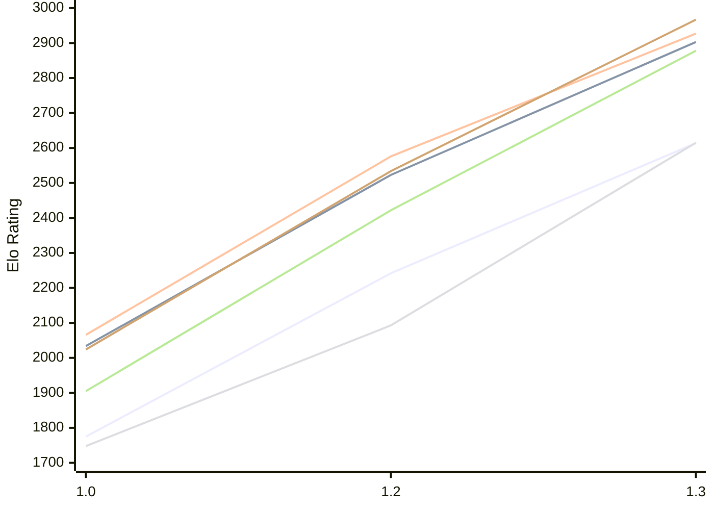
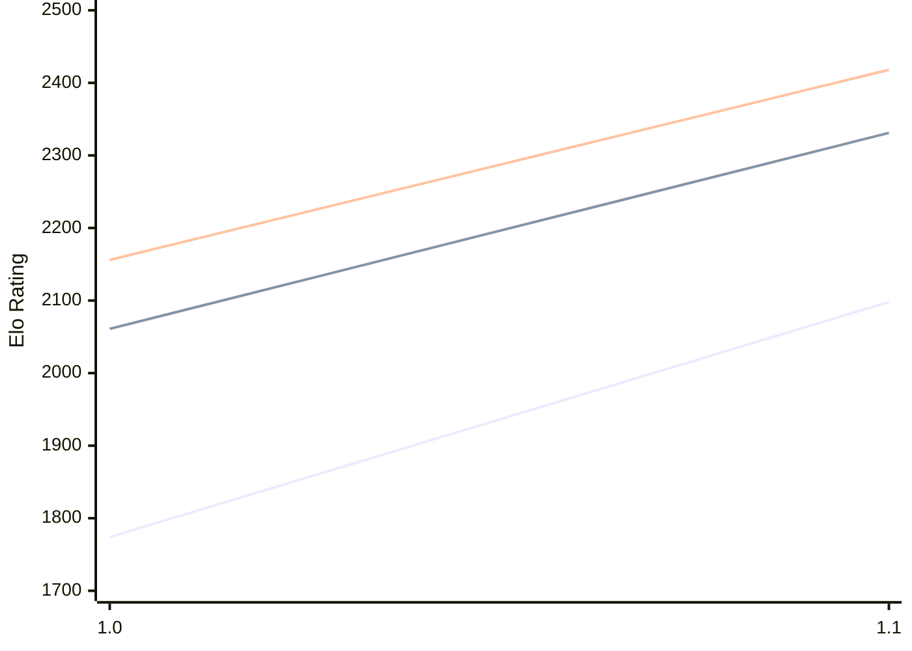

# Engine: Echekinator

Author: Timothee Fixy

Home: https://github.com/Tym972/Echekinator

## Elo Ratings E1 (Ultra 7 265T (1.50 GHz) - E-Core)

| Version | Published | STC 8.0+0.08s  | LTC 60.0+0.60s | VLTC 2m24s+1.12s | Comment |
| --- | --- | --- | --- | --- | --- |
| 1.3 | 2026-11-06 | 2614(+372) | 2903(+380) | 2927(+351) |  |
| 1.2 | 2026-10-14 | 2242(+467) | 2523(+489) | 2576(+510) |  |
| 1.0 | 2025-11-25 | 1775 | 2034 | 2066 |  |
 | | | cElo (∆ prev) | cElo (∆ prev) | cElo (∆ prev) | 

## Elo Ratings P1 (Ultra 7 265T (1.50 GHz) - P-Core)

| Version | Published | STC 8.0+0.08s  | LTC 60.0+0.60s | VLTC 2m24s+1.12s | Comment |
| --- | --- | --- | --- | --- | --- |
| 1.3 | 2026-11-06 | 2615(+522) | 2878(+456) | 2967(+433) |  |
| 1.2 | 2026-10-14 | 2093(+345) | 2422(+517) | 2534(+510) |  |
| 1.0 | 2025-11-25 | 1748 | 1905 | 2024 |  |
 | | | cElo (∆ prev) | cElo (∆ prev) | cElo (∆ prev) | 

## Elo Ratings T1 (i5-7500T 2.70GHz)

| Version | Published | STC 8.0+0.08s  | LTC 60.0+0.60s | VLTC 2m24s+1.12s | Comment |
| --- | --- | --- | --- | --- | --- |
| 1.1 | 2026-09-30 | 2098(+324) | 2331(+270) | 2418(+262) |  |
| 1.0 | 2025-11-25 | 1774 | 2061 | 2156 |  |
 | | | cElo (∆ prev) | cElo (∆ prev) | cElo (∆ prev) | 

<a href="https://github.com/computer-chess-index/cci/issues/new?template=submit-version.yml&title=[VERSION]+Echekinator+<version>&body=###%20Engine%20name%0AEchekinator%0A%0A###%20Version%0A1.1" target="_blank">Submit new version</a>

 Test Conditions:

GUI/CLI: <a href=https://github.com/cutechess/cutechess target="_blank">Cute-Chess</a> 
Elo Calculation: <a href=https://www.remi-coulom.fr/Bayesian-Elo/ target="_blank">Bayesian-Elo</a> 
CPU for P1: Intel(R) Core(TM) Ultra 7 265T (1.50 GHz) - P-Core 
CPU for E1: Intel(R) Core(TM) Ultra 7 265T (1.50 GHz) - E-Core 
CPU for T1: Intel(R) Core(TM) i5-7500T 2.70GHz 
Opening book: 8_moves_v3 
\* STC: 8.0+0.08s, LTC: 60.0+0.60s, VLTC: 2m24s+1.12s

 Lists:
Ratings: <a href=https://github.com/computer-chess-index/cci/blob/main/lists/CCIRatings.csv target="_blank">Complete list</a>

Generated: 2026-11-13 05:37:59

## Ratings Verlauf E1 / P1

## Ratings Verlauf T1

## Detailed Evaluation Results

| Version | Time Control | Variant | Elo  | Range +/- | Matches | Score | Average Opponent Elo | Draws |
| --- | --- |--- | --- | --- | --- | --- | --- | --- |
| 1.3 | VLTC (2m24s+1.12s) | E1 | 2927 | 33 | 280 | 52% | 2908 | 41% |
|  |  | P1 | 2967 | 41 | 172 | 49% | 2971 | 48% |
|  | LTC (60.0+0.60s) | E1 | 2903 | 27 | 410 | 48% | 2915 | 42% |
|  |  | P1 | 2878 | 38 | 202 | 49% | 2880 | 48% |
|  | STC (8.0+0.08s) | P1 | 2615 | 48 | 148 | 57% | 2545 | 29% |
|  |  | E1 | 2614 | 32 | 328 | 54% | 2570 | 27% |
| --- | --- |--- | --- | --- | --- | --- | --- | --- |
| 1.2 | VLTC (2m24s+1.12s) | P1 | 2534 | 44 | 166 | 53% | 2500 | 35% |
|  |  | E1 | 2576 | 35 | 286 | 49% | 2579 | 27% |
|  | LTC (60.0+0.60s) | P1 | 2422 | 46 | 168 | 53% | 2380 | 26% |
|  |  | E1 | 2523 | 36 | 278 | 51% | 2506 | 23% |
|  | STC (8.0+0.08s) | P1 | 2093 | 48 | 154 | 47% | 2117 | 20% |
|  |  | E1 | 2242 | 35 | 292 | 47% | 2279 | 24% |
| --- | --- |--- | --- | --- | --- | --- | --- | --- |
| 1.1 | VLTC (2m24s+1.12s) | T1 | 2418 | 43 | 188 | 53% | 2383 | 27% |
|  | LTC (60.0+0.60s) | T1 | 2331 | 42 | 194 | 51% | 2321 | 28% |
|  | STC (8.0+0.08s) | T1 | 2098 | 37 | 268 | 49% | 2109 | 21% |
| --- | --- |--- | --- | --- | --- | --- | --- | --- |
| 1.0 | VLTC (2m24s+1.12s) | P1 | 2024 | 51 | 156 | 54% | 1974 | 15% |
|  |  | E1 | 2066 | 42 | 208 | 45% | 2163 | 24% |
|  |  | T1 | 2156 | 26 | 544 | 47% | 2196 | 24% |
|  | LTC (60.0+0.60s) | E1 | 2034 | 40 | 228 | 45% | 2111 | 23% |
|  |  | T1 | 2061 | 23 | 684 | 51% | 2049 | 24% |
|  |  | P1 | 1905 | 46 | 164 | 49% | 1926 | 25% |
|  | STC (8.0+0.08s) | E1 | 1775 | 42 | 204 | 50% | 1778 | 20% |
|  |  | T1 | 1774 | 22 | 796 | 48% | 1790 | 18% |
|  |  | P1 | 1748 | 40 | 216 | 50% | 1747 | 23% |