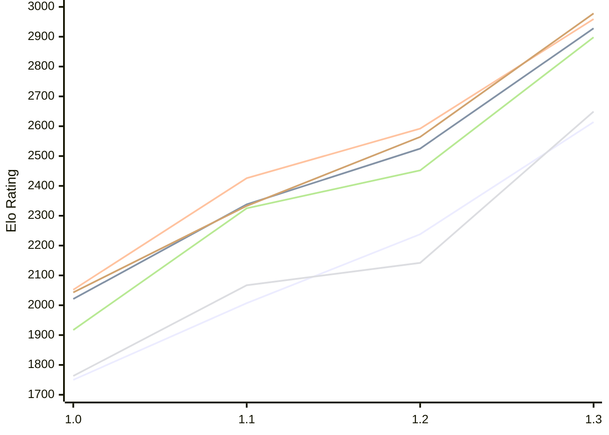
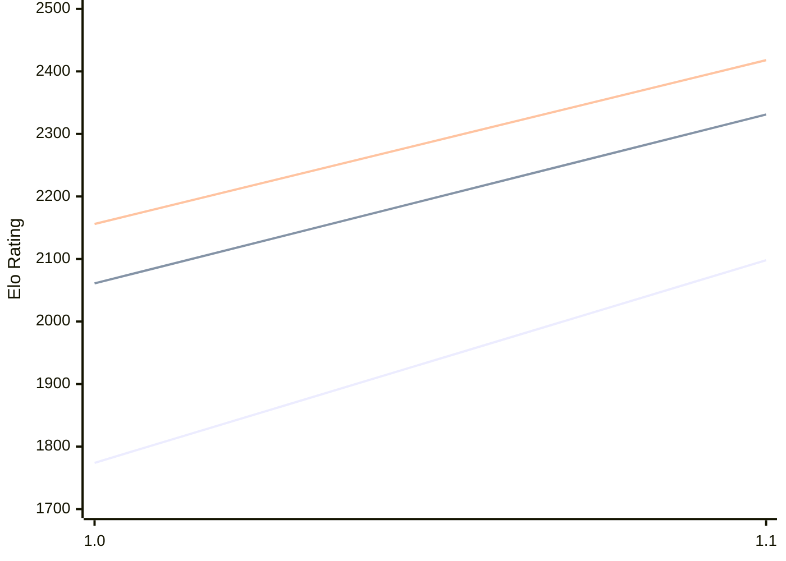

# Engine: Echekinator

Author: Timothee Fixy

Home: https://github.com/Tym972/Echekinator

## Elo Ratings E1 (Ultra 7 265T (1.50 GHz) - E-Core)

| Version | Published | STC 8.0+0.08s  | LTC 60.0+0.60s | VLTC 2m24s+1.12s | Comment |
| --- | --- | --- | --- | --- | --- |
| 1.3 | 2026-11-06 | 2614(+376) | 2928(+403) | 2959(+367) |  |
| 1.2 | 2026-10-14 | 2238(+231) | 2525(+187) | 2592(+166) |  |
| 1.1 | 2026-09-30 | 2007(+257) | 2338(+317) | 2426(+374) |  |
| 1.0 | 2025-11-25 | 1750 | 2021 | 2052 |  |
 | | | cElo (∆ prev) | cElo (∆ prev) | cElo (∆ prev) | 

## Elo Ratings P1 (Ultra 7 265T (1.50 GHz) - P-Core)

| Version | Published | STC 8.0+0.08s  | LTC 60.0+0.60s | VLTC 2m24s+1.12s | Comment |
| --- | --- | --- | --- | --- | --- |
| 1.3 | 2026-11-06 | 2649(+507) | 2898(+446) | 2978(+414) |  |
| 1.2 | 2026-10-14 | 2142(+75) | 2452(+127) | 2564(+231) |  |
| 1.1 | 2026-09-30 | 2067(+304) | 2325(+408) | 2333(+290) |  |
| 1.0 | 2025-11-25 | 1763 | 1917 | 2043 |  |
 | | | cElo (∆ prev) | cElo (∆ prev) | cElo (∆ prev) | 

## Elo Ratings T1 (i5-7500T 2.70GHz)

| Version | Published | STC 8.0+0.08s  | LTC 60.0+0.60s | VLTC 2m24s+1.12s | Comment |
| --- | --- | --- | --- | --- | --- |
| 1.1 | 2026-09-30 | 2098(+324) | 2331(+270) | 2418(+262) |  |
| 1.0 | 2025-11-25 | 1774 | 2061 | 2156 |  |
 | | | cElo (∆ prev) | cElo (∆ prev) | cElo (∆ prev) | 

<a href="https://github.com/computer-chess-index/cci/issues/new?template=submit-version.yml&title=[VERSION]+Echekinator+<version>&body=###%20Engine%20name%0AEchekinator%0A%0A###%20Version%0A1.1" target="_blank">Submit new version</a>

 Test Conditions:

GUI/CLI: <a href=https://github.com/cutechess/cutechess target="_blank">Cute-Chess</a> 
Elo Calculation: <a href=https://www.remi-coulom.fr/Bayesian-Elo/ target="_blank">Bayesian-Elo</a> 
CPU for P1: Intel(R) Core(TM) Ultra 7 265T (1.50 GHz) - P-Core 
CPU for E1: Intel(R) Core(TM) Ultra 7 265T (1.50 GHz) - E-Core 
CPU for T1: Intel(R) Core(TM) i5-7500T 2.70GHz 
Opening book: 8_moves_v3 
\* STC: 8.0+0.08s, LTC: 60.0+0.60s, VLTC: 2m24s+1.12s

 Lists:
Ratings: <a href=https://github.com/computer-chess-index/cci/blob/main/lists/CCIRatings.csv target="_blank">Complete list</a>

Generated: 2026-11-25 05:38:04

## Ratings Verlauf E1 / P1

## Ratings Verlauf T1

## Detailed Evaluation Results

| Version | Time Control | Variant | Elo  | Range +/- | Matches | Score | Average Opponent Elo | Draws |
| --- | --- |--- | --- | --- | --- | --- | --- | --- |
| 1.3 | VLTC (2m24s+1.12s) | E1 | 2959 | 31 | 312 | 52% | 2940 | 41% |
|  |  | P1 | 2978 | 37 | 210 | 49% | 2986 | 47% |
|  | LTC (60.0+0.60s) | E1 | 2928 | 26 | 464 | 48% | 2942 | 42% |
|  |  | P1 | 2898 | 34 | 258 | 49% | 2893 | 46% |
|  | STC (8.0+0.08s) | E1 | 2614 | 30 | 380 | 53% | 2588 | 27% |
|  |  | P1 | 2649 | 41 | 208 | 55% | 2604 | 29% |
| --- | --- |--- | --- | --- | --- | --- | --- | --- |
| 1.2 | VLTC (2m24s+1.12s) | P1 | 2564 | 44 | 170 | 53% | 2534 | 35% |
|  |  | E1 | 2592 | 34 | 294 | 49% | 2599 | 26% |
|  | LTC (60.0+0.60s) | P1 | 2452 | 42 | 204 | 52% | 2414 | 26% |
|  |  | E1 | 2525 | 33 | 326 | 51% | 2499 | 23% |
|  | STC (8.0+0.08s) | P1 | 2142 | 42 | 196 | 49% | 2149 | 22% |
|  |  | E1 | 2238 | 33 | 324 | 47% | 2275 | 24% |
| --- | --- |--- | --- | --- | --- | --- | --- | --- |
| 1.1 | VLTC (2m24s+1.12s) | E1 | 2426 | 35 | 274 | 45% | 2473 | 30% |
|  |  | T1 | 2418 | 43 | 188 | 53% | 2383 | 27% |
|  |  | P1 | 2333 | 68 | 72 | 38% | 2448 | 35% |
|  | LTC (60.0+0.60s) | E1 | 2338 | 45 | 176 | 45% | 2390 | 27% |
|  |  | T1 | 2331 | 42 | 194 | 51% | 2321 | 28% |
|  |  | P1 | 2325 | 56 | 120 | 42% | 2408 | 19% |
|  | STC (8.0+0.08s) | T1 | 2098 | 37 | 268 | 49% | 2109 | 21% |
|  |  | P1 | 2067 | 50 | 140 | 43% | 2140 | 27% |
|  |  | E1 | 2007 | 38 | 246 | 53% | 1985 | 21% |
| --- | --- |--- | --- | --- | --- | --- | --- | --- |
| 1.0 | VLTC (2m24s+1.12s) | T1 | 2156 | 26 | 544 | 47% | 2196 | 24% |
|  |  | P1 | 2043 | 51 | 156 | 54% | 1993 | 15% |
|  |  | E1 | 2052 | 42 | 208 | 45% | 2153 | 24% |
|  | LTC (60.0+0.60s) | T1 | 2061 | 23 | 684 | 51% | 2049 | 24% |
|  |  | P1 | 1917 | 46 | 164 | 49% | 1940 | 25% |
|  |  | E1 | 2021 | 40 | 228 | 45% | 2101 | 23% |
|  | STC (8.0+0.08s) | T1 | 1774 | 22 | 796 | 48% | 1790 | 18% |
|  |  | P1 | 1763 | 40 | 216 | 50% | 1763 | 23% |
|  |  | E1 | 1750 | 42 | 204 | 50% | 1751 | 20% |