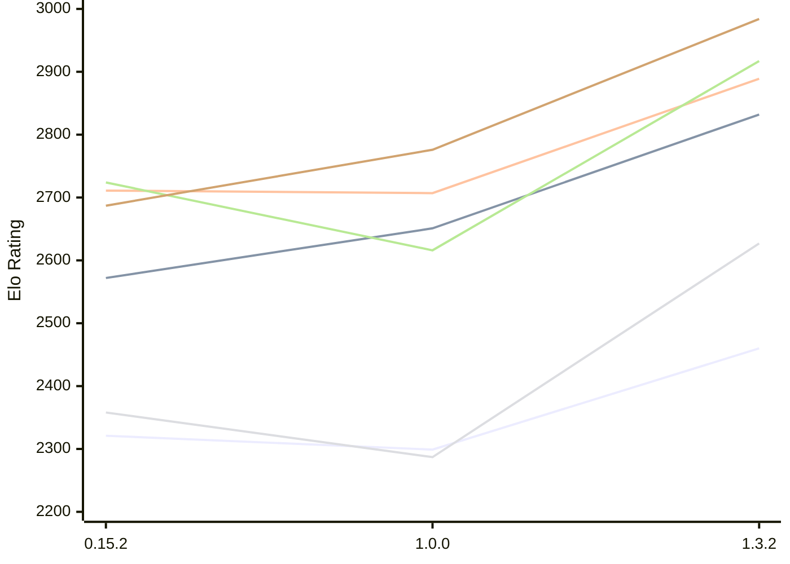

# Engine: ElephantGambit

Author: Ek Alexander Loodin

Home: https://github.com/looak/elephant

## Elo Ratings E1 (Ultra 7 265T (1.50 GHz) - E-Core)

| Version | Published | STC 8.0+0.08s  | LTC 60.0+0.60s | VLTC 2m24s+1.12s | Comment |
| --- | --- | --- | --- | --- | --- |
| 1.3.2 | 2026-10-25 | 2460(+161) | 2832(+181) | 2889(+182) |  |
| 1.0.0 | 2026-10-14 | 2299(-22) | 2651(+79) | 2707(-4) |  |
| 0.15.2 | 2026-10-11 | 2321(+1483) | 2572(+new) | 2711(+30) |  |
| 0.15.1 | 2026-10-11 | 838 |  | 2681 |  |
 | | | cElo (∆ prev) | cElo (∆ prev) | cElo (∆ prev) | 

## Elo Ratings P1 (Ultra 7 265T (1.50 GHz) - P-Core)

| Version | Published | STC 8.0+0.08s  | LTC 60.0+0.60s | VLTC 2m24s+1.12s | Comment |
| --- | --- | --- | --- | --- | --- |
| 1.3.2 | 2026-10-25 | 2627(+340) | 2917(+301) | 2984(+208) |  |
| 1.0.0 | 2026-10-14 | 2287(-71) | 2616(-108) | 2776(+89) |  |
| 0.15.2 | 2026-10-11 | 2358 | 2724 | 2687 |  |
 | | | cElo (∆ prev) | cElo (∆ prev) | cElo (∆ prev) | 

## Elo Ratings T1 (i5-7500T 2.70GHz)

| Version | Published | STC 8.0+0.08s  | LTC 60.0+0.60s | VLTC 2m24s+1.12s | Comment |
| --- | --- | --- | --- | --- | --- |
| 0.15.2 | 2026-10-11 | 2358 | 2724 | 2687 |  |
 | | | cElo (∆ prev) | cElo (∆ prev) | cElo (∆ prev) | 

<a href="https://github.com/computer-chess-index/cci/issues/new?template=submit-version.yml&title=[VERSION]+ElephantGambit+<version>&body=###%20Engine%20name%0AElephantGambit%0A%0A###%20Version%0A1.3.2" target="_blank">Submit new version</a>

 Test Conditions:

GUI/CLI: <a href=https://github.com/cutechess/cutechess target="_blank">Cute-Chess</a> 
Elo Calculation: <a href=https://www.remi-coulom.fr/Bayesian-Elo/ target="_blank">Bayesian-Elo</a> 
CPU for P1: Intel(R) Core(TM) Ultra 7 265T (1.50 GHz) - P-Core 
CPU for E1: Intel(R) Core(TM) Ultra 7 265T (1.50 GHz) - E-Core 
CPU for T1: Intel(R) Core(TM) i5-7500T 2.70GHz 
Opening book: 8_moves_v3 
\* STC: 8.0+0.08s, LTC: 60.0+0.60s, VLTC: 2m24s+1.12s

 Lists:
Ratings: <a href=https://github.com/computer-chess-index/cci/blob/main/lists/CCIRatings.csv target="_blank">Complete list</a>

Generated: 2026-11-04 05:38:08

## Ratings Verlauf E1 / P1

## Detailed Evaluation Results

| Version | Time Control | Variant | Elo  | Range +/- | Matches | Score | Average Opponent Elo | Draws |
| --- | --- |--- | --- | --- | --- | --- | --- | --- |
| 1.3.2 | VLTC (2m24s+1.12s) | P1 | 2984 | 42 | 172 | 50% | 2984 | 40% |
|  |  | E1 | 2889 | 37 | 232 | 56% | 2840 | 39% |
|  | LTC (60.0+0.60s) | P1 | 2917 | 45 | 156 | 50% | 2923 | 35% |
|  |  | E1 | 2832 | 37 | 232 | 48% | 2849 | 34% |
|  | STC (8.0+0.08s) | P1 | 2627 | 48 | 148 | 52% | 2610 | 26% |
|  |  | E1 | 2460 | 40 | 202 | 49% | 2469 | 32% |
| --- | --- |--- | --- | --- | --- | --- | --- | --- |
| 1.0.0 | VLTC (2m24s+1.12s) | P1 | 2776 | 45 | 168 | 54% | 2753 | 27% |
|  |  | E1 | 2707 | 40 | 208 | 50% | 2707 | 25% |
|  | LTC (60.0+0.60s) | E1 | 2651 | 40 | 216 | 50% | 2651 | 26% |
|  |  | P1 | 2616 | 49 | 142 | 49% | 2653 | 28% |
|  | STC (8.0+0.08s) | E1 | 2299 | 40 | 220 | 50% | 2303 | 23% |
|  |  | P1 | 2287 | 47 | 156 | 54% | 2253 | 27% |
| --- | --- |--- | --- | --- | --- | --- | --- | --- |
| 0.15.2 | VLTC (2m24s+1.12s) | P1 | 2687 | 64 | 82 | 53% | 2653 | 28% |
|  |  | E1 | 2711 | 50 | 132 | 49% | 2722 | 28% |
|  | LTC (60.0+0.60s) | P1 | 2724 | 58 | 104 | 55% | 2662 | 28% |
|  |  | E1 | 2572 | 52 | 122 | 51% | 2553 | 30% |
|  | STC (8.0+0.08s) | P1 | 2358 | 65 | 90 | 55% | 2296 | 17% |
|  |  | E1 | 2321 | 49 | 156 | 55% | 2202 | 24% |
| --- | --- |--- | --- | --- | --- | --- | --- | --- |
| 0.15.1 | VLTC (2m24s+1.12s) | E1 | 2681 | 87 | 48 | 51% | 2658 | 19% |
|  | STC (8.0+0.08s) | P1 | 1767 | 330 | 16 | 100% | 710 | 0% |
|  |  | E1 | 838 | 341 | 6 | 100% | 267 | 0% |