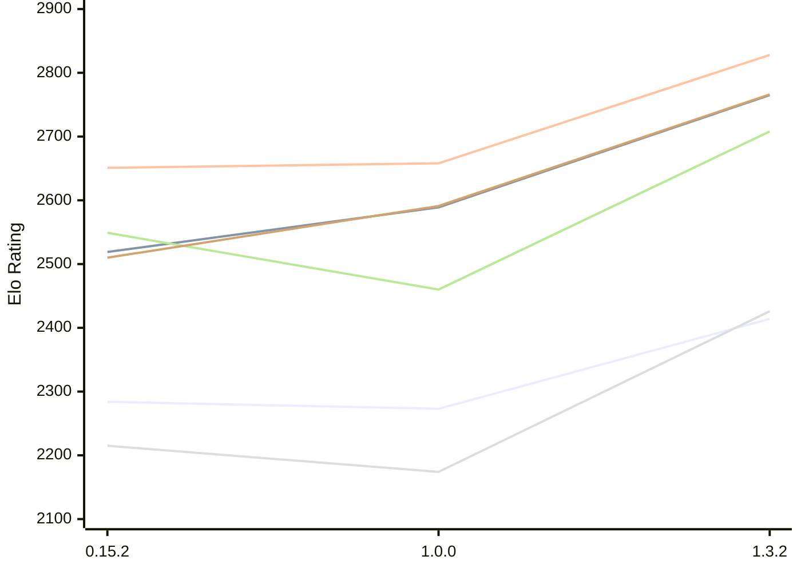

# Engine: ElephantGambit

Author: Ek Alexander Loodin

Home: https://github.com/looak/elephant

## Elo Ratings E1 (Ultra 7 265T (1.50 GHz) - E-Core)

| Version | Published | STC 8.0+0.08s  | LTC 60.0+0.60s | VLTC 2m24s+1.12s | Comment |
| --- | --- | --- | --- | --- | --- |
| 1.3.2 | 2026-10-25 | 2414(+141) | 2765(+176) | 2828(+170) |  |
| 1.0.0 | 2026-10-14 | 2273(-11) | 2589(+70) | 2658(+7) |  |
| 0.15.2 | 2026-10-11 | 2284(+1442) | 2519(+new) | 2651(+27) |  |
| 0.15.1 | 2026-10-11 | 842 |  | 2624 |  |
 | | | cElo (∆ prev) | cElo (∆ prev) | cElo (∆ prev) | 

## Elo Ratings P1 (Ultra 7 265T (1.50 GHz) - P-Core)

| Version | Published | STC 8.0+0.08s  | LTC 60.0+0.60s | VLTC 2m24s+1.12s | Comment |
| --- | --- | --- | --- | --- | --- |
| 1.3.2 | 2026-10-25 | 2426(+252) | 2708(+248) | 2766(+175) |  |
| 1.0.0 | 2026-10-14 | 2174(-41) | 2460(-89) | 2591(+81) |  |
| 0.15.2 | 2026-10-11 | 2215 | 2549 | 2510 |  |
 | | | cElo (∆ prev) | cElo (∆ prev) | cElo (∆ prev) | 

## Elo Ratings T1 (i5-7500T 2.70GHz)

| Version | Published | STC 8.0+0.08s  | LTC 60.0+0.60s | VLTC 2m24s+1.12s | Comment |
| --- | --- | --- | --- | --- | --- |
| 0.15.2 | 2026-10-11 | 2215 | 2549 | 2510 |  |
 | | | cElo (∆ prev) | cElo (∆ prev) | cElo (∆ prev) | 

<a href="https://github.com/computer-chess-index/cci/issues/new?template=submit-version.yml&title=[VERSION]+ElephantGambit+<version>&body=###%20Engine%20name%0AElephantGambit%0A%0A###%20Version%0A1.3.2" target="_blank">Submit new version</a>

 Test Conditions:

GUI/CLI: <a href=https://github.com/cutechess/cutechess target="_blank">Cute-Chess</a> 
Elo Calculation: <a href=https://www.remi-coulom.fr/Bayesian-Elo/ target="_blank">Bayesian-Elo</a> 
CPU for P1: Intel(R) Core(TM) Ultra 7 265T (1.50 GHz) - P-Core 
CPU for E1: Intel(R) Core(TM) Ultra 7 265T (1.50 GHz) - E-Core 
CPU for T1: Intel(R) Core(TM) i5-7500T 2.70GHz 
Opening book: 8_moves_v3 
\* STC: 8.0+0.08s, LTC: 60.0+0.60s, VLTC: 2m24s+1.12s

 Lists:
Ratings: <a href=https://github.com/computer-chess-index/cci/blob/main/lists/CCIRatings.csv target="_blank">Complete list</a>

Generated: 2026-11-14 05:37:56

## Ratings Verlauf E1 / P1

## Detailed Evaluation Results

| Version | Time Control | Variant | Elo  | Range +/- | Matches | Score | Average Opponent Elo | Draws |
| --- | --- |--- | --- | --- | --- | --- | --- | --- |
| 1.3.2 | VLTC (2m24s+1.12s) | P1 | 2766 | 37 | 224 | 47% | 2795 | 38% |
|  |  | E1 | 2828 | 31 | 332 | 53% | 2808 | 34% |
|  | LTC (60.0+0.60s) | P1 | 2708 | 40 | 208 | 48% | 2724 | 34% |
|  |  | E1 | 2765 | 32 | 320 | 48% | 2776 | 34% |
|  | STC (8.0+0.08s) | P1 | 2426 | 43 | 188 | 49% | 2439 | 26% |
|  |  | E1 | 2414 | 37 | 240 | 50% | 2402 | 32% |
| --- | --- |--- | --- | --- | --- | --- | --- | --- |
| 1.0.0 | VLTC (2m24s+1.12s) | P1 | 2591 | 42 | 192 | 52% | 2583 | 29% |
|  |  | E1 | 2658 | 40 | 220 | 50% | 2654 | 25% |
|  | LTC (60.0+0.60s) | P1 | 2460 | 46 | 162 | 51% | 2473 | 28% |
|  |  | E1 | 2589 | 38 | 244 | 49% | 2588 | 26% |
|  | STC (8.0+0.08s) | P1 | 2174 | 44 | 188 | 56% | 2125 | 23% |
|  |  | E1 | 2273 | 38 | 244 | 51% | 2261 | 22% |
| --- | --- |--- | --- | --- | --- | --- | --- | --- |
| 0.15.2 | VLTC (2m24s+1.12s) | P1 | 2510 | 64 | 82 | 53% | 2477 | 28% |
|  |  | E1 | 2651 | 50 | 132 | 49% | 2664 | 28% |
|  | LTC (60.0+0.60s) | P1 | 2549 | 58 | 104 | 55% | 2489 | 28% |
|  |  | E1 | 2519 | 52 | 122 | 51% | 2500 | 30% |
|  | STC (8.0+0.08s) | P1 | 2215 | 64 | 90 | 55% | 2155 | 17% |
|  |  | E1 | 2284 | 49 | 156 | 55% | 2168 | 24% |
| --- | --- |--- | --- | --- | --- | --- | --- | --- |
| 0.15.1 | VLTC (2m24s+1.12s) | E1 | 2624 | 87 | 48 | 51% | 2603 | 19% |
|  | STC (8.0+0.08s) | P1 | 1732 | 330 | 16 | 100% | 699 | 0% |
|  |  | E1 | 842 | 342 | 6 | 100% | 270 | 0% |