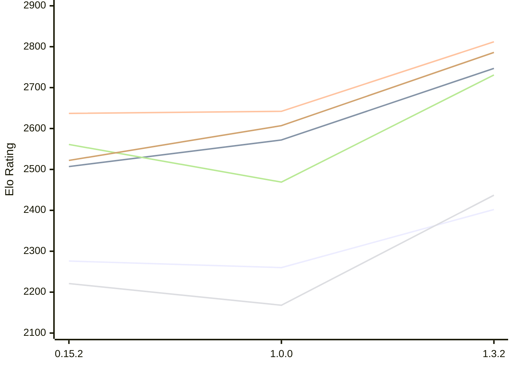

# Engine: ElephantGambit

Author: Ek Alexander Loodin

Home: https://github.com/looak/elephant

## Elo Ratings E1 (Ultra 7 265T (1.50 GHz) - E-Core)

| Version | Published | STC 8.0+0.08s  | LTC 60.0+0.60s | VLTC 2m24s+1.12s | Comment |
| --- | --- | --- | --- | --- | --- |
| 1.3.2 | 2026-10-25 | 2402(+142) | 2747(+175) | 2812(+170) |  |
| 1.0.0 | 2026-10-14 | 2260(-16) | 2572(+65) | 2642(+5) |  |
| 0.15.2 | 2026-10-11 | 2276(+1434) | 2507(+new) | 2637(+29) |  |
| 0.15.1 | 2026-10-11 | 842 |  | 2608 |  |
 | | | cElo (∆ prev) | cElo (∆ prev) | cElo (∆ prev) | 

## Elo Ratings P1 (Ultra 7 265T (1.50 GHz) - P-Core)

| Version | Published | STC 8.0+0.08s  | LTC 60.0+0.60s | VLTC 2m24s+1.12s | Comment |
| --- | --- | --- | --- | --- | --- |
| 1.3.2 | 2026-10-25 | 2437(+269) | 2731(+262) | 2786(+179) |  |
| 1.0.0 | 2026-10-14 | 2168(-53) | 2469(-92) | 2607(+85) |  |
| 0.15.2 | 2026-10-11 | 2221 | 2561 | 2522 |  |
 | | | cElo (∆ prev) | cElo (∆ prev) | cElo (∆ prev) | 

## Elo Ratings T1 (i5-7500T 2.70GHz)

| Version | Published | STC 8.0+0.08s  | LTC 60.0+0.60s | VLTC 2m24s+1.12s | Comment |
| --- | --- | --- | --- | --- | --- |
| 0.15.2 | 2026-10-11 | 2221 | 2561 | 2522 |  |
 | | | cElo (∆ prev) | cElo (∆ prev) | cElo (∆ prev) | 

<a href="https://github.com/computer-chess-index/cci/issues/new?template=submit-version.yml&title=[VERSION]+ElephantGambit+<version>&body=###%20Engine%20name%0AElephantGambit%0A%0A###%20Version%0A1.3.2" target="_blank">Submit new version</a>

 Test Conditions:

GUI/CLI: <a href=https://github.com/cutechess/cutechess target="_blank">Cute-Chess</a> 
Elo Calculation: <a href=https://www.remi-coulom.fr/Bayesian-Elo/ target="_blank">Bayesian-Elo</a> 
CPU for P1: Intel(R) Core(TM) Ultra 7 265T (1.50 GHz) - P-Core 
CPU for E1: Intel(R) Core(TM) Ultra 7 265T (1.50 GHz) - E-Core 
CPU for T1: Intel(R) Core(TM) i5-7500T 2.70GHz 
Opening book: 8_moves_v3 
\* STC: 8.0+0.08s, LTC: 60.0+0.60s, VLTC: 2m24s+1.12s

 Lists:
Ratings: <a href=https://github.com/computer-chess-index/cci/blob/main/lists/CCIRatings.csv target="_blank">Complete list</a>

Generated: 2026-11-13 05:38:07

## Ratings Verlauf E1 / P1

## Detailed Evaluation Results

| Version | Time Control | Variant | Elo  | Range +/- | Matches | Score | Average Opponent Elo | Draws |
| --- | --- |--- | --- | --- | --- | --- | --- | --- |
| 1.3.2 | VLTC (2m24s+1.12s) | P1 | 2786 | 38 | 220 | 48% | 2809 | 39% |
|  |  | E1 | 2812 | 32 | 324 | 53% | 2785 | 34% |
|  | LTC (60.0+0.60s) | P1 | 2731 | 42 | 184 | 48% | 2753 | 35% |
|  |  | E1 | 2747 | 32 | 320 | 48% | 2758 | 34% |
|  | STC (8.0+0.08s) | P1 | 2437 | 43 | 184 | 50% | 2438 | 26% |
|  |  | E1 | 2402 | 37 | 236 | 50% | 2391 | 32% |
| --- | --- |--- | --- | --- | --- | --- | --- | --- |
| 1.0.0 | VLTC (2m24s+1.12s) | E1 | 2642 | 40 | 220 | 50% | 2638 | 25% |
|  |  | P1 | 2607 | 43 | 184 | 52% | 2595 | 28% |
|  | LTC (60.0+0.60s) | E1 | 2572 | 39 | 232 | 49% | 2570 | 25% |
|  |  | P1 | 2469 | 46 | 162 | 51% | 2484 | 28% |
|  | STC (8.0+0.08s) | E1 | 2260 | 39 | 240 | 50% | 2250 | 21% |
|  |  | P1 | 2168 | 45 | 172 | 54% | 2142 | 25% |
| --- | --- |--- | --- | --- | --- | --- | --- | --- |
| 0.15.2 | VLTC (2m24s+1.12s) | P1 | 2522 | 64 | 82 | 53% | 2489 | 28% |
|  |  | E1 | 2637 | 50 | 132 | 49% | 2647 | 28% |
|  | LTC (60.0+0.60s) | P1 | 2561 | 58 | 104 | 55% | 2502 | 28% |
|  |  | E1 | 2507 | 52 | 122 | 51% | 2488 | 30% |
|  | STC (8.0+0.08s) | P1 | 2221 | 64 | 90 | 55% | 2161 | 17% |
|  |  | E1 | 2276 | 49 | 156 | 55% | 2160 | 24% |
| --- | --- |--- | --- | --- | --- | --- | --- | --- |
| 0.15.1 | VLTC (2m24s+1.12s) | E1 | 2608 | 87 | 48 | 51% | 2587 | 19% |
|  | STC (8.0+0.08s) | P1 | 1729 | 330 | 16 | 100% | 698 | 0% |
|  |  | E1 | 842 | 342 | 6 | 100% | 270 | 0% |