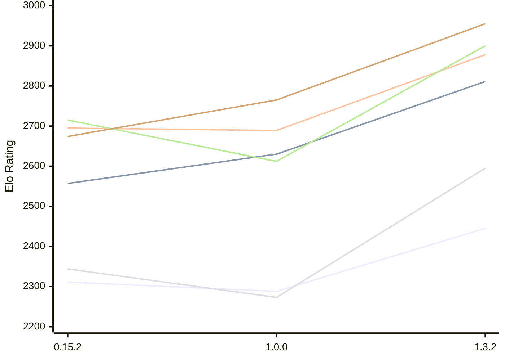

# Engine: ElephantGambit

Author: Ek Alexander Loodin

Home: https://github.com/looak/elephant

## Elo Ratings E1 (Ultra 7 265T (1.50 GHz) - E-Core)

| Version | Published | STC 8.0+0.08s  | LTC 60.0+0.60s | VLTC 2m24s+1.12s | Comment |
| --- | --- | --- | --- | --- | --- |
| 1.3.2 | 2026-10-25 | 2445(+157) | 2811(+181) | 2878(+189) |  |
| 1.0.0 | 2026-10-14 | 2288(-23) | 2630(+73) | 2689(-6) |  |
| 0.15.2 | 2026-10-11 | 2311(+1469) | 2557(+new) | 2695(+30) |  |
| 0.15.1 | 2026-10-11 | 842 |  | 2665 |  |
 | | | cElo (∆ prev) | cElo (∆ prev) | cElo (∆ prev) | 

## Elo Ratings P1 (Ultra 7 265T (1.50 GHz) - P-Core)

| Version | Published | STC 8.0+0.08s  | LTC 60.0+0.60s | VLTC 2m24s+1.12s | Comment |
| --- | --- | --- | --- | --- | --- |
| 1.3.2 | 2026-10-25 | 2595(+322) | 2900(+288) | 2955(+190) |  |
| 1.0.0 | 2026-10-14 | 2273(-71) | 2612(-103) | 2765(+91) |  |
| 0.15.2 | 2026-10-11 | 2344 | 2715 | 2674 |  |
 | | | cElo (∆ prev) | cElo (∆ prev) | cElo (∆ prev) | 

## Elo Ratings T1 (i5-7500T 2.70GHz)

| Version | Published | STC 8.0+0.08s  | LTC 60.0+0.60s | VLTC 2m24s+1.12s | Comment |
| --- | --- | --- | --- | --- | --- |
| 0.15.2 | 2026-10-11 | 2344 | 2715 | 2674 |  |
 | | | cElo (∆ prev) | cElo (∆ prev) | cElo (∆ prev) | 

<a href="https://github.com/computer-chess-index/cci/issues/new?template=submit-version.yml&title=[VERSION]+ElephantGambit+<version>&body=###%20Engine%20name%0AElephantGambit%0A%0A###%20Version%0A1.3.2" target="_blank">Submit new version</a>

 Test Conditions:

GUI/CLI: <a href=https://github.com/cutechess/cutechess target="_blank">Cute-Chess</a> 
Elo Calculation: <a href=https://www.remi-coulom.fr/Bayesian-Elo/ target="_blank">Bayesian-Elo</a> 
CPU for P1: Intel(R) Core(TM) Ultra 7 265T (1.50 GHz) - P-Core 
CPU for E1: Intel(R) Core(TM) Ultra 7 265T (1.50 GHz) - E-Core 
CPU for T1: Intel(R) Core(TM) i5-7500T 2.70GHz 
Opening book: 8_moves_v3 
\* STC: 8.0+0.08s, LTC: 60.0+0.60s, VLTC: 2m24s+1.12s

 Lists:
Ratings: <a href=https://github.com/computer-chess-index/cci/blob/main/lists/CCIRatings.csv target="_blank">Complete list</a>

Generated: 2026-11-12 05:37:55

## Ratings Verlauf E1 / P1

## Detailed Evaluation Results

| Version | Time Control | Variant | Elo  | Range +/- | Matches | Score | Average Opponent Elo | Draws |
| --- | --- |--- | --- | --- | --- | --- | --- | --- |
| 1.3.2 | VLTC (2m24s+1.12s) | P1 | 2955 | 38 | 216 | 48% | 2969 | 39% |
|  |  | E1 | 2878 | 32 | 320 | 54% | 2844 | 35% |
|  | LTC (60.0+0.60s) | P1 | 2900 | 42 | 180 | 49% | 2912 | 36% |
|  |  | E1 | 2811 | 32 | 312 | 49% | 2823 | 35% |
|  | STC (8.0+0.08s) | P1 | 2595 | 45 | 172 | 49% | 2599 | 24% |
|  |  | E1 | 2445 | 37 | 236 | 50% | 2437 | 32% |
| --- | --- |--- | --- | --- | --- | --- | --- | --- |
| 1.0.0 | VLTC (2m24s+1.12s) | P1 | 2765 | 44 | 176 | 53% | 2745 | 28% |
|  |  | E1 | 2689 | 40 | 208 | 50% | 2689 | 25% |
|  | LTC (60.0+0.60s) | P1 | 2612 | 47 | 150 | 50% | 2635 | 28% |
|  |  | E1 | 2630 | 39 | 224 | 50% | 2619 | 26% |
|  | STC (8.0+0.08s) | E1 | 2288 | 40 | 224 | 50% | 2275 | 22% |
|  |  | P1 | 2273 | 46 | 160 | 54% | 2236 | 26% |
| --- | --- |--- | --- | --- | --- | --- | --- | --- |
| 0.15.2 | VLTC (2m24s+1.12s) | P1 | 2674 | 64 | 82 | 53% | 2642 | 28% |
|  |  | E1 | 2695 | 50 | 132 | 49% | 2705 | 28% |
|  | LTC (60.0+0.60s) | P1 | 2715 | 58 | 104 | 55% | 2653 | 28% |
|  |  | E1 | 2557 | 52 | 122 | 51% | 2538 | 30% |
|  | STC (8.0+0.08s) | P1 | 2344 | 65 | 90 | 55% | 2280 | 17% |
|  |  | E1 | 2311 | 49 | 156 | 55% | 2191 | 24% |
| --- | --- |--- | --- | --- | --- | --- | --- | --- |
| 0.15.1 | VLTC (2m24s+1.12s) | E1 | 2665 | 87 | 48 | 51% | 2642 | 19% |
|  | STC (8.0+0.08s) | E1 | 842 | 342 | 6 | 100% | 270 | 0% |
|  |  | P1 | 1737 | 330 | 16 | 100% | 699 | 0% |