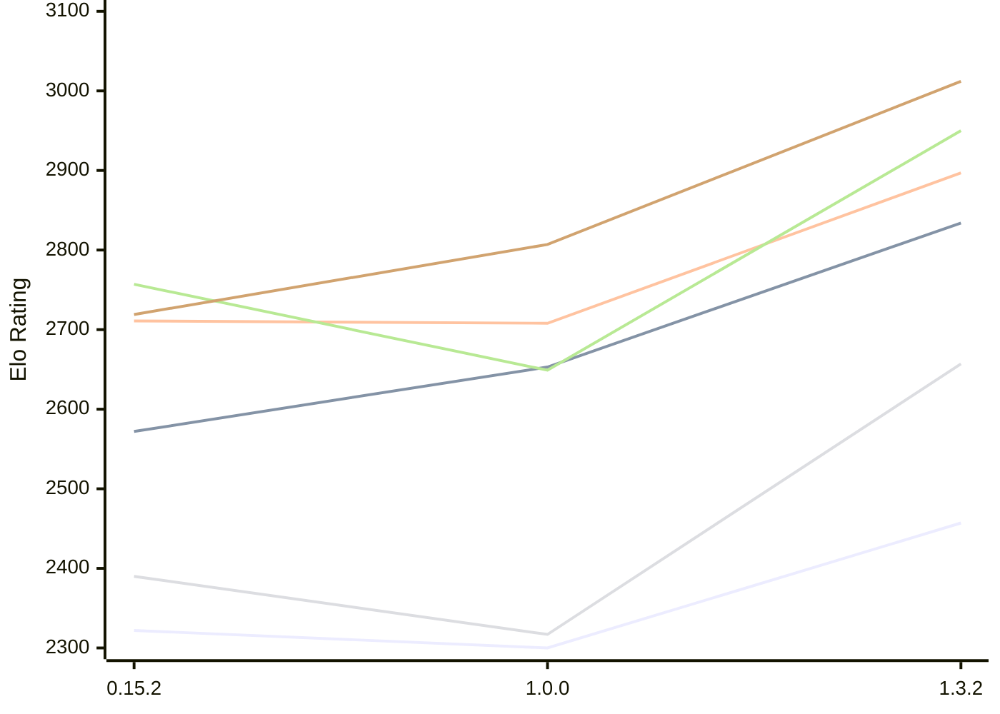

# Engine: ElephantGambit

Author: Ek Alexander Loodin

Home: https://github.com/looak/elephant

## Elo Ratings E1 (Ultra 7 265T (1.50 GHz) - E-Core)

| Version | Published | STC 8.0+0.08s  | LTC 60.0+0.60s | VLTC 2m24s+1.12s | Comment |
| --- | --- | --- | --- | --- | --- |
| 1.3.2 | 2026-10-25 | 2457(+157) | 2834(+181) | 2897(+189) |  |
| 1.0.0 | 2026-10-14 | 2300(-22) | 2653(+81) | 2708(-3) |  |
| 0.15.2 | 2026-10-11 | 2322(+1486) | 2572(+new) | 2711(+30) |  |
| 0.15.1 | 2026-10-11 | 836 |  | 2681 |  |
 | | | cElo (∆ prev) | cElo (∆ prev) | cElo (∆ prev) | 

## Elo Ratings P1 (Ultra 7 265T (1.50 GHz) - P-Core)

| Version | Published | STC 8.0+0.08s  | LTC 60.0+0.60s | VLTC 2m24s+1.12s | Comment |
| --- | --- | --- | --- | --- | --- |
| 1.3.2 | 2026-10-25 | 2657(+340) | 2950(+301) | 3012(+205) |  |
| 1.0.0 | 2026-10-14 | 2317(-73) | 2649(-108) | 2807(+88) |  |
| 0.15.2 | 2026-10-11 | 2390 | 2757 | 2719 |  |
 | | | cElo (∆ prev) | cElo (∆ prev) | cElo (∆ prev) | 

## Elo Ratings T1 (i5-7500T 2.70GHz)

| Version | Published | STC 8.0+0.08s  | LTC 60.0+0.60s | VLTC 2m24s+1.12s | Comment |
| --- | --- | --- | --- | --- | --- |
| 0.15.2 | 2026-10-11 | 2390 | 2757 | 2719 |  |
 | | | cElo (∆ prev) | cElo (∆ prev) | cElo (∆ prev) | 

<a href="https://github.com/computer-chess-index/cci/issues/new?template=submit-version.yml&title=[VERSION]+ElephantGambit+<version>&body=###%20Engine%20name%0AElephantGambit%0A%0A###%20Version%0A1.3.2" target="_blank">Submit new version</a>

 Test Conditions:

GUI/CLI: <a href=https://github.com/cutechess/cutechess target="_blank">Cute-Chess</a> 
Elo Calculation: <a href=https://www.remi-coulom.fr/Bayesian-Elo/ target="_blank">Bayesian-Elo</a> 
CPU for P1: Intel(R) Core(TM) Ultra 7 265T (1.50 GHz) - P-Core 
CPU for E1: Intel(R) Core(TM) Ultra 7 265T (1.50 GHz) - E-Core 
CPU for T1: Intel(R) Core(TM) i5-7500T 2.70GHz 
Opening book: 8_moves_v3 
\* STC: 8.0+0.08s, LTC: 60.0+0.60s, VLTC: 2m24s+1.12s

 Lists:
Ratings: <a href=https://github.com/computer-chess-index/cci/blob/main/lists/CCIRatings.csv target="_blank">Complete list</a>

Generated: 2026-11-05 05:37:57

## Ratings Verlauf E1 / P1

## Detailed Evaluation Results

| Version | Time Control | Variant | Elo  | Range +/- | Matches | Score | Average Opponent Elo | Draws |
| --- | --- |--- | --- | --- | --- | --- | --- | --- |
| 1.3.2 | VLTC (2m24s+1.12s) | P1 | 3012 | 41 | 180 | 49% | 3016 | 40% |
|  |  | E1 | 2897 | 34 | 272 | 55% | 2851 | 38% |
|  | LTC (60.0+0.60s) | P1 | 2950 | 44 | 164 | 50% | 2955 | 37% |
|  |  | E1 | 2834 | 36 | 252 | 48% | 2849 | 34% |
|  | STC (8.0+0.08s) | P1 | 2657 | 47 | 152 | 51% | 2643 | 26% |
|  |  | E1 | 2457 | 40 | 206 | 49% | 2471 | 32% |
| --- | --- |--- | --- | --- | --- | --- | --- | --- |
| 1.0.0 | VLTC (2m24s+1.12s) | P1 | 2807 | 45 | 168 | 54% | 2784 | 27% |
|  |  | E1 | 2708 | 40 | 208 | 50% | 2708 | 25% |
|  | LTC (60.0+0.60s) | E1 | 2653 | 40 | 216 | 50% | 2653 | 26% |
|  |  | P1 | 2649 | 49 | 142 | 49% | 2685 | 28% |
|  | STC (8.0+0.08s) | E1 | 2300 | 40 | 220 | 50% | 2303 | 23% |
|  |  | P1 | 2317 | 47 | 156 | 54% | 2283 | 27% |
| --- | --- |--- | --- | --- | --- | --- | --- | --- |
| 0.15.2 | VLTC (2m24s+1.12s) | P1 | 2719 | 64 | 82 | 53% | 2685 | 28% |
|  |  | E1 | 2711 | 50 | 132 | 49% | 2722 | 28% |
|  | LTC (60.0+0.60s) | P1 | 2757 | 58 | 104 | 55% | 2695 | 28% |
|  |  | E1 | 2572 | 52 | 122 | 51% | 2553 | 30% |
|  | STC (8.0+0.08s) | P1 | 2390 | 65 | 90 | 55% | 2327 | 17% |
|  |  | E1 | 2322 | 49 | 156 | 55% | 2202 | 24% |
| --- | --- |--- | --- | --- | --- | --- | --- | --- |
| 0.15.1 | VLTC (2m24s+1.12s) | E1 | 2681 | 87 | 48 | 51% | 2658 | 19% |
|  | STC (8.0+0.08s) | P1 | 1782 | 331 | 16 | 100% | 718 | 0% |
|  |  | E1 | 836 | 341 | 6 | 100% | 265 | 0% |