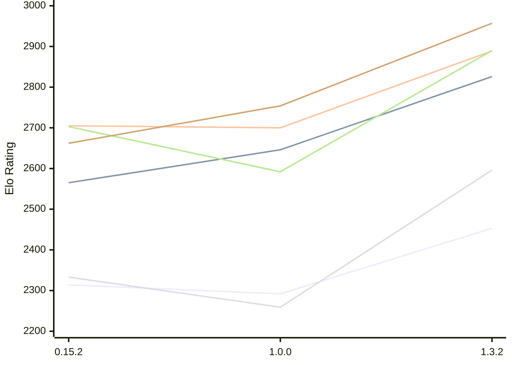

# Engine: ElephantGambit

Author: Ek Alexander Loodin

Home: https://github.com/looak/elephant

## Elo Ratings E1 (Ultra 7 265T (1.50 GHz) - E-Core)

| Version | Published | STC 8.0+0.08s  | LTC 60.0+0.60s | VLTC 2m24s+1.12s | Comment |
| --- | --- | --- | --- | --- | --- |
| 1.3.2 | 2026-10-25 | 2453(+161) | 2826(+180) | 2889(+189) |  |
| 1.0.0 | 2026-10-14 | 2292(-22) | 2646(+81) | 2700(-5) |  |
| 0.15.2 | 2026-10-11 | 2314(+1473) | 2565(+new) | 2705(+31) |  |
| 0.15.1 | 2026-10-11 | 841 |  | 2674 |  |
 | | | cElo (∆ prev) | cElo (∆ prev) | cElo (∆ prev) | 

## Elo Ratings P1 (Ultra 7 265T (1.50 GHz) - P-Core)

| Version | Published | STC 8.0+0.08s  | LTC 60.0+0.60s | VLTC 2m24s+1.12s | Comment |
| --- | --- | --- | --- | --- | --- |
| 1.3.2 | 2026-10-25 | 2596(+337) | 2890(+298) | 2957(+203) |  |
| 1.0.0 | 2026-10-14 | 2259(-74) | 2592(-111) | 2754(+92) |  |
| 0.15.2 | 2026-10-11 | 2333 | 2703 | 2662 |  |
 | | | cElo (∆ prev) | cElo (∆ prev) | cElo (∆ prev) | 

## Elo Ratings T1 (i5-7500T 2.70GHz)

| Version | Published | STC 8.0+0.08s  | LTC 60.0+0.60s | VLTC 2m24s+1.12s | Comment |
| --- | --- | --- | --- | --- | --- |
| 0.15.2 | 2026-10-11 | 2333 | 2703 | 2662 |  |
 | | | cElo (∆ prev) | cElo (∆ prev) | cElo (∆ prev) | 

<a href="https://github.com/computer-chess-index/cci/issues/new?template=submit-version.yml&title=[VERSION]+ElephantGambit+<version>&body=###%20Engine%20name%0AElephantGambit%0A%0A###%20Version%0A1.3.2" target="_blank">Submit new version</a>

 Test Conditions:

GUI/CLI: <a href=https://github.com/cutechess/cutechess target="_blank">Cute-Chess</a> 
Elo Calculation: <a href=https://www.remi-coulom.fr/Bayesian-Elo/ target="_blank">Bayesian-Elo</a> 
CPU for P1: Intel(R) Core(TM) Ultra 7 265T (1.50 GHz) - P-Core 
CPU for E1: Intel(R) Core(TM) Ultra 7 265T (1.50 GHz) - E-Core 
CPU for T1: Intel(R) Core(TM) i5-7500T 2.70GHz 
Opening book: 8_moves_v3 
\* STC: 8.0+0.08s, LTC: 60.0+0.60s, VLTC: 2m24s+1.12s

 Lists:
Ratings: <a href=https://github.com/computer-chess-index/cci/blob/main/lists/CCIRatings.csv target="_blank">Complete list</a>

Generated: 2026-11-09 05:38:01

## Ratings Verlauf E1 / P1

## Detailed Evaluation Results

| Version | Time Control | Variant | Elo  | Range +/- | Matches | Score | Average Opponent Elo | Draws |
| --- | --- |--- | --- | --- | --- | --- | --- | --- |
| 1.3.2 | VLTC (2m24s+1.12s) | P1 | 2957 | 40 | 196 | 49% | 2962 | 40% |
|  |  | E1 | 2889 | 32 | 312 | 54% | 2854 | 35% |
|  | LTC (60.0+0.60s) | P1 | 2890 | 43 | 172 | 49% | 2900 | 37% |
|  |  | E1 | 2826 | 34 | 284 | 48% | 2843 | 35% |
|  | STC (8.0+0.08s) | P1 | 2596 | 46 | 164 | 51% | 2587 | 25% |
|  |  | E1 | 2453 | 38 | 228 | 49% | 2460 | 32% |
| --- | --- |--- | --- | --- | --- | --- | --- | --- |
| 1.0.0 | VLTC (2m24s+1.12s) | P1 | 2754 | 45 | 168 | 54% | 2731 | 27% |
|  |  | E1 | 2700 | 40 | 208 | 50% | 2700 | 25% |
|  | LTC (60.0+0.60s) | P1 | 2592 | 49 | 142 | 49% | 2628 | 28% |
|  |  | E1 | 2646 | 40 | 216 | 50% | 2646 | 26% |
|  | STC (8.0+0.08s) | P1 | 2259 | 47 | 156 | 54% | 2225 | 27% |
|  |  | E1 | 2292 | 40 | 220 | 50% | 2296 | 23% |
| --- | --- |--- | --- | --- | --- | --- | --- | --- |
| 0.15.2 | VLTC (2m24s+1.12s) | P1 | 2662 | 64 | 82 | 53% | 2628 | 28% |
|  |  | E1 | 2705 | 50 | 132 | 49% | 2715 | 28% |
|  | LTC (60.0+0.60s) | P1 | 2703 | 58 | 104 | 55% | 2641 | 28% |
|  |  | E1 | 2565 | 52 | 122 | 51% | 2546 | 30% |
|  | STC (8.0+0.08s) | P1 | 2333 | 65 | 90 | 55% | 2269 | 17% |
|  |  | E1 | 2314 | 49 | 156 | 55% | 2195 | 24% |
| --- | --- |--- | --- | --- | --- | --- | --- | --- |
| 0.15.1 | VLTC (2m24s+1.12s) | E1 | 2674 | 87 | 48 | 51% | 2651 | 19% |
|  | STC (8.0+0.08s) | P1 | 1733 | 330 | 16 | 100% | 697 | 0% |
|  |  | E1 | 841 | 342 | 6 | 100% | 269 | 0% |