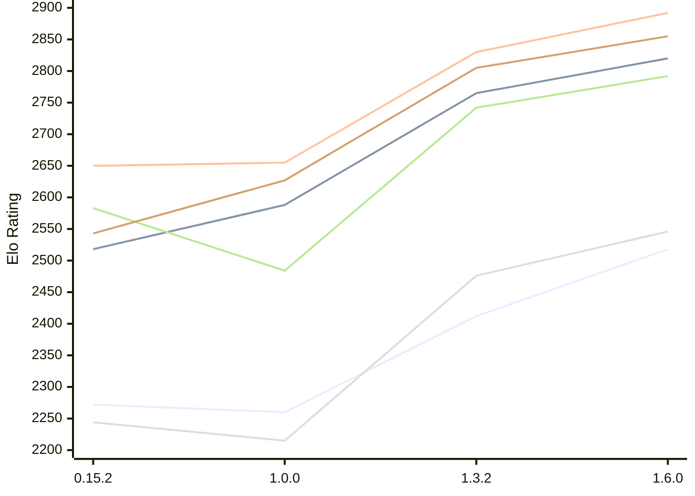

# Engine: ElephantGambit

Author: Ek Alexander Loodin

Home: https://github.com/looak/elephant

## Elo Ratings E1 (Ultra 7 265T (1.50 GHz) - E-Core)

| Version | Published | STC 8.0+0.08s  | LTC 60.0+0.60s | VLTC 2m24s+1.12s | Comment |
| --- | --- | --- | --- | --- | --- |
| 1.6.0 | 2026-11-19 | 2518(+106) | 2820(+55) | 2892(+62) |  |
| 1.3.2 | 2026-10-25 | 2412(+152) | 2765(+177) | 2830(+175) |  |
| 1.0.0 | 2026-10-14 | 2260(-12) | 2588(+70) | 2655(+5) |  |
| 0.15.2 | 2026-10-11 | 2272(+1454) | 2518(+new) | 2650(+27) |  |
| 0.15.1 | 2026-10-11 | 818 |  | 2623 |  |
 | | | cElo (∆ prev) | cElo (∆ prev) | cElo (∆ prev) | 

## Elo Ratings P1 (Ultra 7 265T (1.50 GHz) - P-Core)

| Version | Published | STC 8.0+0.08s  | LTC 60.0+0.60s | VLTC 2m24s+1.12s | Comment |
| --- | --- | --- | --- | --- | --- |
| 1.6.0 | 2026-11-19 | 2546(+70) | 2792(+50) | 2855(+50) |  |
| 1.3.2 | 2026-10-25 | 2476(+261) | 2742(+258) | 2805(+178) |  |
| 1.0.0 | 2026-10-14 | 2215(-29) | 2484(-99) | 2627(+84) |  |
| 0.15.2 | 2026-10-11 | 2244 | 2583 | 2543 |  |
 | | | cElo (∆ prev) | cElo (∆ prev) | cElo (∆ prev) | 

## Elo Ratings T1 (i5-7500T 2.70GHz)

| Version | Published | STC 8.0+0.08s  | LTC 60.0+0.60s | VLTC 2m24s+1.12s | Comment |
| --- | --- | --- | --- | --- | --- |
| 0.15.2 | 2026-10-11 | 2244 | 2583 | 2543 |  |
 | | | cElo (∆ prev) | cElo (∆ prev) | cElo (∆ prev) | 

<a href="https://github.com/computer-chess-index/cci/issues/new?template=submit-version.yml&title=[VERSION]+ElephantGambit+<version>&body=###%20Engine%20name%0AElephantGambit%0A%0A###%20Version%0A1.6.0" target="_blank">Submit new version</a>

 Test Conditions:

GUI/CLI: <a href=https://github.com/cutechess/cutechess target="_blank">Cute-Chess</a> 
Elo Calculation: <a href=https://www.remi-coulom.fr/Bayesian-Elo/ target="_blank">Bayesian-Elo</a> 
CPU for P1: Intel(R) Core(TM) Ultra 7 265T (1.50 GHz) - P-Core 
CPU for E1: Intel(R) Core(TM) Ultra 7 265T (1.50 GHz) - E-Core 
CPU for T1: Intel(R) Core(TM) i5-7500T 2.70GHz 
Opening book: 8_moves_v3 
\* STC: 8.0+0.08s, LTC: 60.0+0.60s, VLTC: 2m24s+1.12s

 Lists:
Ratings: <a href=https://github.com/computer-chess-index/cci/blob/main/lists/CCIRatings.csv target="_blank">Complete list</a>

Generated: 2026-11-23 05:38:06

## Ratings Verlauf E1 / P1

## Detailed Evaluation Results

| Version | Time Control | Variant | Elo  | Range +/- | Matches | Score | Average Opponent Elo | Draws |
| --- | --- |--- | --- | --- | --- | --- | --- | --- |
| 1.6.0 | VLTC (2m24s+1.12s) | P1 | 2855 | 56 | 100 | 57% | 2796 | 39% |
|  |  | E1 | 2892 | 40 | 192 | 52% | 2870 | 41% |
|  | LTC (60.0+0.60s) | P1 | 2792 | 58 | 96 | 52% | 2772 | 29% |
|  |  | E1 | 2820 | 33 | 276 | 54% | 2789 | 39% |
|  | STC (8.0+0.08s) | P1 | 2546 | 48 | 144 | 46% | 2579 | 30% |
|  |  | E1 | 2518 | 51 | 116 | 52% | 2499 | 39% |
| --- | --- |--- | --- | --- | --- | --- | --- | --- |
| 1.3.2 | VLTC (2m24s+1.12s) | P1 | 2805 | 35 | 256 | 47% | 2838 | 38% |
|  |  | E1 | 2830 | 30 | 360 | 52% | 2812 | 34% |
|  | LTC (60.0+0.60s) | P1 | 2742 | 38 | 232 | 48% | 2761 | 33% |
|  |  | E1 | 2765 | 31 | 344 | 48% | 2778 | 33% |
|  | STC (8.0+0.08s) | P1 | 2476 | 40 | 208 | 50% | 2475 | 27% |
|  |  | E1 | 2412 | 35 | 268 | 50% | 2407 | 30% |
| --- | --- |--- | --- | --- | --- | --- | --- | --- |
| 1.0.0 | VLTC (2m24s+1.12s) | P1 | 2627 | 40 | 208 | 52% | 2618 | 28% |
|  |  | E1 | 2655 | 39 | 232 | 50% | 2662 | 24% |
|  | LTC (60.0+0.60s) | P1 | 2484 | 42 | 186 | 50% | 2502 | 29% |
|  |  | E1 | 2588 | 37 | 254 | 49% | 2588 | 26% |
|  | STC (8.0+0.08s) | P1 | 2215 | 39 | 236 | 57% | 2159 | 22% |
|  |  | E1 | 2260 | 38 | 256 | 50% | 2252 | 21% |
| --- | --- |--- | --- | --- | --- | --- | --- | --- |
| 0.15.2 | VLTC (2m24s+1.12s) | P1 | 2543 | 64 | 82 | 53% | 2510 | 28% |
|  |  | E1 | 2650 | 50 | 132 | 49% | 2661 | 28% |
|  | LTC (60.0+0.60s) | P1 | 2583 | 58 | 104 | 55% | 2522 | 28% |
|  |  | E1 | 2518 | 52 | 122 | 51% | 2498 | 30% |
|  | STC (8.0+0.08s) | E1 | 2272 | 49 | 156 | 55% | 2153 | 24% |
|  |  | P1 | 2244 | 64 | 90 | 55% | 2182 | 17% |
| --- | --- |--- | --- | --- | --- | --- | --- | --- |
| 0.15.1 | VLTC (2m24s+1.12s) | E1 | 2623 | 87 | 48 | 51% | 2601 | 19% |
|  | STC (8.0+0.08s) | P1 | 1728 | 331 | 16 | 100% | 694 | 0% |
|  |  | E1 | 818 | 341 | 6 | 100% | 251 | 0% |