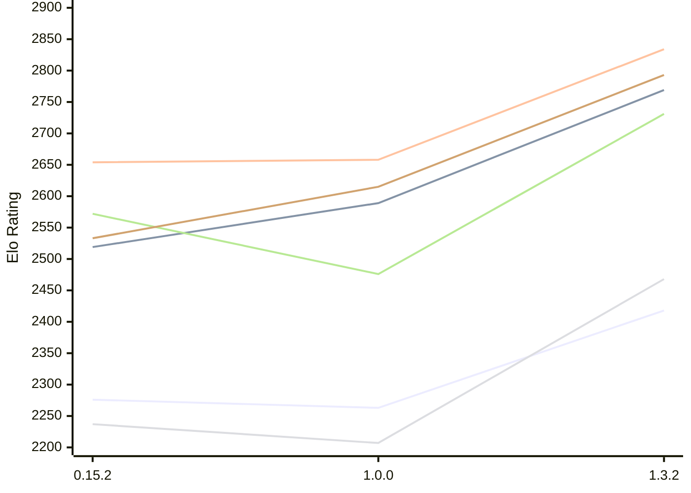

# Engine: ElephantGambit

Author: Ek Alexander Loodin

Home: https://github.com/looak/elephant

## Elo Ratings E1 (Ultra 7 265T (1.50 GHz) - E-Core)

| Version | Published | STC 8.0+0.08s  | LTC 60.0+0.60s | VLTC 2m24s+1.12s | Comment |
| --- | --- | --- | --- | --- | --- |
| 1.3.2 | 2026-10-25 | 2418(+155) | 2769(+180) | 2834(+176) |  |
| 1.0.0 | 2026-10-14 | 2263(-13) | 2589(+70) | 2658(+4) |  |
| 0.15.2 | 2026-10-11 | 2276(+1455) | 2519(+new) | 2654(+27) |  |
| 0.15.1 | 2026-10-11 | 821 |  | 2627 |  |
 | | | cElo (∆ prev) | cElo (∆ prev) | cElo (∆ prev) | 

## Elo Ratings P1 (Ultra 7 265T (1.50 GHz) - P-Core)

| Version | Published | STC 8.0+0.08s  | LTC 60.0+0.60s | VLTC 2m24s+1.12s | Comment |
| --- | --- | --- | --- | --- | --- |
| 1.3.2 | 2026-10-25 | 2468(+261) | 2731(+255) | 2793(+178) |  |
| 1.0.0 | 2026-10-14 | 2207(-30) | 2476(-96) | 2615(+82) |  |
| 0.15.2 | 2026-10-11 | 2237 | 2572 | 2533 |  |
 | | | cElo (∆ prev) | cElo (∆ prev) | cElo (∆ prev) | 

## Elo Ratings T1 (i5-7500T 2.70GHz)

| Version | Published | STC 8.0+0.08s  | LTC 60.0+0.60s | VLTC 2m24s+1.12s | Comment |
| --- | --- | --- | --- | --- | --- |
| 0.15.2 | 2026-10-11 | 2237 | 2572 | 2533 |  |
 | | | cElo (∆ prev) | cElo (∆ prev) | cElo (∆ prev) | 

<a href="https://github.com/computer-chess-index/cci/issues/new?template=submit-version.yml&title=[VERSION]+ElephantGambit+<version>&body=###%20Engine%20name%0AElephantGambit%0A%0A###%20Version%0A1.3.2" target="_blank">Submit new version</a>

 Test Conditions:

GUI/CLI: <a href=https://github.com/cutechess/cutechess target="_blank">Cute-Chess</a> 
Elo Calculation: <a href=https://www.remi-coulom.fr/Bayesian-Elo/ target="_blank">Bayesian-Elo</a> 
CPU for P1: Intel(R) Core(TM) Ultra 7 265T (1.50 GHz) - P-Core 
CPU for E1: Intel(R) Core(TM) Ultra 7 265T (1.50 GHz) - E-Core 
CPU for T1: Intel(R) Core(TM) i5-7500T 2.70GHz 
Opening book: 8_moves_v3 
\* STC: 8.0+0.08s, LTC: 60.0+0.60s, VLTC: 2m24s+1.12s

 Lists:
Ratings: <a href=https://github.com/computer-chess-index/cci/blob/main/lists/CCIRatings.csv target="_blank">Complete list</a>

Generated: 2026-11-20 05:38:05

## Ratings Verlauf E1 / P1

## Detailed Evaluation Results

| Version | Time Control | Variant | Elo  | Range +/- | Matches | Score | Average Opponent Elo | Draws |
| --- | --- |--- | --- | --- | --- | --- | --- | --- |
| 1.3.2 | VLTC (2m24s+1.12s) | P1 | 2793 | 35 | 256 | 47% | 2826 | 38% |
|  |  | E1 | 2834 | 30 | 360 | 52% | 2817 | 34% |
|  | LTC (60.0+0.60s) | P1 | 2731 | 38 | 228 | 48% | 2751 | 32% |
|  |  | E1 | 2769 | 31 | 344 | 48% | 2782 | 33% |
|  | STC (8.0+0.08s) | P1 | 2468 | 40 | 208 | 50% | 2466 | 27% |
|  |  | E1 | 2418 | 35 | 268 | 50% | 2411 | 30% |
| --- | --- |--- | --- | --- | --- | --- | --- | --- |
| 1.0.0 | VLTC (2m24s+1.12s) | E1 | 2658 | 39 | 232 | 50% | 2665 | 24% |
|  |  | P1 | 2615 | 40 | 208 | 52% | 2606 | 28% |
|  | LTC (60.0+0.60s) | P1 | 2476 | 42 | 186 | 50% | 2493 | 29% |
|  |  | E1 | 2589 | 37 | 254 | 49% | 2589 | 26% |
|  | STC (8.0+0.08s) | P1 | 2207 | 39 | 236 | 57% | 2152 | 22% |
|  |  | E1 | 2263 | 38 | 256 | 50% | 2255 | 21% |
| --- | --- |--- | --- | --- | --- | --- | --- | --- |
| 0.15.2 | VLTC (2m24s+1.12s) | P1 | 2533 | 64 | 82 | 53% | 2500 | 28% |
|  |  | E1 | 2654 | 50 | 132 | 49% | 2665 | 28% |
|  | LTC (60.0+0.60s) | P1 | 2572 | 58 | 104 | 55% | 2512 | 28% |
|  |  | E1 | 2519 | 52 | 122 | 51% | 2500 | 30% |
|  | STC (8.0+0.08s) | P1 | 2237 | 64 | 90 | 55% | 2175 | 17% |
|  |  | E1 | 2276 | 49 | 156 | 55% | 2157 | 24% |
| --- | --- |--- | --- | --- | --- | --- | --- | --- |
| 0.15.1 | VLTC (2m24s+1.12s) | E1 | 2627 | 87 | 48 | 51% | 2606 | 19% |
|  | STC (8.0+0.08s) | P1 | 1725 | 331 | 16 | 100% | 694 | 0% |
|  |  | E1 | 821 | 341 | 6 | 100% | 254 | 0% |