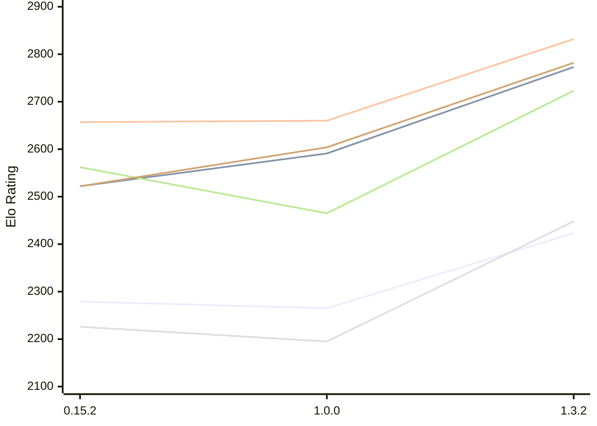

# Engine: ElephantGambit

Author: Ek Alexander Loodin

Home: https://github.com/looak/elephant

## Elo Ratings E1 (Ultra 7 265T (1.50 GHz) - E-Core)

| Version | Published | STC 8.0+0.08s  | LTC 60.0+0.60s | VLTC 2m24s+1.12s | Comment |
| --- | --- | --- | --- | --- | --- |
| 1.3.2 | 2026-10-25 | 2423(+158) | 2773(+182) | 2832(+172) |  |
| 1.0.0 | 2026-10-14 | 2265(-14) | 2591(+69) | 2660(+3) |  |
| 0.15.2 | 2026-10-11 | 2279(+1449) | 2522(+new) | 2657(+29) |  |
| 0.15.1 | 2026-10-11 | 830 |  | 2628 |  |
 | | | cElo (∆ prev) | cElo (∆ prev) | cElo (∆ prev) | 

## Elo Ratings P1 (Ultra 7 265T (1.50 GHz) - P-Core)

| Version | Published | STC 8.0+0.08s  | LTC 60.0+0.60s | VLTC 2m24s+1.12s | Comment |
| --- | --- | --- | --- | --- | --- |
| 1.3.2 | 2026-10-25 | 2448(+253) | 2723(+258) | 2782(+178) |  |
| 1.0.0 | 2026-10-14 | 2195(-31) | 2465(-97) | 2604(+82) |  |
| 0.15.2 | 2026-10-11 | 2226 | 2562 | 2522 |  |
 | | | cElo (∆ prev) | cElo (∆ prev) | cElo (∆ prev) | 

## Elo Ratings T1 (i5-7500T 2.70GHz)

| Version | Published | STC 8.0+0.08s  | LTC 60.0+0.60s | VLTC 2m24s+1.12s | Comment |
| --- | --- | --- | --- | --- | --- |
| 0.15.2 | 2026-10-11 | 2226 | 2562 | 2522 |  |
 | | | cElo (∆ prev) | cElo (∆ prev) | cElo (∆ prev) | 

<a href="https://github.com/computer-chess-index/cci/issues/new?template=submit-version.yml&title=[VERSION]+ElephantGambit+<version>&body=###%20Engine%20name%0AElephantGambit%0A%0A###%20Version%0A1.3.2" target="_blank">Submit new version</a>

 Test Conditions:

GUI/CLI: <a href=https://github.com/cutechess/cutechess target="_blank">Cute-Chess</a> 
Elo Calculation: <a href=https://www.remi-coulom.fr/Bayesian-Elo/ target="_blank">Bayesian-Elo</a> 
CPU for P1: Intel(R) Core(TM) Ultra 7 265T (1.50 GHz) - P-Core 
CPU for E1: Intel(R) Core(TM) Ultra 7 265T (1.50 GHz) - E-Core 
CPU for T1: Intel(R) Core(TM) i5-7500T 2.70GHz 
Opening book: 8_moves_v3 
\* STC: 8.0+0.08s, LTC: 60.0+0.60s, VLTC: 2m24s+1.12s

 Lists:
Ratings: <a href=https://github.com/computer-chess-index/cci/blob/main/lists/CCIRatings.csv target="_blank">Complete list</a>

Generated: 2026-11-17 05:38:13

## Ratings Verlauf E1 / P1

## Detailed Evaluation Results

| Version | Time Control | Variant | Elo  | Range +/- | Matches | Score | Average Opponent Elo | Draws |
| --- | --- |--- | --- | --- | --- | --- | --- | --- |
| 1.3.2 | VLTC (2m24s+1.12s) | P1 | 2782 | 37 | 232 | 47% | 2813 | 38% |
|  |  | E1 | 2832 | 31 | 340 | 52% | 2819 | 34% |
|  | LTC (60.0+0.60s) | P1 | 2723 | 39 | 220 | 48% | 2739 | 33% |
|  |  | E1 | 2773 | 31 | 340 | 48% | 2785 | 33% |
|  | STC (8.0+0.08s) | P1 | 2448 | 41 | 200 | 50% | 2456 | 27% |
|  |  | E1 | 2423 | 36 | 260 | 51% | 2410 | 30% |
| --- | --- |--- | --- | --- | --- | --- | --- | --- |
| 1.0.0 | VLTC (2m24s+1.12s) | P1 | 2604 | 41 | 204 | 52% | 2595 | 28% |
|  |  | E1 | 2660 | 39 | 232 | 50% | 2666 | 24% |
|  | LTC (60.0+0.60s) | P1 | 2465 | 43 | 182 | 50% | 2483 | 29% |
|  |  | E1 | 2591 | 37 | 254 | 49% | 2591 | 26% |
|  | STC (8.0+0.08s) | P1 | 2195 | 40 | 228 | 56% | 2144 | 22% |
|  |  | E1 | 2265 | 38 | 256 | 50% | 2257 | 21% |
| --- | --- |--- | --- | --- | --- | --- | --- | --- |
| 0.15.2 | VLTC (2m24s+1.12s) | P1 | 2522 | 64 | 82 | 53% | 2489 | 28% |
|  |  | E1 | 2657 | 50 | 132 | 49% | 2668 | 28% |
|  | LTC (60.0+0.60s) | P1 | 2562 | 58 | 104 | 55% | 2502 | 28% |
|  |  | E1 | 2522 | 52 | 122 | 51% | 2503 | 30% |
|  | STC (8.0+0.08s) | P1 | 2226 | 64 | 90 | 55% | 2165 | 17% |
|  |  | E1 | 2279 | 49 | 156 | 55% | 2160 | 24% |
| --- | --- |--- | --- | --- | --- | --- | --- | --- |
| 0.15.1 | VLTC (2m24s+1.12s) | E1 | 2628 | 87 | 48 | 51% | 2607 | 19% |
|  | STC (8.0+0.08s) | P1 | 1728 | 331 | 16 | 100% | 695 | 0% |
|  |  | E1 | 830 | 342 | 6 | 100% | 261 | 0% |