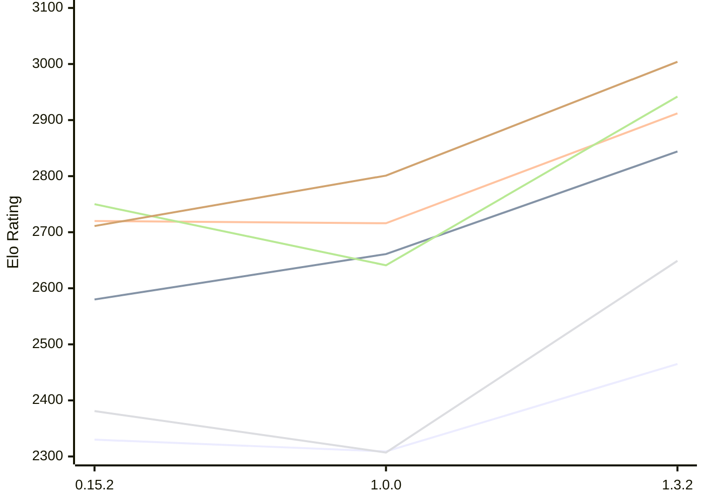

# Engine: ElephantGambit

Author: Ek Alexander Loodin

Home: https://github.com/looak/elephant

## Elo Ratings E1 (Ultra 7 265T (1.50 GHz) - E-Core)

| Version | Published | STC 8.0+0.08s  | LTC 60.0+0.60s | VLTC 2m24s+1.12s | Comment |
| --- | --- | --- | --- | --- | --- |
| 1.3.2 | 2026-10-25 | 2465(+156) | 2844(+183) | 2912(+196) |  |
| 1.0.0 | 2026-10-14 | 2309(-21) | 2661(+81) | 2716(-4) |  |
| 0.15.2 | 2026-10-11 | 2330(+1490) | 2580(+new) | 2720(+29) |  |
| 0.15.1 | 2026-10-11 | 840 |  | 2691 |  |
 | | | cElo (∆ prev) | cElo (∆ prev) | cElo (∆ prev) | 

## Elo Ratings P1 (Ultra 7 265T (1.50 GHz) - P-Core)

| Version | Published | STC 8.0+0.08s  | LTC 60.0+0.60s | VLTC 2m24s+1.12s | Comment |
| --- | --- | --- | --- | --- | --- |
| 1.3.2 | 2026-10-25 | 2649(+342) | 2942(+301) | 3004(+203) |  |
| 1.0.0 | 2026-10-14 | 2307(-74) | 2641(-109) | 2801(+90) |  |
| 0.15.2 | 2026-10-11 | 2381 | 2750 | 2711 |  |
 | | | cElo (∆ prev) | cElo (∆ prev) | cElo (∆ prev) | 

## Elo Ratings T1 (i5-7500T 2.70GHz)

| Version | Published | STC 8.0+0.08s  | LTC 60.0+0.60s | VLTC 2m24s+1.12s | Comment |
| --- | --- | --- | --- | --- | --- |
| 0.15.2 | 2026-10-11 | 2381 | 2750 | 2711 |  |
 | | | cElo (∆ prev) | cElo (∆ prev) | cElo (∆ prev) | 

<a href="https://github.com/computer-chess-index/cci/issues/new?template=submit-version.yml&title=[VERSION]+ElephantGambit+<version>&body=###%20Engine%20name%0AElephantGambit%0A%0A###%20Version%0A1.3.2" target="_blank">Submit new version</a>

 Test Conditions:

GUI/CLI: <a href=https://github.com/cutechess/cutechess target="_blank">Cute-Chess</a> 
Elo Calculation: <a href=https://www.remi-coulom.fr/Bayesian-Elo/ target="_blank">Bayesian-Elo</a> 
CPU for P1: Intel(R) Core(TM) Ultra 7 265T (1.50 GHz) - P-Core 
CPU for E1: Intel(R) Core(TM) Ultra 7 265T (1.50 GHz) - E-Core 
CPU for T1: Intel(R) Core(TM) i5-7500T 2.70GHz 
Opening book: 8_moves_v3 
\* STC: 8.0+0.08s, LTC: 60.0+0.60s, VLTC: 2m24s+1.12s

 Lists:
Ratings: <a href=https://github.com/computer-chess-index/cci/blob/main/lists/CCIRatings.csv target="_blank">Complete list</a>

Generated: 2026-11-06 05:37:54

## Ratings Verlauf E1 / P1

## Detailed Evaluation Results

| Version | Time Control | Variant | Elo  | Range +/- | Matches | Score | Average Opponent Elo | Draws |
| --- | --- |--- | --- | --- | --- | --- | --- | --- |
| 1.3.2 | VLTC (2m24s+1.12s) | P1 | 3004 | 41 | 184 | 49% | 3011 | 40% |
|  |  | E1 | 2912 | 33 | 288 | 55% | 2865 | 36% |
|  | LTC (60.0+0.60s) | P1 | 2942 | 43 | 168 | 49% | 2948 | 37% |
|  |  | E1 | 2844 | 35 | 256 | 49% | 2858 | 35% |
|  | STC (8.0+0.08s) | P1 | 2649 | 47 | 152 | 51% | 2635 | 26% |
|  |  | E1 | 2465 | 40 | 206 | 49% | 2479 | 32% |
| --- | --- |--- | --- | --- | --- | --- | --- | --- |
| 1.0.0 | VLTC (2m24s+1.12s) | P1 | 2801 | 45 | 168 | 54% | 2778 | 27% |
|  |  | E1 | 2716 | 40 | 208 | 50% | 2716 | 25% |
|  | LTC (60.0+0.60s) | P1 | 2641 | 49 | 142 | 49% | 2677 | 28% |
|  |  | E1 | 2661 | 40 | 216 | 50% | 2662 | 26% |
|  | STC (8.0+0.08s) | P1 | 2307 | 47 | 156 | 54% | 2275 | 27% |
|  |  | E1 | 2309 | 40 | 220 | 50% | 2311 | 23% |
| --- | --- |--- | --- | --- | --- | --- | --- | --- |
| 0.15.2 | VLTC (2m24s+1.12s) | P1 | 2711 | 64 | 82 | 53% | 2677 | 28% |
|  |  | E1 | 2720 | 50 | 132 | 49% | 2731 | 28% |
|  | LTC (60.0+0.60s) | P1 | 2750 | 58 | 104 | 55% | 2688 | 28% |
|  |  | E1 | 2580 | 52 | 122 | 51% | 2561 | 30% |
|  | STC (8.0+0.08s) | P1 | 2381 | 65 | 90 | 55% | 2318 | 17% |
|  |  | E1 | 2330 | 49 | 156 | 55% | 2210 | 24% |
| --- | --- |--- | --- | --- | --- | --- | --- | --- |
| 0.15.1 | VLTC (2m24s+1.12s) | E1 | 2691 | 87 | 48 | 51% | 2668 | 19% |
|  | STC (8.0+0.08s) | P1 | 1775 | 331 | 16 | 100% | 714 | 0% |
|  |  | E1 | 840 | 341 | 6 | 100% | 269 | 0% |