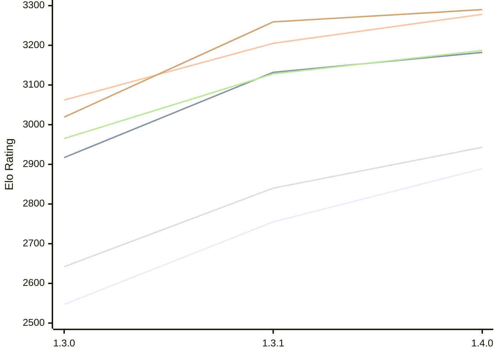
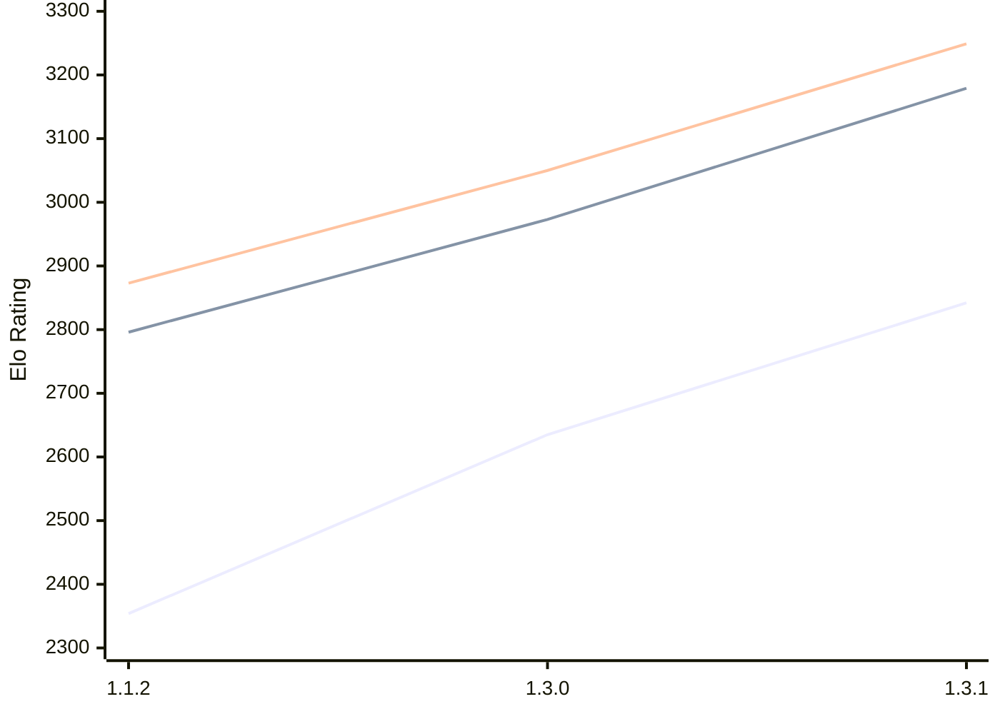

# Engine: Ember

Author: Daniel Krețu

Home: https://github.com/ExxDreamerCode/Ember

## Elo Ratings E1 (Ultra 7 265T (1.50 GHz) - E-Core)

| Version | Published | STC 8.0+0.08s  | LTC 60.0+0.60s | VLTC 2m24s+1.12s | Comment |
| --- | --- | --- | --- | --- | --- |
| 1.4.0 | 2026-10-15 | 2889(+134) | 3182(+50) | 3278(+73) |  |
| 1.3.1 | 2026-09-18 | 2755(+208) | 3132(+215) | 3205(+143) |  |
| 1.3.0 | 2026-08-28 | 2547 | 2917 | 3062 |  |
 | | | cElo (∆ prev) | cElo (∆ prev) | cElo (∆ prev) | 

## Elo Ratings P1 (Ultra 7 265T (1.50 GHz) - P-Core)

| Version | Published | STC 8.0+0.08s  | LTC 60.0+0.60s | VLTC 2m24s+1.12s | Comment |
| --- | --- | --- | --- | --- | --- |
| 1.4.0 | 2026-10-15 | 2943(+103) | 3187(+59) | 3290(+31) |  |
| 1.3.1 | 2026-09-18 | 2840(+198) | 3128(+163) | 3259(+240) |  |
| 1.3.0 | 2026-08-28 | 2642 | 2965 | 3019 |  |
 | | | cElo (∆ prev) | cElo (∆ prev) | cElo (∆ prev) | 

## Elo Ratings T1 (i5-7500T 2.70GHz)

| Version | Published | STC 8.0+0.08s  | LTC 60.0+0.60s | VLTC 2m24s+1.12s | Comment |
| --- | --- | --- | --- | --- | --- |
| 1.3.1 | 2026-09-18 | 2842(+207) | 3179(+206) | 3249(+199) |  |
| 1.3.0 | 2026-08-28 | 2635(+281) | 2973(+177) | 3050(+177) |  |
| 1.1.2 | 2026-07-08 | 2354 | 2796 | 2873 |  |
 | | | cElo (∆ prev) | cElo (∆ prev) | cElo (∆ prev) | 

<a href="https://github.com/computer-chess-index/cci/issues/new?template=submit-version.yml&title=[VERSION]+Ember+<version>&body=###%20Engine%20name%0AEmber%0A%0A###%20Version%0A1.3.1" target="_blank">Submit new version</a>

 Test Conditions:

GUI/CLI: <a href=https://github.com/cutechess/cutechess target="_blank">Cute-Chess</a> 
Elo Calculation: <a href=https://www.remi-coulom.fr/Bayesian-Elo/ target="_blank">Bayesian-Elo</a> 
CPU for P1: Intel(R) Core(TM) Ultra 7 265T (1.50 GHz) - P-Core 
CPU for E1: Intel(R) Core(TM) Ultra 7 265T (1.50 GHz) - E-Core 
CPU for T1: Intel(R) Core(TM) i5-7500T 2.70GHz 
Opening book: 8_moves_v3 
\* STC: 8.0+0.08s, LTC: 60.0+0.60s, VLTC: 2m24s+1.12s

 Lists:
Ratings: <a href=https://github.com/computer-chess-index/cci/blob/main/lists/CCIRatings.csv target="_blank">Complete list</a>

Generated: 2026-11-25 05:38:15

## Ratings Verlauf E1 / P1

## Ratings Verlauf T1

## Detailed Evaluation Results

| Version | Time Control | Variant | Elo  | Range +/- | Matches | Score | Average Opponent Elo | Draws |
| --- | --- |--- | --- | --- | --- | --- | --- | --- |
| 1.4.0 | VLTC (2m24s+1.12s) | P1 | 3290 | 32 | 260 | 48% | 3302 | 64% |
|  |  | E1 | 3278 | 28 | 334 | 50% | 3274 | 68% |
|  | LTC (60.0+0.60s) | E1 | 3182 | 26 | 414 | 51% | 3175 | 57% |
|  |  | P1 | 3187 | 31 | 276 | 49% | 3190 | 62% |
|  | STC (8.0+0.08s) | E1 | 2889 | 27 | 416 | 50% | 2886 | 41% |
|  |  | P1 | 2943 | 34 | 266 | 51% | 2931 | 40% |
| --- | --- |--- | --- | --- | --- | --- | --- | --- |
| 1.3.1 | VLTC (2m24s+1.12s) | T1 | 3249 | 62 | 68 | 51% | 3235 | 62% |
|  |  | P1 | 3259 | 52 | 96 | 51% | 3251 | 65% |
|  |  | E1 | 3205 | 32 | 276 | 51% | 3195 | 51% |
|  | LTC (60.0+0.60s) | T1 | 3179 | 50 | 112 | 54% | 3143 | 52% |
|  |  | P1 | 3128 | 46 | 128 | 49% | 3132 | 55% |
|  |  | E1 | 3132 | 36 | 208 | 48% | 3146 | 56% |
|  | STC (8.0+0.08s) | T1 | 2842 | 56 | 96 | 54% | 2807 | 42% |
|  |  | P1 | 2840 | 50 | 120 | 51% | 2830 | 41% |
|  |  | E1 | 2755 | 42 | 164 | 47% | 2782 | 45% |
| --- | --- |--- | --- | --- | --- | --- | --- | --- |
| 1.3.0 | VLTC (2m24s+1.12s) | T1 | 3050 | 33 | 256 | 51% | 3042 | 53% |
|  |  | P1 | 3019 | 34 | 246 | 48% | 3029 | 50% |
|  |  | E1 | 3062 | 32 | 284 | 47% | 3085 | 49% |
|  | LTC (60.0+0.60s) | T1 | 2973 | 32 | 296 | 53% | 2946 | 45% |
|  |  | P1 | 2965 | 36 | 232 | 52% | 2944 | 46% |
|  |  | E1 | 2917 | 30 | 334 | 47% | 2947 | 40% |
|  | STC (8.0+0.08s) | P1 | 2642 | 32 | 318 | 48% | 2674 | 35% |
|  |  | E1 | 2547 | 32 | 332 | 44% | 2608 | 31% |
|  |  | T1 | 2635 | 35 | 264 | 52% | 2619 | 33% |
| --- | --- |--- | --- | --- | --- | --- | --- | --- |
| 1.1.2 | VLTC (2m24s+1.12s) | T1 | 2873 | 31 | 330 | 50% | 2867 | 41% |
|  | LTC (60.0+0.60s) | T1 | 2796 | 31 | 332 | 51% | 2773 | 38% |
|  | STC (8.0+0.08s) | T1 | 2354 | 33 | 316 | 49% | 2358 | 25% |