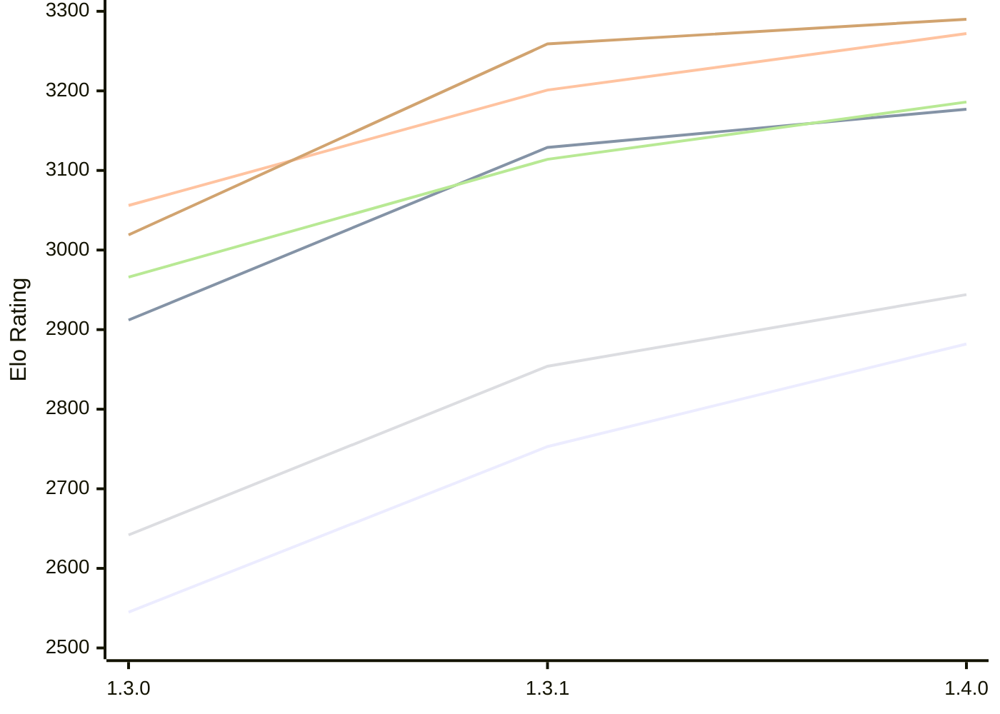
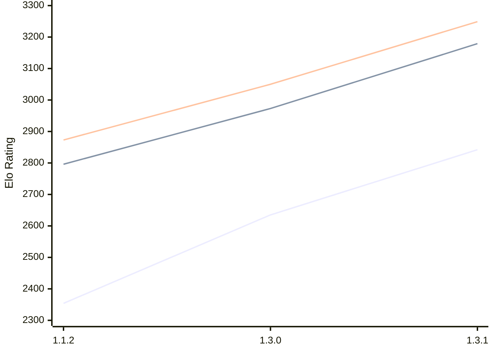

# Engine: Ember

Author: Daniel Krețu

Home: https://github.com/ExxDreamerCode/Ember

## Elo Ratings E1 (Ultra 7 265T (1.50 GHz) - E-Core)

| Version | Published | STC 8.0+0.08s  | LTC 60.0+0.60s | VLTC 2m24s+1.12s | Comment |
| --- | --- | --- | --- | --- | --- |
| 1.4.0 | 2026-10-15 | 2882(+129) | 3177(+48) | 3272(+71) |  |
| 1.3.1 | 2026-09-18 | 2753(+208) | 3129(+217) | 3201(+145) |  |
| 1.3.0 | 2026-08-28 | 2545 | 2912 | 3056 |  |
 | | | cElo (∆ prev) | cElo (∆ prev) | cElo (∆ prev) | 

## Elo Ratings P1 (Ultra 7 265T (1.50 GHz) - P-Core)

| Version | Published | STC 8.0+0.08s  | LTC 60.0+0.60s | VLTC 2m24s+1.12s | Comment |
| --- | --- | --- | --- | --- | --- |
| 1.4.0 | 2026-10-15 | 2944(+90) | 3186(+72) | 3290(+31) |  |
| 1.3.1 | 2026-09-18 | 2854(+212) | 3114(+148) | 3259(+240) |  |
| 1.3.0 | 2026-08-28 | 2642 | 2966 | 3019 |  |
 | | | cElo (∆ prev) | cElo (∆ prev) | cElo (∆ prev) | 

## Elo Ratings T1 (i5-7500T 2.70GHz)

| Version | Published | STC 8.0+0.08s  | LTC 60.0+0.60s | VLTC 2m24s+1.12s | Comment |
| --- | --- | --- | --- | --- | --- |
| 1.3.1 | 2026-09-18 | 2842(+207) | 3179(+206) | 3249(+199) |  |
| 1.3.0 | 2026-08-28 | 2635(+281) | 2973(+177) | 3050(+177) |  |
| 1.1.2 | 2026-07-08 | 2354 | 2796 | 2873 |  |
 | | | cElo (∆ prev) | cElo (∆ prev) | cElo (∆ prev) | 

<a href="https://github.com/computer-chess-index/cci/issues/new?template=submit-version.yml&title=[VERSION]+Ember+<version>&body=###%20Engine%20name%0AEmber%0A%0A###%20Version%0A1.3.1" target="_blank">Submit new version</a>

 Test Conditions:

GUI/CLI: <a href=https://github.com/cutechess/cutechess target="_blank">Cute-Chess</a> 
Elo Calculation: <a href=https://www.remi-coulom.fr/Bayesian-Elo/ target="_blank">Bayesian-Elo</a> 
CPU for P1: Intel(R) Core(TM) Ultra 7 265T (1.50 GHz) - P-Core 
CPU for E1: Intel(R) Core(TM) Ultra 7 265T (1.50 GHz) - E-Core 
CPU for T1: Intel(R) Core(TM) i5-7500T 2.70GHz 
Opening book: 8_moves_v3 
\* STC: 8.0+0.08s, LTC: 60.0+0.60s, VLTC: 2m24s+1.12s

 Lists:
Ratings: <a href=https://github.com/computer-chess-index/cci/blob/main/lists/CCIRatings.csv target="_blank">Complete list</a>

Generated: 2026-11-27 05:38:14

## Ratings Verlauf E1 / P1

## Ratings Verlauf T1

## Detailed Evaluation Results

| Version | Time Control | Variant | Elo  | Range +/- | Matches | Score | Average Opponent Elo | Draws |
| --- | --- |--- | --- | --- | --- | --- | --- | --- |
| 1.4.0 | VLTC (2m24s+1.12s) | E1 | 3272 | 28 | 334 | 50% | 3268 | 68% |
|  |  | P1 | 3290 | 32 | 260 | 48% | 3302 | 64% |
|  | LTC (60.0+0.60s) | P1 | 3186 | 31 | 276 | 49% | 3189 | 62% |
|  |  | E1 | 3177 | 25 | 422 | 50% | 3171 | 58% |
|  | STC (8.0+0.08s) | P1 | 2944 | 34 | 266 | 51% | 2931 | 40% |
|  |  | E1 | 2882 | 27 | 420 | 50% | 2882 | 41% |
| --- | --- |--- | --- | --- | --- | --- | --- | --- |
| 1.3.1 | VLTC (2m24s+1.12s) | T1 | 3249 | 62 | 68 | 51% | 3235 | 62% |
|  |  | P1 | 3259 | 52 | 96 | 51% | 3249 | 65% |
|  |  | E1 | 3201 | 32 | 280 | 51% | 3191 | 52% |
|  | LTC (60.0+0.60s) | T1 | 3179 | 50 | 112 | 54% | 3143 | 52% |
|  |  | P1 | 3114 | 45 | 140 | 48% | 3133 | 52% |
|  |  | E1 | 3129 | 34 | 232 | 48% | 3141 | 56% |
|  | STC (8.0+0.08s) | T1 | 2842 | 56 | 96 | 54% | 2807 | 42% |
|  |  | P1 | 2854 | 36 | 232 | 52% | 2840 | 43% |
|  |  | E1 | 2753 | 36 | 236 | 48% | 2769 | 42% |
| --- | --- |--- | --- | --- | --- | --- | --- | --- |
| 1.3.0 | VLTC (2m24s+1.12s) | P1 | 3019 | 34 | 246 | 48% | 3031 | 50% |
|  |  | E1 | 3056 | 32 | 284 | 47% | 3079 | 49% |
|  |  | T1 | 3050 | 33 | 256 | 51% | 3042 | 53% |
|  | LTC (60.0+0.60s) | P1 | 2966 | 36 | 232 | 52% | 2946 | 46% |
|  |  | E1 | 2912 | 30 | 334 | 47% | 2942 | 40% |
|  |  | T1 | 2973 | 32 | 296 | 53% | 2946 | 45% |
|  | STC (8.0+0.08s) | E1 | 2545 | 32 | 332 | 44% | 2607 | 31% |
|  |  | T1 | 2635 | 35 | 264 | 52% | 2619 | 33% |
|  |  | P1 | 2642 | 32 | 318 | 48% | 2674 | 35% |
| --- | --- |--- | --- | --- | --- | --- | --- | --- |
| 1.1.2 | VLTC (2m24s+1.12s) | T1 | 2873 | 31 | 330 | 50% | 2867 | 41% |
|  | LTC (60.0+0.60s) | T1 | 2796 | 31 | 332 | 51% | 2773 | 38% |
|  | STC (8.0+0.08s) | T1 | 2354 | 33 | 316 | 49% | 2358 | 25% |