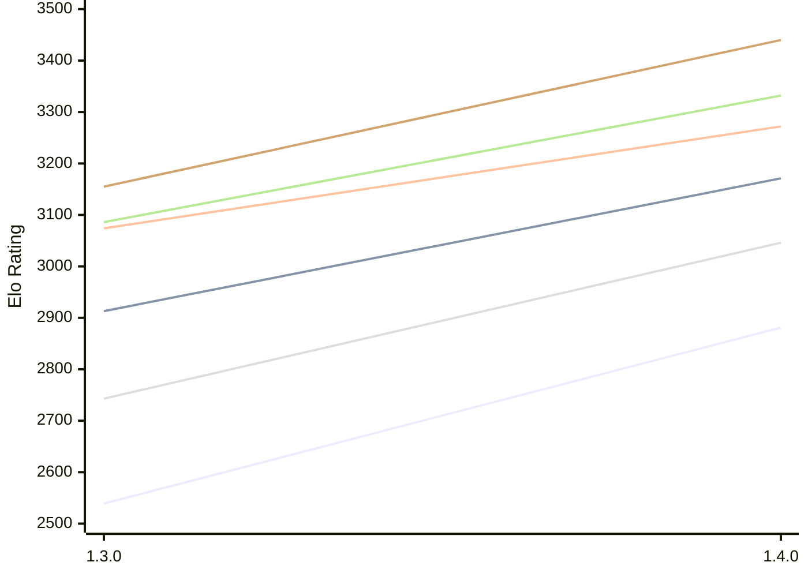
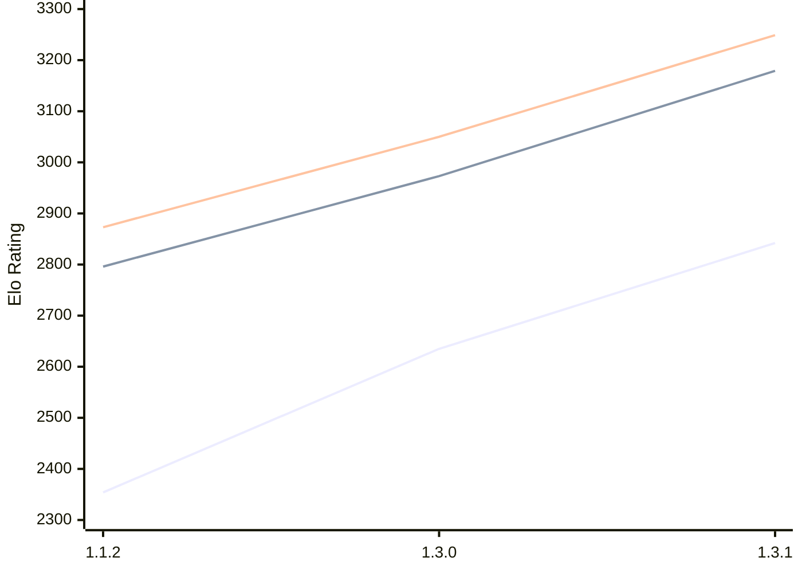

# Engine: Ember

Author: Daniel Krețu

Home: https://github.com/ExxDreamerCode/Ember

## Elo Ratings E1 (Ultra 7 265T (1.50 GHz) - E-Core)

| Version | Published | STC 8.0+0.08s  | LTC 60.0+0.60s | VLTC 2m24s+1.12s | Comment |
| --- | --- | --- | --- | --- | --- |
| 1.4.0 | 2026-10-15 | 2881(+342) | 3171(+258) | 3272(+198) |  |
| 1.3.0 | 2026-08-28 | 2539 | 2913 | 3074 |  |
 | | | cElo (∆ prev) | cElo (∆ prev) | cElo (∆ prev) | 

## Elo Ratings P1 (Ultra 7 265T (1.50 GHz) - P-Core)

| Version | Published | STC 8.0+0.08s  | LTC 60.0+0.60s | VLTC 2m24s+1.12s | Comment |
| --- | --- | --- | --- | --- | --- |
| 1.4.0 | 2026-10-15 | 3046(+303) | 3332(+246) | 3440(+285) |  |
| 1.3.0 | 2026-08-28 | 2743 | 3086 | 3155 |  |
 | | | cElo (∆ prev) | cElo (∆ prev) | cElo (∆ prev) | 

## Elo Ratings T1 (i5-7500T 2.70GHz)

| Version | Published | STC 8.0+0.08s  | LTC 60.0+0.60s | VLTC 2m24s+1.12s | Comment |
| --- | --- | --- | --- | --- | --- |
| 1.3.1 | 2026-09-18 | 2842(+207) | 3179(+206) | 3249(+199) |  |
| 1.3.0 | 2026-08-28 | 2635(+281) | 2973(+177) | 3050(+177) |  |
| 1.1.2 | 2026-07-08 | 2354 | 2796 | 2873 |  |
 | | | cElo (∆ prev) | cElo (∆ prev) | cElo (∆ prev) | 

<a href="https://github.com/computer-chess-index/cci/issues/new?template=submit-version.yml&title=[VERSION]+Ember+<version>&body=###%20Engine%20name%0AEmber%0A%0A###%20Version%0A1.3.1" target="_blank">Submit new version</a>

 Test Conditions:

GUI/CLI: <a href=https://github.com/cutechess/cutechess target="_blank">Cute-Chess</a> 
Elo Calculation: <a href=https://www.remi-coulom.fr/Bayesian-Elo/ target="_blank">Bayesian-Elo</a> 
CPU for P1: Intel(R) Core(TM) Ultra 7 265T (1.50 GHz) - P-Core 
CPU for E1: Intel(R) Core(TM) Ultra 7 265T (1.50 GHz) - E-Core 
CPU for T1: Intel(R) Core(TM) i5-7500T 2.70GHz 
Opening book: 8_moves_v3 
\* STC: 8.0+0.08s, LTC: 60.0+0.60s, VLTC: 2m24s+1.12s

 Lists:
Ratings: <a href=https://github.com/computer-chess-index/cci/blob/main/lists/CCIRatings.csv target="_blank">Complete list</a>

Generated: 2026-10-21 04:38:19

## Ratings Verlauf E1 / P1

## Ratings Verlauf T1

## Detailed Evaluation Results

| Version | Time Control | Variant | Elo  | Range +/- | Matches | Score | Average Opponent Elo | Draws |
| --- | --- |--- | --- | --- | --- | --- | --- | --- |
| 1.4.0 | VLTC (2m24s+1.12s) | E1 | 3272 | 36 | 192 | 49% | 3274 | 69% |
|  |  | P1 | 3440 | 44 | 140 | 49% | 3443 | 61% |
|  | LTC (60.0+0.60s) | E1 | 3171 | 36 | 220 | 51% | 3162 | 55% |
|  |  | P1 | 3332 | 38 | 184 | 49% | 3335 | 61% |
|  | STC (8.0+0.08s) | E1 | 2881 | 33 | 280 | 49% | 2880 | 43% |
|  |  | P1 | 3046 | 42 | 174 | 52% | 3021 | 41% |
| --- | --- |--- | --- | --- | --- | --- | --- | --- |
| 1.3.1 | VLTC (2m24s+1.12s) | T1 | 3249 | 62 | 68 | 51% | 3235 | 62% |
|  | LTC (60.0+0.60s) | T1 | 3179 | 50 | 112 | 54% | 3143 | 52% |
|  | STC (8.0+0.08s) | T1 | 2842 | 56 | 96 | 54% | 2807 | 42% |
| --- | --- |--- | --- | --- | --- | --- | --- | --- |
| 1.3.0 | VLTC (2m24s+1.12s) | E1 | 3074 | 33 | 264 | 49% | 3085 | 50% |
|  |  | T1 | 3050 | 33 | 256 | 51% | 3042 | 53% |
|  |  | P1 | 3155 | 36 | 222 | 49% | 3164 | 49% |
|  | LTC (60.0+0.60s) | T1 | 2973 | 32 | 296 | 53% | 2946 | 45% |
|  |  | P1 | 3086 | 37 | 220 | 52% | 3066 | 45% |
|  |  | E1 | 2913 | 32 | 298 | 46% | 2951 | 41% |
|  | STC (8.0+0.08s) | T1 | 2635 | 35 | 264 | 52% | 2619 | 33% |
|  |  | P1 | 2743 | 35 | 254 | 48% | 2768 | 37% |
|  |  | E1 | 2539 | 34 | 280 | 43% | 2614 | 34% |
| --- | --- |--- | --- | --- | --- | --- | --- | --- |
| 1.1.2 | VLTC (2m24s+1.12s) | T1 | 2873 | 31 | 330 | 50% | 2867 | 41% |
|  | LTC (60.0+0.60s) | T1 | 2796 | 31 | 332 | 51% | 2773 | 38% |
|  | STC (8.0+0.08s) | T1 | 2354 | 33 | 316 | 49% | 2358 | 25% |