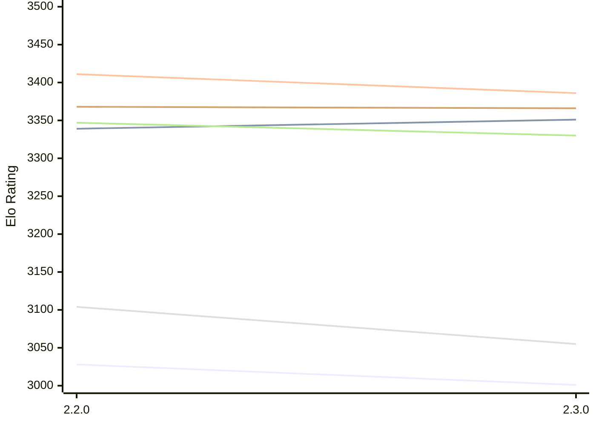

# Engine: Endspiel

Author: Thilo Horstmann

Home: https://github.com/thilo11/endspiel

## Elo Ratings E1 (Ultra 7 265T (1.50 GHz) - E-Core)

| Version | Published | STC 8.0+0.08s  | LTC 60.0+0.60s | VLTC 2m24s+1.12s | Comment |
| --- | --- | --- | --- | --- | --- |
| 2.3.0 | 2026-11-12 | 3001(-27) | 3351(+12) | 3386(-25) |  |
| 2.2.0 | 2026-10-30 | 3028 | 3339 | 3411 |  |
 | | | cElo (∆ prev) | cElo (∆ prev) | cElo (∆ prev) | 

## Elo Ratings P1 (Ultra 7 265T (1.50 GHz) - P-Core)

| Version | Published | STC 8.0+0.08s  | LTC 60.0+0.60s | VLTC 2m24s+1.12s | Comment |
| --- | --- | --- | --- | --- | --- |
| 2.3.0 | 2026-11-12 | 3055(-49) | 3330(-17) | 3366(-2) |  |
| 2.2.0 | 2026-10-30 | 3104 | 3347 | 3368 |  |
 | | | cElo (∆ prev) | cElo (∆ prev) | cElo (∆ prev) | 

## Elo Ratings T1 (i5-7500T 2.70GHz)

| Version | Published | STC 8.0+0.08s  | LTC 60.0+0.60s | VLTC 2m24s+1.12s | Comment |
| --- | --- | --- | --- | --- | --- |
| 2.2.0 | 2026-10-30 | 3104 | 3347 | 3368 |  |
 | | | cElo (∆ prev) | cElo (∆ prev) | cElo (∆ prev) | 

<a href="https://github.com/computer-chess-index/cci/issues/new?template=submit-version.yml&title=[VERSION]+Endspiel+<version>&body=###%20Engine%20name%0AEndspiel%0A%0A###%20Version%0A2.3.0" target="_blank">Submit new version</a>

 Test Conditions:

GUI/CLI: <a href=https://github.com/cutechess/cutechess target="_blank">Cute-Chess</a> 
Elo Calculation: <a href=https://www.remi-coulom.fr/Bayesian-Elo/ target="_blank">Bayesian-Elo</a> 
CPU for P1: Intel(R) Core(TM) Ultra 7 265T (1.50 GHz) - P-Core 
CPU for E1: Intel(R) Core(TM) Ultra 7 265T (1.50 GHz) - E-Core 
CPU for T1: Intel(R) Core(TM) i5-7500T 2.70GHz 
Opening book: 8_moves_v3 
\* STC: 8.0+0.08s, LTC: 60.0+0.60s, VLTC: 2m24s+1.12s

 Lists:
Ratings: <a href=https://github.com/computer-chess-index/cci/blob/main/lists/CCIRatings.csv target="_blank">Complete list</a>

Generated: 2026-11-24 05:38:16

## Ratings Verlauf E1 / P1

## Detailed Evaluation Results

| Version | Time Control | Variant | Elo  | Range +/- | Matches | Score | Average Opponent Elo | Draws |
| --- | --- |--- | --- | --- | --- | --- | --- | --- |
| 2.3.0 | VLTC (2m24s+1.12s) | P1 | 3366 | 46 | 136 | 58% | 3178 | 61% |
|  |  | E1 | 3386 | 39 | 184 | 55% | 3303 | 64% |
|  | LTC (60.0+0.60s) | P1 | 3330 | 52 | 104 | 58% | 3155 | 59% |
|  |  | E1 | 3351 | 36 | 212 | 55% | 3290 | 65% |
|  | STC (8.0+0.08s) | P1 | 3055 | 39 | 202 | 57% | 2977 | 47% |
|  |  | E1 | 3001 | 37 | 224 | 50% | 3000 | 45% |
| --- | --- |--- | --- | --- | --- | --- | --- | --- |
| 2.2.0 | VLTC (2m24s+1.12s) | P1 | 3368 | 116 | 16 | 50% | 3366 | 88% |
|  |  | E1 | 3411 | 41 | 148 | 50% | 3410 | 70% |
|  | LTC (60.0+0.60s) | P1 | 3347 | 78 | 40 | 53% | 3330 | 70% |
|  |  | E1 | 3339 | 35 | 212 | 51% | 3328 | 64% |
|  | STC (8.0+0.08s) | P1 | 3104 | 52 | 96 | 52% | 3087 | 61% |
|  |  | E1 | 3028 | 38 | 196 | 48% | 3042 | 55% |