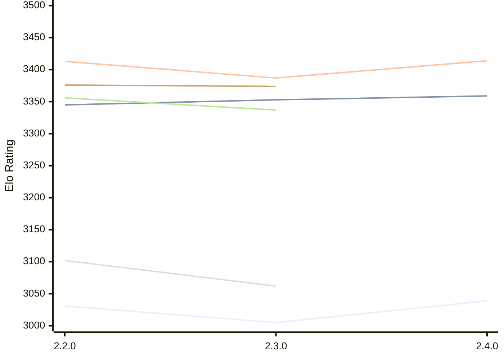

# Engine: Endspiel

Author: Thilo Horstmann

Home: https://github.com/thilo11/endspiel

## Elo Ratings E1 (Ultra 7 265T (1.50 GHz) - E-Core)

| Version | Published | STC 8.0+0.08s  | LTC 60.0+0.60s | VLTC 2m24s+1.12s | Comment |
| --- | --- | --- | --- | --- | --- |
| 2.4.0 | 2026-11-24 | 3039(+34) | 3359(+6) | 3414(+27) |  |
| 2.3.0 | 2026-11-12 | 3005(-26) | 3353(+8) | 3387(-26) |  |
| 2.2.0 | 2026-10-30 | 3031 | 3345 | 3413 |  |
 | | | cElo (∆ prev) | cElo (∆ prev) | cElo (∆ prev) | 

## Elo Ratings P1 (Ultra 7 265T (1.50 GHz) - P-Core)

| Version | Published | STC 8.0+0.08s  | LTC 60.0+0.60s | VLTC 2m24s+1.12s | Comment |
| --- | --- | --- | --- | --- | --- |
| 2.3.0 | 2026-11-12 | 3062(-40) | 3337(-19) | 3374(-2) |  |
| 2.2.0 | 2026-10-30 | 3102 | 3356 | 3376 |  |
 | | | cElo (∆ prev) | cElo (∆ prev) | cElo (∆ prev) | 

## Elo Ratings T1 (i5-7500T 2.70GHz)

| Version | Published | STC 8.0+0.08s  | LTC 60.0+0.60s | VLTC 2m24s+1.12s | Comment |
| --- | --- | --- | --- | --- | --- |
| 2.2.0 | 2026-10-30 | 3102 | 3356 | 3376 |  |
 | | | cElo (∆ prev) | cElo (∆ prev) | cElo (∆ prev) | 

<a href="https://github.com/computer-chess-index/cci/issues/new?template=submit-version.yml&title=[VERSION]+Endspiel+<version>&body=###%20Engine%20name%0AEndspiel%0A%0A###%20Version%0A2.3.0" target="_blank">Submit new version</a>

 Test Conditions:

GUI/CLI: <a href=https://github.com/cutechess/cutechess target="_blank">Cute-Chess</a> 
Elo Calculation: <a href=https://www.remi-coulom.fr/Bayesian-Elo/ target="_blank">Bayesian-Elo</a> 
CPU for P1: Intel(R) Core(TM) Ultra 7 265T (1.50 GHz) - P-Core 
CPU for E1: Intel(R) Core(TM) Ultra 7 265T (1.50 GHz) - E-Core 
CPU for T1: Intel(R) Core(TM) i5-7500T 2.70GHz 
Opening book: 8_moves_v3 
\* STC: 8.0+0.08s, LTC: 60.0+0.60s, VLTC: 2m24s+1.12s

 Lists:
Ratings: <a href=https://github.com/computer-chess-index/cci/blob/main/lists/CCIRatings.csv target="_blank">Complete list</a>

Generated: 2026-11-25 05:38:17

## Ratings Verlauf E1 / P1

## Detailed Evaluation Results

| Version | Time Control | Variant | Elo  | Range +/- | Matches | Score | Average Opponent Elo | Draws |
| --- | --- |--- | --- | --- | --- | --- | --- | --- |
| 2.4.0 | VLTC (2m24s+1.12s) | E1 | 3414 | 84 | 32 | 52% | 3407 | 84% |
|  | LTC (60.0+0.60s) | E1 | 3359 | 67 | 60 | 48% | 3378 | 58% |
|  | STC (8.0+0.08s) | E1 | 3039 | 74 | 48 | 55% | 3002 | 60% |
| --- | --- |--- | --- | --- | --- | --- | --- | --- |
| 2.3.0 | VLTC (2m24s+1.12s) | P1 | 3374 | 46 | 136 | 58% | 3187 | 61% |
|  |  | E1 | 3387 | 38 | 188 | 55% | 3309 | 63% |
|  | LTC (60.0+0.60s) | E1 | 3353 | 35 | 217 | 55% | 3293 | 66% |
|  |  | P1 | 3337 | 53 | 104 | 58% | 3163 | 59% |
|  | STC (8.0+0.08s) | E1 | 3005 | 37 | 228 | 50% | 3002 | 45% |
|  |  | P1 | 3062 | 39 | 206 | 57% | 2989 | 46% |
| --- | --- |--- | --- | --- | --- | --- | --- | --- |
| 2.2.0 | VLTC (2m24s+1.12s) | P1 | 3376 | 116 | 16 | 50% | 3374 | 88% |
|  |  | E1 | 3413 | 41 | 148 | 50% | 3411 | 70% |
|  | LTC (60.0+0.60s) | P1 | 3356 | 75 | 44 | 52% | 3341 | 68% |
|  |  | E1 | 3345 | 34 | 224 | 52% | 3330 | 64% |
|  | STC (8.0+0.08s) | P1 | 3102 | 49 | 108 | 50% | 3098 | 61% |
|  |  | E1 | 3031 | 36 | 208 | 48% | 3044 | 54% |